# 피아노 연주 시뮬레이션 및 고정밀 렌더링 시스템

## 졸업 프로젝트 2학기 3차 중간 보고서

| 항목 | 내용 |
|---|---|
| 과목 | 졸업프로젝트 3201 |
| 팀 | 2팀 |
| 제출일 | 2026년 11월 19일 |
| 보고 차수 | 3차 (1차 9/29 · 2차 10/29 · **3차 11/19**) |
| 팀원 | 정근녕, 한승현, 이수민, 곽경민 |
| 지도교수 | 김형석 교수님 |

## 목차

1. 프로젝트 개요
2. 전체 시스템 아키텍처
3. 1학기 누적 성과 요약
4. 2학기 진행 현황 (W01 ~ W11)
5. 모듈별 상세 구현 현황
   - 5.1 운지법 결정 엔진 (정근녕)
   - 5.2 IK 기반 모션 생성 (한승현)
   - 5.3 커스텀 GPU 스키닝 파이프라인 (이수민)
   - 5.4 Chaos Flesh PBD Skinning (곽경민)
6. 주요 기술적 도전 및 해결
7. 결과물 분석
8. 2차 중간발표 지도교수 피드백 및 대응
9. 현재 상태 및 향후 계획
10. 결론

---

## 3차 보고서에서 더해진 것

2차(10/29) 이후의 W09~W11 작업과 10월 30일 2차 중간발표 피드백을 반영하였습니다.
**1·2차 본문과 그림은 지우지 않고 그대로 두었으며, 사실이 바뀐 곳에는 정정 표시를 붙여 덧붙였습니다.**

| 절 | 더해진 내용 |
|---|---|
| 4 | W05 ~ W11 진행 현황 (기존 W01~W04 유지) |
| 5.1 | 순간 단위 물리 제약, 기준 코퍼스, 코스트 함수 측정, 손목 출력·IK 인계 |
| 5.2 | 관절 각도 CSV 내보내기, IK 품질 정량 측정, 손목 회전 반영 실험 |
| 5.3 | Phase 8~13c — Implicit Skinning, UV 심 용접, Flesh 접힘부 결합, 텐션맵 유도 |
| 5.4 | Flesh→스키닝 어댑터, 손끝 어긋남 정량 분리, 60 FPS 달성, 인계 문서 |
| 6 | 기술적 도전 6건 추가 (6.9 ~ 6.14) |
| 7 | 13곡 재집계, Flesh–스키닝 결합 결과, 통합 성능 |
| 8 | **신설** — 2차 중간발표 지도교수 피드백 4건과 대응 |
| 9 | 완료·진행·마일스톤·한계 전면 갱신 |

---

# 1. 프로젝트 개요

## 1.1 기획 배경

기존 게임 및 시뮬레이션 환경에서 손가락 움직임은 Linear Blend Skinning(LBS)에 의존하여, 피아노 연주와 같은 정교한 동작 시 관절 뭉개짐(Candy Wrapper Artifact), 주름 및 피하 조직의 비사실적 표현 문제가 발생합니다. 또한 MIDI 데이터만으로 실제 피아니스트 수준의 운지법을 자동 재현하고 영화적 품질의 렌더링을 생성하는 도구는 현재 존재하지 않습니다.

본 프로젝트는 이러한 기술적 공백을 해소하기 위해, **MIDI 입력 → 최적 운지법 계산 → IK 기반 모션 생성 → 고품질 피부 렌더링**으로 이어지는 통합 파이프라인을 구축하는 것을 목표로 합니다.

## 1.2 프로젝트 목표

- **MIDI-to-Motion**: MIDI 파일을 파싱하여 해부학적으로 유효한 최적 운지법을 자동 계산하고 IK 애니메이션 데이터로 변환합니다.
- **High-Fidelity Rendering**: PBD(Position Based Dynamics) 기반 조직 변형 및 Tension Map 기반 동적 노멀 맵을 활용한 주름·핏줄 렌더링을 구현합니다.

## 1.3 팀 구성 및 역할 분담

| 팀원 | 담당 모듈 | 주요 역할 |
|---|---|---|
| 정근녕 | 01_Fingering | MIDI 파서 및 DP 기반 운지법 결정 알고리즘 |
| 한승현 | 02_IK | Jacobian 기반 역운동학(IK) 모션 생성 |
| 이수민 | 03_Skinning (셰이더) | UE5 커스텀 GPU 스키닝, Tension Map, 주름 렌더링 |
| 곽경민 | 03_Skinning (시뮬레이션) | Chaos Flesh PBD 피부 시뮬레이션, 살 눌림·부피 보존 |

## 1.4 기술 스택

| 분야 | 기술 |
|---|---|
| 운지법 알고리즘 | Python 3.11, Dynamic Programming, Polyphonic Voice Leading |
| IK 시스템 | C++, Jacobian IK (Damped Least Squares) |
| 렌더링 엔진 | Unreal Engine 5.5 |
| 피부 시뮬레이션 | Chaos Flesh (FEM/PBD) |
| 셰이더 | HLSL, UMeshDeformer, RDG, Compute Shader |
| 데이터 포맷 | Standard MIDI File (Format 0/1), JSON, UE5 DataTable CSV |

---

# 2. 전체 시스템 아키텍처

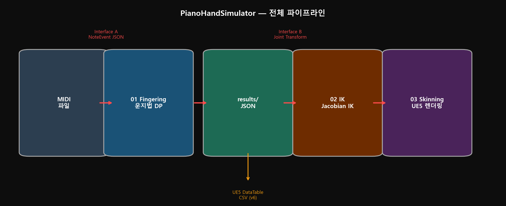

```
MIDI 파일
  → [01_Fingering | 정근녕]
        MIDI 파서 → 양손 분리 → V5 Polyphonic DP Solver → JSON 출력
        Interface A — NoteEvent JSON (pitch, finger, wrist_yaw, pressure ...)
  → [02_IK | 한승현]
        IK 목표 설정 → Weighted DLS IK → ROM 클램핑 → 베지어 손목 궤적 → Bone Transform
        Interface B — Joint Transform (30 FPS)
  → [03_Skinning | 이수민 · 곽경민]
        Chaos Flesh (살 눌림·부피 보존)
          → 커스텀 GPU 스키닝 (주름·핏줄·미세 노멀)
          → UE5 최종 렌더링 출력
```

---

# 3. 1학기 누적 성과 요약

| 모듈 | 1학기 완료 항목 | 상태 |
|---|---|---|
| 01_Fingering | MIDI 파서(Format 0/1), V5 Polyphonic DP 엔진, Pygame 시뮬레이터 | 완료 |
| 02_IK | DLS Jacobian IK 알고리즘, ROM 제약, 베지어 손목 궤적 (C++/Vulkan 검증) | 알고리즘 검증 완료 |
| 03_Skinning (셰이더) | SVE 기반 커스텀 패스 삽입, RDG 자원 관리, HLSL 분기, 스레드 동기화 사전 검증 | 사전 검증 완료 |
| 03_Skinning (Flesh) | Chaos Flesh Dataflow 그래프, Capsule 콜리전 17개, 사면체 볼륨 생성 확인 | 에셋 구성 완료 |

---

# 4. 2학기 진행 현황 (W01 ~ W11)

## W01 ~ W02 (8/31 ~ 9/13) — 재설계 및 문서화

1학기 산출물 전체를 검토하고 파이프라인 구조를 재설계하였습니다.

- 요구사항/설계 명세 재작성
- 파트 간 인터페이스 정의 (`03_Interface_Design_Spec.md`)
- 피아노 건반 좌표 변환 규칙 문서화
- 03_Skinning(셰이더): SVE → UMeshDeformer 기반으로 후크 지점 전환 결정

## W03 (9/14 ~ 9/20) — 인터페이스 파라미터 확정

미확정 상태였던 IK 인터페이스 파라미터를 팀 전체가 합의하여 확정하였습니다.

| 항목 | 이전 | 확정값 |
|------|------|--------|
| 흑건 상면 Y 오프셋 (`BLACK_KEY_Y_OFFSET_CM`) | 미정 | **3.0 cm** |
| 건반 최대 누름 깊이 (`MAX_KEY_TRAVEL_CM`) | 미정 | **1.0 cm** |
| 손가락-손목 오프셋 (오른손) | 미조정 | 1:−4, 2:−2, 3:0, 4:+2, 5:+4 반음 |
| 손가락-손목 오프셋 (왼손) | 미조정 | 1:+4, 2:+2, 3:0, 4:−2, 5:−4 반음 |

## W04 (9/21 ~ 9/27) — 공유 상수 분리 및 모듈 동기화

운지법 엔진, IK 솔버, 스키닝 모듈이 공통으로 참조하는 `shared_constants.py`를 신규 작성하여 파트 간 상수 불일치 문제를 구조적으로 방지하였습니다.

```python
# shared_constants.py (주요 항목)
BLACK_KEY_Y_OFFSET_CM = 3.0
MAX_KEY_TRAVEL_CM     = 1.0
IK_FRAME_RATE         = 30   # fps

BONE_NAME_R = {
    1: "thumb_03_r",  2: "index_03_r",  3: "middle_03_r",
    4: "ring_03_r",   5: "pinky_03_r"
}

# IK 타이밍 프로토콜 (2차에서 정정: duration_ms -> key_hold_ms)
# t = start_ms           : Fingertip → Target 도달 (건반 눌림)
# t ~ start+key_hold     : 위치 유지
# t = start+key_hold     : Z → 0 복귀
```

> **2차 정정 (10/29).** 위 블록의 두 상수와 타이밍 기준은 2차 작업에서 다음과 같이 바뀌었다.
>
> | 항목 | 1차 기재 | 2차 확정 | 사유 |
> |---|---|---|---|
> | 흑건 상면 Y 오프셋 | `3.0 cm` | `BLACK_KEY_FRONT_Y_MM = 55.0` | `+3.0 cm` 는 건반 형상에서 도출되지 않는 값이었다. 백건 길이 150 mm − 흑건 길이 95 mm 로 재정의하였다 |
> | 흑건 상면 높이 | (정의 없음) | `BLACK_KEY_HEIGHT_MM = 12.5` | IK 가 참조할 값인데 명세에 항목 자체가 없었다 |
> | 해제 시점 | `start_ms + duration_ms` | `start_ms + key_hold_ms` | `duration_ms` 는 페달로 늘어난 **소리**의 끝이다. 이 값으로 건반을 떼면 한 손가락이 두 건반을 동시에 누르는 자세가 만들어진다 |
>
> 현재 값의 유일한 출처는 `02_Implementation/01_Fingering/shared_constants.py` 다.


## W05 (9/28 ~ 10/04) — 1차 중간보고서 제출, Flesh 에셋 재구성

- 1차 중간보고서를 제출하였습니다 (9/29).
- **04_Flesh**: Chaos Flesh 손 에셋을 MetaHuman 손 기준으로 재구성하고 4.4 보고서를 작성하였습니다. 빌드 스크립트의 엔진 경로 하드코딩을 `PH_ENGINE_ROOT` 환경변수로 교체하고, 셰이더 파라미터 구조체 순서 때문에 생기던 에디터 시작 크래시를 수정하였습니다.
- **03_Skinning**: 커스텀 GPU 스키닝 파이프라인에 대한 보고서 4.3절을 작성하였습니다.

## W06 (10/05 ~ 10/11) — 운지법 물리 제약의 순간 단위 재설계

**01_Fingering.** 지금까지 손 범위·손가락 중복·순서 제약을 **화음 단위**로 검사하고 있었습니다. 지속음이 다음 화음까지 눌려 있는 경우가 빠져, 한 손가락이 서로 다른 건반을 동시에 누르는 운지가 나올 수 있었습니다. 검사 기준을 **시간상의 한 순간**으로 바꾸는 작업을 5단계로 나누어 수행하였습니다.

| 단계 | 내용 |
|---|---|
| 0 | 화음 그룹화의 시간 정합성 확보, 건반 단위 점유 보정 |
| 1 | 물리 제약 지표를 순간 단위로 확장 |
| 2 | 페달 상태를 반영한 필수 점유 구간(`required_hold_ms`) 산출 |
| 3 | DP 상태에 점유 정보 포함 |
| 4 | 순간 단위 충돌 해소 및 음표 제외 보고 |

함께 수행한 것은 다음과 같습니다.

- 엄지 넘기기(thumb-under) 지원 — 음계 진행에서 엄지가 다른 손가락 아래로 넘어가는 운지가 나오도록 하였습니다.
- 화음 분리 단계에서 음표를 통째로 버리던 것을 성부 중요도 순 배정으로 바꿔 유실을 2,525개에서 1,394개로 줄였습니다.
- 건반 3D 좌표 공유 모듈(`piano_keyboard.py`)을 신설하여 좌표 산출 경로를 하나로 모았습니다.
- UE5 DataTable 변환 도구와 정량 평가 지표 측정 도구를 추가하였습니다.
- MIDI 파싱·운지 배정 결함 7건을 수정하였습니다.
- **연주 가능함이 보장된 기준 코퍼스**를 도입하였습니다 (5.1.7절).

결과: 실곡 13곡 기준 물리 제약 위반 **0건**, 음표 보존율 **85.2%**.

**03_Skinning.** 주름 디테일 v2 — 변형 텐서 기반 계산, 관절별 주름 패턴, Bando 단면, 미세 노멀 이방성을 적용하였습니다. 주름 깊이를 2단계로 나누고 좌굴 진폭을 압축량의 제곱근에 비례시켰습니다.

**04_Flesh.** 물성을 조정하고 손끝 지연 내용을 보고서에 반영하였습니다.

## W07 (10/12 ~ 10/18) — 공유 상수 단일화, Implicit Skinning

**01_Fingering.** W04에 분리한 공유 상수가 현행 코드와 연결되지 않은 부분이 있었습니다. 운지법 엔진·좌표 변환 모듈·내보내기 도구가 모두 같은 모듈을 참조하도록 고쳐 **수치의 단일 출처**를 확립하였습니다. 배치 실행기를 정비하여 곡 일괄 처리, 물리 제약 측정, UE5 데이터 생성을 한 번의 명령으로 수행할 수 있게 하였습니다.

**02_IK.** IK 모듈이 운지법 엔진이 생성한 CSV를 직접 읽어 연산하도록 수정하였습니다 (모의 데이터 → 실데이터 전환).

**03_Skinning.** Phase 8~11 — Vaillant(2013/2014)의 **Implicit Skinning**을 도입하여 관절 접촉을 풀고, 그래프 기반 주름 격자를 추가하였습니다. Phase 12 — UV 심 용접, 손금 누출 재베이크, MCP 바깥쪽 페이드, 접힘 주름 기하를 적용하였습니다.

## W08 (10/19 ~ 10/25) — 시험 기간

시험 기간으로 주간 활동서를 작성하지 않았습니다. **04_Flesh**에서만 작업이 있었습니다.

- IK 관절 각도 인계 형식(CSV), 검증기, `AnimSequence` 임포터 및 샘플을 작성하였습니다.
- 손 비율 실측 스크립트를 만들고 IK 인계 문서에 웜스타트·60 Hz·비율 항목을 보강하였습니다.

## W09 (10/26 ~ 11/01) — 2차 중간발표

**10월 30일 2차 중간발표를 수행**하였습니다. 제출 문서 4종(요구사항 분석서, 프로젝트 설계서, 운지법·스키닝 테스트 케이스)과 발표자료를 작성하였습니다. 발표 시간이 10분으로 정해져 29장 중 17장만 사용하고 나머지는 숨김 처리하여 질의응답 시 번호로 띄우도록 구성하였습니다.

각 파트에서 받은 측정값을 문서에 반영하는 과정에서, 추정으로 적어 두었던 **네 건이 실제와 달라 발표 전에 바로잡았습니다** (8.5절).

- **01_Fingering**: 코스트 함수 구조를 계측 도구 2종으로 측정하고, 관측된 빔 가지치기 문제를 수정하였습니다 (5.1.8절).
- **02_IK**: 관절 각도 CSV 내보내기 경로를 구현하고, 계측 빌드로 IK 품질을 수치화하였습니다 (5.2.11~5.2.12절).
- **04_Flesh**: Flesh→스키닝 어댑터를 구현하고 손끝 어긋남을 정량 측정하였습니다 (5.4.8~5.4.9절).

## W10 (11/02 ~ 11/08) — 60 FPS 달성, 손목 인계 경계 확정

- **01_Fingering**: 기준 코퍼스를 12곡으로 확장하여 코스트 구조를 재측정하였고, 회귀 테스트의 판정 기준을 최종 출력으로 정정하였습니다. 손목 가로 위치를 mm 단위(`WristXMm`)로 추가하고 회전 부호 규약을 확정한 뒤 IK 인계 요청서를 작성하였습니다 (5.1.9절).
- **04_Flesh**: `stat Chaos`로 프레임 비용을 분해하여 병목이 Flesh 솔버(41.8 ms)임을 확인하고, 솔버 설정과 어댑터 읽기를 최적화하여 **약 70 ms → 약 16.6 ms (60 FPS)** 를 달성하였습니다 (5.4.10절).
- **03_Skinning**: Flesh를 손 전체가 아니라 접힘 안쪽만 받도록 결합 방식을 바꾸고, 관절 주름선에 사행을 넣었습니다.
- **02_IK**: 손 모델과 피아노 모델의 모듈 간 불일치를 확인하고 통일 필요성을 검토하였습니다.

## W11 (11/09 ~ 11/15) — Flesh와 스키닝 합치기

- **04_Flesh**: 어댑터 API, 매 프레임 데이터 흐름, 컴포넌트 속성, 씬 구성, 알려진 한계를 담은 합치기 인계 문서를 작성하여 03_Skinning에 전달하였습니다 (5.4.11절).
- **03_Skinning**: Phase 13 — Flesh를 접힘부의 저주파 살 변형으로만 받는 보정을 구현하였습니다. 그 과정에서 Play 중 손이 터지던 원인이 **표면 바인딩 결함이 아니라 Metal의 버퍼 간격 문제**임을 찾아 정정하였습니다 (6.12절). Phase 13c — 보정이 굴곡측 전체에 고르게 퍼지던 것을 텐션맵으로 유도하여 실제로 눌리는 곳에만 들어가게 하였습니다 (5.3.11절).
- **01_Fingering · 02_IK**: 손목 회전의 IK 반영 결과를 기다리는 단계로, 이 기간 저장소에 반영한 작업은 없습니다.

---

# 5. 모듈별 상세 구현 현황

## 5.1 운지법 결정 엔진 — 정근녕

### 5.1.1 운지법 파이프라인 구성

1~2학기 결과물을 통합하고 확장한 운지법 파이프라인을 구성하였습니다.

```
코드_운지법파이프라인/
├── shared_constants.py   ← W03/W04 공유 상수 (신규)
├── fingering_engine.py   ← V5 엔진 + CLI 인수 + shared_constants 연동
├── simulator.py          ← V5 시뮬레이터 + CLI 인수 + shared_constants 연동
├── ue5_exporter.py       ← JSON → UE5 DataTable CSV 변환기 (신규)
└── run_batch.py          ← 전체 MIDI 일괄 처리 (신규)
```

### 5.1.2 V5 Polyphonic DP 엔진 (1학기 완성, 2학기 유지)

4개 모듈이 순차적으로 동작하는 파이프라인입니다.

```
MIDI 파일
    ↓ parse_midi_to_hand_chords()
MIDI 파서 ──→ 손/화음 분리, MELODY/BASS/INNER 태깅
    ↓ split_wide_chords_between_hands()
손 분리기 ──→ 스팬 17반음 초과 화음 → 반대 손 이관
    ↓ solve_fingering_chord_dp()
DP 솔버  ──→ 9종 비용 함수 기반 최적 운지 경로 탐색
    ↓ calculate_wrist_rotation_rom()
손목 물리 ──→ Yaw(±35°) / Roll(±20°) 계산
    ↓
JSON 출력 ──→ Interface A (02_IK 입력)
```

**DP 비용 함수 (9종):**

| 항목 | 조건 | 비용 |
|------|------|------|
| SpanPenalty | 손가락 쌍 최대 스팬 초과 | +5,000 |
| SimultaneousConflict | 눌린 손가락 재사용 | +2,500 |
| CrossingPenalty | 엄지 제외 교차 | +2,000 |
| ArpeggioRolling | 피치/손가락 방향 불일치 | +35~60 |
| FingerDifficulty | 약지(4번) | +6 |
| BlackKeyPenalty | 엄지로 흑건 | +25 |
| MelodyContinuity | Step motion + 같은 손가락 | −20 (보상) |
| RoleAffinity | MELODY → 오른손 4번 | −12 (보상) |
| WristMove | 손목 이동 거리 | ×2.0 |

### 5.1.3 Interface A 출력 JSON 스키마

```json
{
  "pitch":                60,
  "start_ms":             0.0,
  "duration_ms":          1200.0,
  "hand":                 "Right",
  "role":                 "MELODY",
  "finger":               3,
  "pressure":             0.622,
  "key_depth":            0.622,
  "is_black":             false,
  "wrist_pos_normalized": 0.449,
  "wrist_yaw_deg":        -5.0,
  "wrist_roll_deg":       0.0
}
```

### 5.1.4 UE5 DataTable CSV 출력 (2학기 신규)

`ue5_exporter.py`가 JSON을 UE5 DataTable 형식 CSV로 변환합니다.

```csv
---,Pitch,StartMs,DurationMs,Hand,Role,Finger,Pressure,KeyDepth,bIsBlack,...
Note_000000,60,0.0,1200.0,Right,MELODY,3,0.622,0.622,False,...
```

UE5 Content Browser → Import → DataTable Row Type: `FFingeringNoteData`로 즉시 사용 가능합니다.

### 5.1.5 Pygame 시뮬레이터

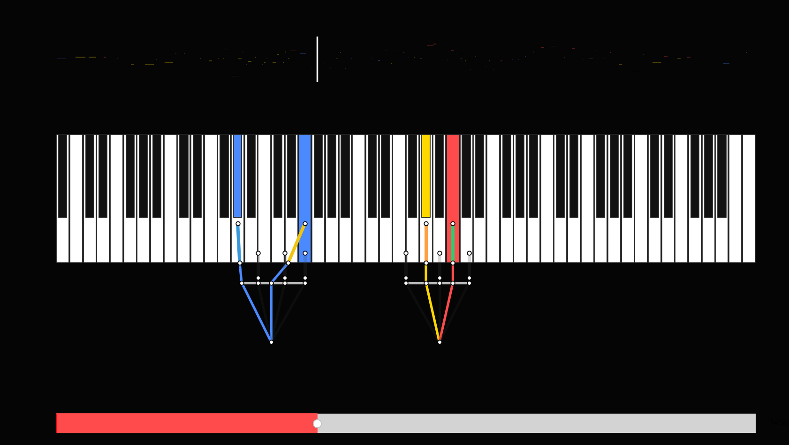

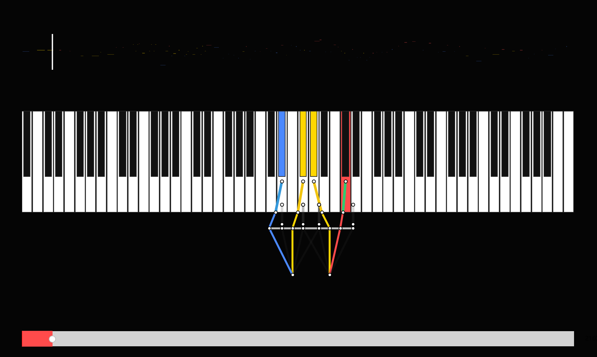

- MELODY(빨강) / BASS(파랑) / INNER(노랑) 성부별 색상 구분
- 손가락 번호(1~5번)별 색상 이중 채색
- MIDI 오디오 동기 재생, 타임라인 탐색 슬라이더

### 5.1.6 물리 제약의 순간 단위 재설계 (2학기 신규)

**문제.** 1학기 엔진은 손 범위·손가락 중복·순서 제약을 **화음 단위**로 검사하였습니다. 지속음이 다음 화음까지 눌려 있는 경우가 검사에서 빠져, 한 손가락이 서로 다른 건반을 동시에 누르는 운지가 생길 수 있었습니다.

**세 가지 시간 개념의 분리.** 이 작업에서 다음을 구분하였습니다.

| 값 | 의미 | 쓰는 곳 |
|---|---|---|
| `duration_ms` | 소리가 울리는 시간. Sustain 페달로 늘어난 **청각적** 지속 | 오디오 동기 |
| `key_hold_ms` | 손가락이 실제로 건반을 누르고 있는 시간 | **IK의 누름·해제 기준** |
| `required_hold_ms` | 페달 상태를 반영한 **최소 점유 의무** 시간 | DP 내부 제약 검사 |

페달이 눌린 구간에서는 건반을 떼도 소리가 유지되므로 `key_hold_ms < duration_ms` 입니다. `duration_ms`로 건반을 떼면 한 손가락이 두 건반을 동시에 누르는 자세가 만들어집니다.

**구현.** 검사 기준을 시간 구간 겹침으로 바꾸는 작업을 5단계로 나누어 수행하였습니다 (4장 W06). 운지로 해결되지 않는 구간은 **건반 조기 해제**(점유 단축) 또는 **음표 제외**로 처리하고, 어느 쪽을 썼는지 보고하도록 하였습니다.

**결과.** 실곡 13곡 기준 물리 제약 위반 **0건**, 음표 보존율 **85.2%**. 잔여 음표 손실은 밴드 편곡 곡에 집중되어 있으며, 피아노 트랙 자동 선별이 미구현인 것이 원인입니다.

### 5.1.7 기준 코퍼스 — 엔진 정확도와 입력 연주 가능성의 분리

실곡에서 나오는 제약 위반은 **엔진의 정확도가 아니라 입력의 연주 가능성**을 재는 값입니다. 측정 결과 위반 시점의 **81.6%가 사람 두 손으로는 칠 수 없는 구간**이었습니다. 이런 입력으로는 알고리즘 변경의 효과를 가릴 수 없습니다.

그래서 **연주 가능함이 보장된 기준 코퍼스**를 따로 만들었습니다. 사람이 칠 수 있도록 설계한 곡만 넣었으므로, 여기서 위반이 나오면 그것은 엔진의 결함입니다.

| 시기 | 곡 수 | 내용 |
|---|---|---|
| W06 | 8곡 | ref_01 ~ ref_08 — 기본 음형, 페달 아르페지오 등 |
| W10 | **12곡** | ref_09 긴 내성부(400음) · ref_10 흑건 엄지 반복(600음) · ref_11 포지션 이동(640음) · ref_12 페달 지속음 + 선율(1,000음) |

W10에 추가한 네 곡은 **코스트 구조를 일부러 압박하도록 설계**한 것입니다 (5.1.8절).

### 5.1.8 코스트 함수 구조 측정과 빔 가지치기 수정

**지적.** 2차 중간발표에서 "절대 위반해서는 안 되는 제약을 가산 코스트에 섞으면, 다른 항이 낮아질 때 전체 합이 작아져 위반이 선택될 수 있다"는 지적을 받았습니다 (8.1절).

**코드 확인.** 지적한 구조가 그대로 있었습니다. DP가 하드 제약을 후보에서 배제하지 않고 큰 수(손 범위 5,000 · 손가락 중복 4,000 · 순서 역전 1,500)를 **더하는** 방식으로 다루고 있었고, 이 값들이 성부 보정(−12~+20)이나 순차 진행 보상(−20) 같은 선호도 항과 같은 스칼라에 섞이고 있었습니다. 또한 상태 폭발을 막는 **빔 가지치기**(화음당 상위 120개 유지)도 같은 스칼라로 정렬하고 있었습니다.

**고치기 전에 먼저 측정하였습니다.** 저장소 엔진은 수정하지 않고, 소스에 카운터만 끼운 사본을 메모리에서 실행하는 계측 도구 2종(`tools/measure_cost.py`, `tools/measure_beam.py`)을 작성하였습니다.

| | 기준 코퍼스 | 실곡 13곡 |
|---|---|---|
| DP 직후 위반 시점 | **0** | 2,384 |
| 사후 해소 후 | 0 | 0 |
| 가지치기로 버린 상태 | 5,300 | 202,780 |
| 그중 위반이 없던 것 | 455 (8.6%) | 2,922 (1.4%) |

**결과가 둘로 갈렸습니다.**

- **위반이 선호도와 교환되는 현상은 관측되지 않았습니다.** 연주 가능함이 보장된 입력에서 DP 직후 위반이 0이므로, 입력이 실제로 칠 수 있는 곡이면 현행 구조도 위반을 고르지 않습니다. 실곡의 2,384건은 입력 자체가 두 손으로 칠 수 없는 구간이며, 앞의 81.6% 측정과 일치합니다. W10에 압박용 네 곡을 더해 재측정하였으나 **여전히 재현되지 않았고**, 네 곡 중 셋은 위반이 0건이었습니다.
- **가지치기에서 좋은 상태가 사라지는 현상은 관측되었습니다.** `ref_04`는 화음의 53.3%에서 빔이 포화되며, 그 과정에서 위반 없는 상태 455개를 버리고 위반 있는 상태 1,247개를 남겼습니다.

**관측된 문제만 고쳤습니다.** 정렬 기준을 `(위반 여부, 비용)`으로 바꾸었습니다. 불가능은 양이 아니므로 두 번 어긴 상태를 한 번 어긴 상태의 두 배로 다루지 않습니다. 수정 후 버려지는 깨끗한 상태가 **455개 → 0개**가 되었고, 21곡 재처리 결과 출력 JSON이 내용상 완전히 동일하며 회귀 테스트 5종을 통과하였습니다.

> 첫 시도는 판정 범위를 좁게 잡아(손 범위를 현재 화음 안에서만) 실곡 위반이 2,384 → 2,389로 늘고 음표가 1개 줄었습니다. 좁은 기준으로 깨끗하다고 남긴 상태 중에 실제로는 점유 중인 음과의 손 범위를 어기는 것이 섞여 있었기 때문입니다. 판정 범위를 사후 측정과 같게 맞추어 해결하였습니다.

**ref_12의 위반 281건은 원인이 달랐습니다.** 교환도 빔 포화도 아니었고, **DP가 점유를 `required_hold_ms`로 보는 데서 온 모델 불일치**였습니다. 페달 구간에서 이 값이 30 ms까지 내려가 겹침이 보이지 않는 반면, 출력은 실제 손가락 점유 시간(850~1,050 ms)을 씁니다. 사후 해소가 점유 단축 111건으로 **음을 버리거나 소리를 자르지 않고** 전부 처리하므로, 회귀 테스트의 판정 기준을 DP 직후가 아닌 **최종 출력**으로 정정하였습니다.

**판단.** 지적은 구조적으로 타당하나, 연주 가능함이 보장된 입력에서는 문제가 재현되지 않아 전면 재설계(후보 배제·전이 배제·사전식 비교)의 근거가 없습니다. 결합 방식 비교(가산 / max / 곱)는 문제가 실제로 드러나는 입력을 확보한 뒤로 미루었습니다. 설계안과 측정 결과는 `01_Design/13_Cost_Function_Design.md`에 정리하였습니다.

### 5.1.9 손목 출력과 IK 인계 (2학기 신규)

**`wrist_pos_normalized`의 문제.** 이 값은 이름과 달리 위치가 아니라 **화음 평균 pitch를 0~1로 정규화한 값**이었습니다. 다른 좌표가 전부 mm인데 이것만 단위가 달라, 쓰려면 건반 치수를 다시 알아야 했습니다. 같은 뜻을 mm로 내는 `wrist_x_mm`을 추가하였습니다 (원점 A0(MIDI 21) 좌측 모서리, 산출은 `piano_keyboard` 모듈 경유).

**부호 규약 확정.** IK 파트에서 "요(yaw)의 부호는 운지법 코드를 보고 추론한 것이라 확인이 필요하다"는 요청이 있어, 코드를 확인하여 확정하고 주석에 기재하였습니다.

| 값 | + 방향 | − 방향 | 범위 |
|---|---|---|---|
| `WristYawDeg` | **새끼손가락 쪽** | 엄지 쪽 | ±35° |
| `WristRollDeg` | **엄지 쪽**을 들어 올림 | 새끼 쪽을 들어 올림 | ±20° |

**두 손 공통**입니다. 오른손은 새끼가 고음 쪽, 왼손은 저음 쪽이라 pitch 기준으로는 방향이 반대인데, 엔진이 왼손에 −1을 곱해 해부학적 기준(새끼 쪽)으로 부호를 통일합니다. 따라서 IK는 `Hand`를 보고 부호를 뒤집을 필요가 없습니다. 엄지와 소지가 **둘 다** 흑건이면 +12와 −12가 상쇄되어 롤이 0이 됩니다(엄지가 흑건인 음 1,758개 중 251개).

**역할 경계.** 설계서에 운지법 책임이 "손목 물리", IK 책임이 "손목 궤적"으로 적혀 있어 경계가 모호했습니다. 다음과 같이 정리하였습니다.

| | 하는 일 | 하지 않는 일 |
|---|---|---|
| **운지법** | 화음마다 손목이 어디에 어떤 각도로 있어야 하는지 **목표값**을 낸다 | 시간에 따른 궤적, 보간, 속도 제한 |
| **IK** | 목표값을 받아 **궤적을 만들고** 관절 한계 안에서 실제로 움직인다 | 각도를 스스로 추정 |

운지법이 내는 값은 **힌트**이지 명령이 아닙니다. IK가 보기에 무리하면 줄이거나 쓰지 않아도 됩니다.

**CSV 열 추가.** IK가 열 번호로 파싱하므로 기존 열 사이에 끼우지 않고 뒤에 붙였습니다. 1~18번 열의 위치는 그대로이고, 19번에 `WristXMm`이 들어가면서 `BoneName`·`FrameIndex`·`ReleaseFrameIndex`가 한 칸씩 밀렸습니다. UE5 DataTable은 이름으로 맞추므로 영향이 없습니다.

이 내용을 `01_Design/14_Wrist_Handoff_Request.md`로 정리하여 IK 파트에 전달하였습니다 (11/08).

---

## 5.2 IK 기반 모션 생성 — 한승현

### 5.2.1 설계 방향

IK 계산은 실시간이 아닌 **오프라인 사전 계산** 단계에서 수행됩니다. 수렴 속도보다 정확도와 제약 처리 유연성을 우선하여 **Weighted DLS(Damped Least Squares) 방식의 Jacobian 기반 IK**를 채택하였습니다. 알고리즘 검증은 Vulkan 기반 테스트베드에서 MIDI 노트 시퀀스를 재생하며 수행하고, 최종 오프라인 계산 결과를 UE5로 전달하는 구조입니다.

### 5.2.2 손 모델 계층 구조 및 ROM 설정

관절 계층: **Wrist → Metacarpal → MCP → PIP → DIP → Fingertip**

| 관절 | 굴곡 범위 | 신전 범위 | 내외전 |
|---|---|---|---|
| MCP | 0° ~ 90° | 0° ~ 20° | **±35°** |
| PIP | 0° ~ 110° | 0° ~ 20° | — |
| DIP | 0° ~ 32° | 0° ~ 15° | — |
| 엄지 CMC | 0° ~ 50° | 0° ~ 50° | ±40° (축회전 0°~15°) |
| 엄지 MCP | 0° ~ 110° | 0° ~ 15° | — |
| 엄지 IP | 0° ~ 32° | 0° ~ 15° | — |

모든 관절 각도는 `std::clamp`로 ROM 범위 내로 강제 제한하여 생리적으로 불가능한 동작을 원천 차단합니다.

### 5.2.3 Weighted DLS IK 연산

중간보고의 DLS IK를 관절 한계를 반영하는 **Weighted DLS**로 확장하였습니다. 손가락당 최대 40회 반복, 허용 오차 0.01입니다.

> **3차 정정 (11/19).** 허용 오차 `0.01`은 **IK 내부 단위**이며 실제 길이로는 **약 0.05 cm**입니다. 2차까지 이 값을 0.01 cm로 읽고 있었고, 그 때문에 "40회 내 수렴 실패 60.7%"를 작은 문제로 해석할 뻔하였습니다. 실제로 수렴하지 못한 풀이의 **남은 오차 중앙값은 1.4 cm**입니다 (5.2.12절).

1. 각 타임스텝마다 모든 관절 각도를 **0°(일자 자세)로 초기화**합니다. 이전 타임스텝 결과에 의존하지 않고 매번 같은 조건에서 풀 수 있습니다.
2. `computeFK`로 각 관절의 전역 변환을 갱신합니다.
3. 오차 벡터 $e = target - p_{end}$ 를 계산하고, $|e| < 0.01$ 이면 반복을 종료합니다.
4. 각 관절 $i$의 회전축 $a$와 끝점까지의 벡터를 외적하여 $3 \times 9$ Jacobian을 생성합니다: $J_{col} = a \times (p_{end} - p_i)$
5. **관절 한계 가중치**를 계산합니다. 각도를 가동 범위 안에서 $[-1, 1]$로 정규화한 뒤 한계에 가까울수록 비용이 급증합니다.
   - $\hat{q} = (q - q_{mid}) / q_{range}$
   - $w = 1 + 100 \cdot |\hat{q}|^6$
   - $W^{-1} = 1 / w$ (가동 범위가 0인 자유도는 $W^{-1} = 0$)
6. Weighted DLS 역행렬로 보정 오차를 구합니다 ($\lambda = 0.05$): $e^* = (J W^{-1} J^T + \lambda^2 I)^{-1} e$
7. 관절 변화량을 계산합니다: $\Delta\theta = W^{-1} J^T e^*$
8. **9개 자유도 전체 스텝 길이**가 0.1 rad을 넘으면 방향을 유지하고 길이만 줄입니다.
9. 각도를 갱신하고 `std::clamp`로 최종 제한합니다.

한계각에 가까운 관절은 $W^{-1}$이 0에 가까워져 거의 움직이지 않고, 나머지 관절이 움직임을 분담합니다. 하드 클램프에 의존하지 않고도 자연스럽게 관절 한계를 피하게 됩니다.

### 5.2.4 MIDI 노트 연동

IK 입력으로 운지법 엔진과 같은 `NoteEvent` 자료구조를 사용합니다.

```cpp
struct NoteEvent { float time_ms; int pitch; int velocity; float duration_ms; int hand; int finger; };
```

현재는 운지법 엔진과 연동하기 전 단계로, 모의 MIDI 데이터(`initMockMidiData`)로 검증하고 있습니다.

| 구간 | 시간 | 왼손 | 오른손 |
|---|---|---|---|
| 파트 1: 반음계 상행 | 0 ~ 6.0초 (500ms 간격) | C3~B3 12음, 손가락 5→1 순환 | C4~B4 12음, 손가락 1→5 순환 |
| 파트 2: C장조 화음 | 6.0 ~ 7.5초 | C3·E3·G3 (5·3·1번) | C4·E4·G4 (1·3·5번) |

각 음의 지속 시간은 450ms로, 다음 음까지 50ms 동안 손가락을 떼는 동작이 나오도록 하였습니다.

### 5.2.5 피아노 건반 모델

12개 반음을 균등하게 놓지 않고, 실제 피아노처럼 **흰 건반 폭을 기준으로** 배치하였습니다(옥타브당 흰 건반 7개). 흰 건반 폭은 손가락 전체 길이(1.75)에 비례하도록 **0.45**로 정하였습니다.

- 흰 건반: $z = 옥타브 \times 7 \times w + 흰건반순서 \times w$
- 검은 건반: 왼쪽 흰 건반 위치 $+ \; w \times (0.5 + bias)$
- 검은 건반 편향(bias): C#·F# −0.15, D#·A# +0.15, G# 0

| 구분 | 누르는 지점 X (앞뒤) | 누르는 지점 Y (높이) | 폭 |
|---|---|---|---|
| 흰 건반 | 0.8 | −0.5 | 0.45 − 간격 0.04 |
| 검은 건반 | 1.3 | −0.35 | 흰 건반의 50% |

검은 건반은 흰 건반보다 짧고 높으며 안쪽에 있습니다. 건반 메시와 IK 타겟이 `kWhiteKeyWidth` 상수를 공유하므로 위치가 어긋나지 않습니다.

### 5.2.6 손목 트래킹 및 아치형 궤적

중간보고의 베지어 기반 C↔F 전환은 정해진 두 자세 사이를 오가는 데는 적합했으나, 임의의 MIDI 시퀀스에서는 목표 위치가 수시로 바뀌므로 **목표 추적 + 지수 감쇠 보간** 방식으로 전환하였습니다.

**① 목표 위치 (손별, 활성 노트 기준)**

- **Z (좌우):** 손목을 누르는 손가락의 뿌리가 건반 바로 위에 오는 위치에 둡니다.
  - $wrist_z = \text{평균}(key_z - rootOffset_z)$
- **X (앞뒤):** 흰 건반 기준 위치에서 검은 건반까지 차이의 30%만 손목이 따라가고, 나머지는 손가락이 뻗어서 처리합니다.
  - $wrist_x = 0.8 + (\overline{key_x} - 0.8) \times 0.3 - 0.8$
- **검은 건반 높이 보정:** 누르는 건반의 평균 높이가 높은 만큼 그 30%를 손목 높이에 더합니다.

**② 아치형 높이**

이동할 거리가 많이 남을수록 손목을 위로 들어올립니다. XZ 평면 거리를 사용합니다.

$$target_y = 0.1 + |target_{xz} - current_{xz}| \times 0.2 + bias$$

**③ 타임스텝 독립 보간**

$$\alpha = 1 - e^{-k \cdot dt}$$

k값: 수평 이동 7.7, 높이 9.75. 계산 간격(dt)이 바뀌어도 손목 궤적이 같게 나와 오프라인 연산에서 출력 프레임레이트를 바꿔도 결과가 일관됩니다.

### 5.2.7 손가락 타겟 설정 및 타건 모션

1. **대기 자세:** 노트가 없는 손가락은 $wrist + rootOffset + (0.9, -0.35, 0)$ 을 목표로 합니다. 자연스럽게 아래로 굽은 이완 자세입니다.
2. **타건:** 노트가 배정된 손가락은 `getKeyPosition(pitch)`로 목표를 덮어씁니다.
3. **보간:** 타겟을 스텝마다 0.25 비율로 목표에 가깝게 옮깁니다. 이때 남은 거리 × 0.08만큼 Y를 올려서, 손가락이 살짝 들렸다가 건반을 내려치는 궤적을 만듭니다.

### 5.2.8 검증용 테스트베드 (Vulkan)

IK 결과를 눈으로 확인하기 위해 Vulkan으로 손가락 골격과 건반을 렌더링하는 테스트베드를 구현하였습니다.

| 정점 범위 | 내용 | 파이프라인 |
|---|---|---|
| 0 ~ 39 | 손가락 10개 × 관절 4개 골격 | 선(Line) |
| 40 ~ 79 | 타겟 십자선 10개 | 선(Line) |
| 80 ~ | 건반 사각형 | Triangle List, 컬링 없음 |

색상: 엄지 초록, 왼손 주황, 오른손 파랑, 타겟 빨간 십자선. 흰 건반을 먼저 그리고 검은 건반을 위에 그리며 깊이 테스트(`LESS`)로 겹침을 처리합니다.

**[그림] 양손 Weighted DLS IK 타건 결과 — Vulkan 테스트베드**

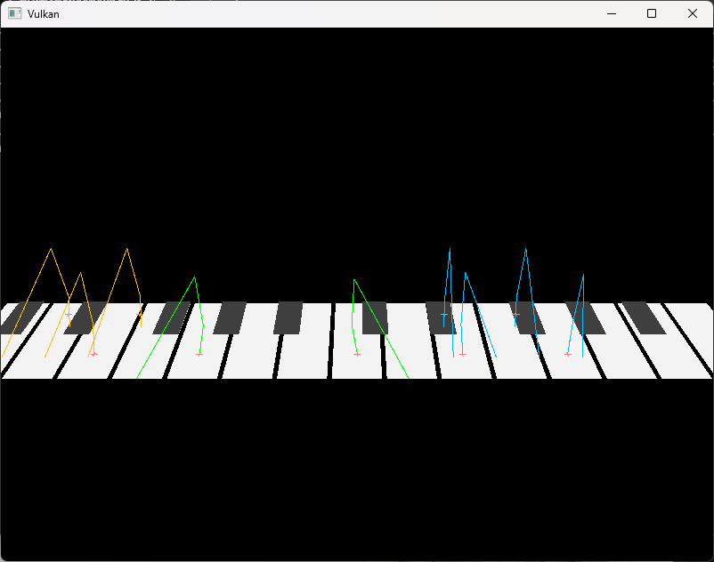

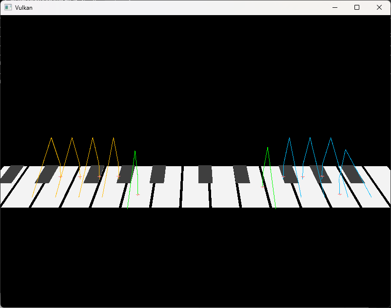

왼손(주황)·오른손(파랑)·엄지(초록) 골격과 타겟 십자선(빨강). 각 손가락이 배정된 건반의 누름 지점으로 수렴하고, 노트가 없는 손가락은 이완된 대기 자세를 유지합니다.

### 5.2.9 W03 확정 파라미터

| 항목 | 값 |
|---|---|
| 흑건 상면 Y 오프셋 | 3.0 cm |
| 건반 최대 누름 깊이 | 1.0 cm |
| IK 출력 프레임레이트 | 30 FPS |
| 손가락-손목 오프셋 (오른손 1~5번) | −4, −2, 0, +2, +4 반음 |

### 5.2.10 향후 연동 계획

- 운지법 엔진 JSON 연동 (`start_ms`→`time_ms`, `hand` 문자열→정수 매핑)
- 운지법 엔진의 손목 회전(`wrist_yaw_deg`, `wrist_roll_deg`) 반영
- 건반 관통 및 다중 손가락 충돌 방지 로직
- 오프라인 계산 결과를 UE5 Animation 시스템(MetaHuman 손 모델)으로 전달하는 데이터 파이프라인 구축

### 5.2.11 관절 각도 CSV 내보내기 (2학기 신규)

IK 결과를 다른 파트가 쓸 수 있도록 관절 각도를 CSV로 내보내는 경로를 구현하였습니다.

- 내부 계산은 **60 Hz**, 기록은 **30 FPS**로 맞추었습니다.
- 긴 곡에서도 상태를 알 수 있도록 진행률을 출력합니다.
- 손가락 마디 길이를 **MetaHuman 손 실측값**으로 변경하였습니다.
- 엄지 뿌리를 **CMC 위치**로 옮기고 엄지의 타건 지점을 건반 앞쪽으로 조정하였습니다.

04_Flesh 파트가 이 CSV를 받아 `AnimSequence`로 변환하는 임포터를 구현하여, 실제 곡(`deb_clai`, 248초, 7,447프레임)으로 내보내기부터 애니메이션 생성까지 확인하였습니다.

### 5.2.12 IK 품질 정량 측정 (2학기 신규)

저장소 코드와 별개로 **계측 코드를 넣은 빌드**를 만들어 IK 품질을 수치로 측정하였습니다. 처음에는 `joints.csv`만으로 손끝 오차와 반복 수를 계산할 수 있다고 보았으나, 반복 수는 출력되지 않고 오차 계산에는 손목 위치·건반 좌표·음표 데이터가 함께 필요하여 IK 쪽에 계측을 넣는 방식으로 바꾸었습니다.

**측정 조건:** 일반 3곡, 오른손, 타건 150 ms 이후.

| 지표 | 값 |
|---|---|
| 손끝–건반 오차 평균 | **0.45 cm** |
| 손끝–건반 오차 최대 | 10.66 cm |
| 오차 1 cm 이상 비율 | 5.1% |
| 반복 횟수 평균 | 31.0회 |
| **40회 내 수렴 실패 프레임** | **60.7%** |
| 수렴 실패 시 남은 오차 중앙값 | 1.4 cm |
| 인접 프레임 각도 변화 최대 | 39.1° (달빛 123.5°) |
| 25° 초과 점프 횟수 | 903회 |

**해석.**

- 관절 제한은 거의 항상 **DIP 최대 굴곡(32°)** 과 **MCP 최대 신전(20°)** 에서 걸립니다. 목표점이 손가락 도달 범위의 끝에 놓인다는 뜻입니다.
- 프레임 간 급점프의 원인은 **매 프레임 관절을 0°로 초기화한 뒤 다시 푸는 구조**(5.2.3절 1번, 6.7절에서 국소해 고착을 막으려고 도입한 것)에 있습니다. 국소해 고착은 해결되었으나 시간적 연속성을 잃는 맞교환이 발생하였습니다.
- 마디 길이를 MetaHuman 실측값으로 바꾼 뒤 **소지 오차가 35%에서 57%로 증가**하였고, 프레임 0에서 중간 마디가 84~97° 굽은 채 시작하는 현상이 확인되었습니다. 기본 굽힘이 각도에 포함된 것인지 확인이 필요합니다.

### 5.2.13 손목 회전 반영 실험 (2학기 신규)

현재 IK는 운지법 CSV를 **13번째 열부터 파싱**하여 `WristYawDeg`·`WristRollDeg`를 읽지 않으며, 출력도 0으로 고정되어 있습니다. 인터페이스는 정의되어 있으나 **소비되지 않고 있었습니다.**

시험 삼아 반영해 본 결과입니다.

| 조건 | 엄지–흑건 오차 |
|---|---|
| 현재 (회전 미반영) | 1.54 cm |
| 롤 단독 | 효과 없음 (±12°를 적용해도 엄지 뿌리가 약 0.4 cm만 상승) |
| **요 + 롤 반영** | **1.10 cm** |

롤만으로는 되지 않고 요를 함께 넣어야 한다는 것을 확인하였습니다. 운지법 파트가 부호 규약을 확정하여 요청서를 전달하였고(5.1.9절), 본 반영은 대기 중입니다.

### 5.2.14 모듈 간 손 모델 불일치 (W10)

테스트베드에서 보이는 손 모양과 실제 모델에 적용했을 때의 손 모양이 다르다는 지적(8.2절)에 따라, 손 모델과 피아노 모델의 모듈 간 불일치를 확인하고 통일 필요성을 검토하였습니다. **UE5 MetaHuman 손 모델링 기반으로 통일**하는 방향으로 정하였습니다.

---

## 5.3 커스텀 GPU 스키닝 파이프라인 — 이수민

### 5.3.1 목표 및 1학기→2학기 전환

손가락이 굽혀질 때 피부 주름이 생기게 하는 것이 목표입니다. 엔진 기본 GPU 스키닝은 정점을 옮기기만 하며 표면 신장률을 계산하지 않으므로 주름이 생기지 않습니다.

1학기에는 SVE(Scene View Extension)를 이용해 포스트프로세스 단계에 커스텀 패스를 삽입하는 방식을 검증하였습니다. 2학기에는 계획대로 **후크 지점을 정점 처리 단계로 전환**, UE5의 `UMeshDeformer`를 상속하여 엔진 스킨 캐시를 커스텀 컴퓨트 셰이더로 대체하였습니다.

<div align="center">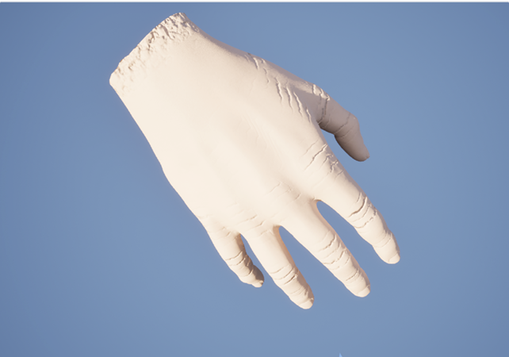</div>

<p align="center"><b>[그림 1]</b> 최종 결과. 손을 편 상태에서 마디마다 가로 주름이 보입니다.</p>

### 5.3.2 6-Pass 컴퓨트 셰이더 파이프라인

`UMeshDeformer`를 상속하여 컴퓨트 셰이더 6개를 글로벌 셰이더로 등록합니다.

```cpp
IMPLEMENT_GLOBAL_SHADER(FPianoHandSkinDeformerCS,      "/PianoHand/Private/CustomSkinningDeformer.usf", "DeformCS",           SF_Compute);
IMPLEMENT_GLOBAL_SHADER(FPianoHandTensionAccumulateCS, "/PianoHand/Private/CustomSkinningTension.usf",  "AccumulateCS",       SF_Compute);
IMPLEMENT_GLOBAL_SHADER(FPianoHandTensionResolveCS,    "/PianoHand/Private/CustomSkinningTension.usf",  "ResolveCS",          SF_Compute);
IMPLEMENT_GLOBAL_SHADER(FPianoHandDetailDisplaceCS,    "/PianoHand/Private/CustomSkinningDetail.usf",   "DisplaceCS",         SF_Compute);
IMPLEMENT_GLOBAL_SHADER(FPianoHandNormalAccumulateCS,  "/PianoHand/Private/CustomSkinningDetail.usf",   "NormalAccumulateCS", SF_Compute);
IMPLEMENT_GLOBAL_SHADER(FPianoHandNormalResolveCS,     "/PianoHand/Private/CustomSkinningDetail.usf",   "NormalResolveCS",    SF_Compute);
```

| 순서 | 패스 | 스레드 단위 | 역할 |
|---|---|---|---|
| ① | `DeformCS` | 정점 | 본 행렬로 위치·탄젠트 계산 (LBS / DQS) |
| ② | `AccumulateCS` | 삼각형 | 변 신장률을 계산해 정점에 누적 |
| ③ | `ResolveCS` | 정점 | 누적값 평균 → 정점 컬러 + strain 버퍼 |
| ④ | `DisplaceCS` | 정점 | 부피 보존 + 관절 주름 변위 |
| ⑤ | `NormalAccumulateCS` | 삼각형 | 변위 후 면 노멀 재계산 |
| ⑥ | `NormalResolveCS` | 정점 | 노멀 평균 + 탄젠트 재직교화 |

결과는 GPU skin passthrough 정점 팩토리 버퍼에 직접 씁니다. 머티리얼·그림자·라이팅 경로는 그대로 사용합니다.

```cpp
FRDGBufferRef PositionBuffer = FSkeletalMeshDeformerHelpers::AllocateVertexFactoryPositionBuffer(
    GraphBuilder, ExternalAccessQueue, MeshObject, LodIndex, TEXT("PianoHandSkinDeformerPosition"));
// ... 6개 패스 디스패치 ...
FSkeletalMeshDeformerHelpers::UpdateVertexFactoryBufferOverrides(
    GraphBuilder, MeshObject, LodIndex, bInvalidatePreviousPosition);
```

> **Nanite를 쓰지 않은 이유:** Nanite 메시는 passthrough 정점 팩토리를 우회합니다. 정점 밀도는 에셋 단계 PN 테셀레이션으로 올렸습니다. ⑤⑥ 노멀 재계산 패스가 빠지면 정점이 움직여도 주름이 화면에 전혀 보이지 않습니다 — 초기 구현에서 실제로 겪은 문제입니다.

### 5.3.3 텐션(Strain) 계산

기준 자세의 변 길이와 스키닝 후 변 길이를 비교합니다.

```hlsl
// CustomSkinningTension.usf — AccumulateCS
void AccumulateEdge(uint A, uint B, float3 RestA, float3 RestB, float3 SkinA, float3 SkinB)
{
    const float RestLen = length(RestB - RestA);
    const float SkinLen = length(SkinB - SkinA);
    if (RestLen < 1e-5f) return;                 // 중복 정점으로 생긴 0길이 변은 제외

    const float Strain = clamp(SkinLen / RestLen - 1.0f, -8.0f, 8.0f);
    const int   Packed = (int)round(Strain * TENSION_FIXED_SCALE);

    InterlockedAdd(StrainAccum[A], Packed);      // 여러 삼각형이 같은 정점에 동시에 쓴다
    InterlockedAdd(StrainAccum[B], Packed);
    InterlockedAdd(StrainCount[A], 1u);
    InterlockedAdd(StrainCount[B], 1u);
}
```

- **양수**: 늘어남 (손등·손가락 바깥)
- **음수**: 눌림 (손바닥·마디 안쪽)
- float atomic add는 GPU에서 사용 불가. `TENSION_FIXED_SCALE`(65536)을 곱해 int로 변환 후 atomic 누적. strain을 ±8로 clamp하면 정점에 변이 4,000개 붙어도 int32가 넘치지 않습니다.

`ResolveCS`에서 평균을 내고 정점 컬러로 출력합니다.

<div align="center">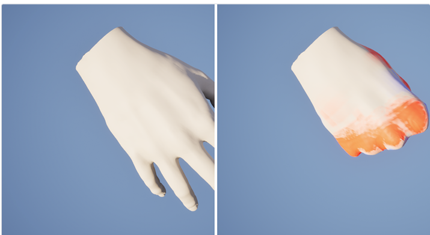</div>

<p align="center"><b>[그림 2]</b> 텐션 디버깅. 왼쪽은 기준 자세로 변형이 없습니다. 오른쪽은 주먹을 쥔 상태입니다.<br/>빨강이 늘어난 곳(손등·손가락 바깥), 파랑이 눌린 곳(손바닥·마디 안쪽)입니다.</p>

### 5.3.4 관절 위치 판별 — 스킨 웨이트 기반

주름은 관절에만 생겨야 합니다. 별도 마스크를 쓰면 메시가 바뀔 때마다 다시 만들어야 합니다. 관절 위의 정점은 정의상 두 본이 섞이는 정점이므로, 스킨 웨이트에서 직접 뽑았습니다.

```hlsl
// CustomSkinningDetail.usf — DisplaceCS
// 강체 부분에서 0, 관절의 50:50 블렌드 선에서 정확히 1
const float JointBlend = saturate(4.0f * LargestWeight * SecondWeight);
const float JointBand  = pow(max(JointBlend, 0.0f), max(CreaseSharpness, 1.0f));
```

별도 마스크 없이 어떤 스켈레탈 메시에도 적용됩니다.

**부피 보존:** 면 방향 신장률이 λ이면 비압축 가정에서 두께는 `1/λ²`배가 됩니다. 눌린 쪽이 법선 방향으로 부풀어 올라 LBS의 사탕포장지 변형을 방지합니다.

```hlsl
const float Lambda     = max(1.0f + Strain, 0.2f);
const float VolumeTerm = VolumeBulge * clamp(1.0f / (Lambda * Lambda) - 1.0f, -2.0f, 2.0f);
```

### 5.3.5 이력(History) — 폈다 놓은 직후 남는 주름

당겨졌던 피부는 바로 원래대로 돌아가지 않습니다. 잠시 주름이 남습니다. strain 하나로는 표현할 수 없습니다 — 쭉 펴고 있던 손가락과 방금 편 손가락의 strain이 같기 때문입니다. **직전 프레임 상태를 기억해야 합니다.**

```hlsl
// CustomSkinningTension.usf — ResolveCS
// RelaxState는 프레임 사이에 유지되는 버퍼 (.x = 직전 strain, .y = 남은 여유분)
const float2 PrevState   = (bResetRelax != 0u) ? float2(Strain, 0.0f) : RelaxState[V];
const float  PrevStretch = max(PrevState.x, 0.0f);
const float  NowStretch  = max(Strain, 0.0f);

float Slack = PrevState.y;
Slack += max(PrevStretch - NowStretch, 0.0f) * RelaxGain;   // 신장이 풀리면 여유분이 생기고
Slack -= max(NowStretch - PrevStretch, 0.0f) * RelaxGain;   // 다시 당기면 곧바로 사라진다
Slack  = saturate(Slack) * exp(-DeltaTime / max(RelaxTau, 1e-3f));

RelaxState[V] = float2(Strain, Slack);
ColorBufferUAV[V] = float4(saturate(T), saturate(-T), 0.5f + 0.5f * clamp(T, -1, 1), Slack);
```

버퍼를 프레임 사이에 유지하는 것이 핵심입니다. RDG의 `QueueBufferExtraction`과 `RegisterExternalBuffer`로 왕복시켰습니다. `Slack`은 정점 컬러 **알파 채널**로 나가 머티리얼이 주름을 되살리는 데 사용합니다.

<div align="center">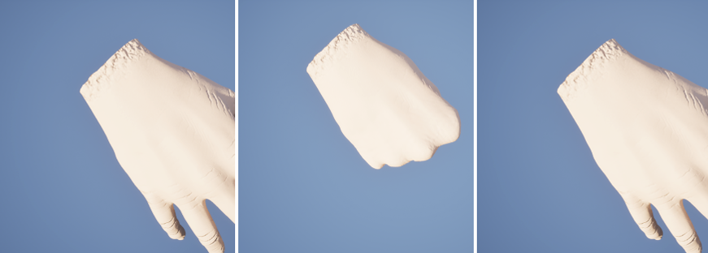</div>

<p align="center"><b>[그림 3]</b> 굴곡 사이클. 편 상태 / 주먹 / 막 편 직후입니다.<br/>세 번째의 주름이 첫 번째보다 깊습니다. 이 차이가 이력(Slack) 버퍼의 효과입니다.</p>

### 5.3.6 손 모델 교체 (MetaHuman)

기존 VR 템플릿 손은 관절이 단순한 2본 블렌드라 관절 밴드가 해부학과 어긋났습니다. MetaHumanCharacter 플러그인의 템플릿 바디에서 오른손만 잘라 교체했습니다.

| 단계 | 삼각형 | 정점 |
|---|---:|---:|
| 원본 바디 `SKM_Body` | 60,816 | 30,455 |
| 오른손 추출 | 9,624 | 4,834 |
| PN 테셀레이션 (level 3) | 154,624 | 77,314 |

<div align="center">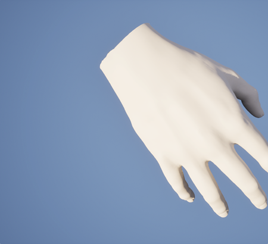</div>

<p align="center"><b>[그림 4]</b> 추출한 오른손. 손목 절단면은 삼각형 팬으로 막았습니다.</p>

두 가지 처리가 필요했습니다.

- **보조 본 정리**: MetaHuman은 정점 하나에 평균 9.6개 본을 묶습니다. 대부분 한 마디 안쪽의 보조 본이라 상위 두 웨이트가 같은 마디에 앉습니다. 평평한 손가락에서도 `4·w₀·w₁`이 1로 읽히는 문제가 발생합니다. 보조 본을 주 관절로 합쳐 평균 3.5개로 줄였습니다.
- **UV 재패킹**: 손 UV가 바디 아틀라스의 사선 조각이라 텍스처의 10%만 덮었습니다. 섬 회전을 포함해 재패킹해 47%로 올렸습니다.

관절별로 주름이 몰리는 정도는 리그에서 미리 계산해 텍스처로 구웠습니다.

| 채널 | 내용 |
|---|---|
| R | 가중치 적용 관절 밴드 |
| G | 관절 피벗 기준 뼈 축 방향 부호 거리 (±3 cm) |
| B | 원본 관절 밴드 |
| A | 손등 / 손바닥 판별값 |

<div align="center">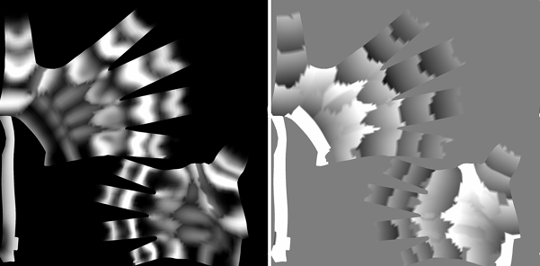</div>

<p align="center"><b>[그림 5]</b> 구운 맵의 R 채널(좌)과 G 채널(우). 밴드가 각 마디에 앉아 있습니다.<br/>셰이더는 G에 <code>sin()</code>을 적용해 손가락을 가로지르는 주름선을 만듭니다.</p>

### 5.3.7 손등과 손바닥은 반대로 동작한다

관절 밴드는 스킨 웨이트에서 나오므로 관절을 빙 둘러 깔립니다. 실제 피부는 두 면이 반대로 움직입니다.

| | 손 펼 때 | 주먹 쥘 때 |
|---|---|---|
| 손바닥 | 주름 적음 | 주름 깊어짐 |
| 손등 (마디 위) | 여유 피부가 뭉쳐 **주름 생김** | 팽팽히 당겨져 **주름 사라짐** |

베이크 단계에서 정점마다 "굽힐 때 늘어나는 쪽인지"를 계산해 마스크 알파에 넣었습니다. 굽힘은 본 로컬 +Z 축 기준 음수 회전 θ이며, 피벗에서 `u = cross(flexAxis, boneDir)` 방향으로 h만큼 떨어진 점은 `−h·θ`만큼 변합니다. `h > 0`이면 늘어나므로 u가 손등 방향입니다. 부호는 기준 자세에 40° 굽힘을 직접 적용해 검증하였습니다.

| 검증 항목 | 값 |
|---|---:|
| 상관계수 `corr(dorsality, strain)` | **+0.68** |
| dorsality > +0.5 평균 변형률 | **+6.9 %** (늘어남) |
| dorsality < −0.5 평균 변형률 | **−9.4 %** (눌림) |

<div align="center">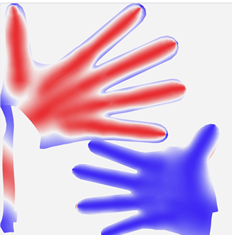</div>

<p align="center"><b>[그림 6]</b> 구워낸 판별 채널. 빨강이 손등, 파랑이 손바닥입니다.</p>

셰이더 게이트를 손등/손바닥 둘로 나눕니다.

```hlsl
// PianoHandSkin.ush
float PH_CreaseGate(
    float Dorsal, float Compress, float Stretch, float Relax,
    float PalmarBase, float PalmarCompress, float PalmarIron, float PalmarRelax,
    float DorsalBase, float DorsalIron, float DorsalRelax)
{
    float Palm = PalmarBase + Compress * PalmarCompress + Relax * PalmarRelax - Stretch * PalmarIron;
    float Back = DorsalBase                            + Relax * DorsalRelax - Stretch * DorsalIron;
    return saturate(lerp(Palm, Back, Dorsal));
}
```

손등 쪽 `Back`에는 **압축 항이 없습니다**. 기본 여유분 `DorsalBase`에서 시작해 신장이 그것을 깎아냅니다.

| 파라미터 | 의미 | 값 |
|---|---|---:|
| `PalmarBase` | 편 손바닥에 남는 기본 주름 | 0.30 |
| `PalmarCompress` | 쥘 때 손바닥 주름이 깊어지는 속도 | 2.6 |
| `PalmarIron` | 펼 때 펴지는 속도 | 1.2 |
| `DorsalBase` | 편 상태에서 손등에 뭉치는 주름 | 0.40 |
| `DorsalIron` | 쥘 때 팽팽해지는 속도 | 5.0 |
| `DorsalRelax` | 막 편 직후 되살아나는 주름 | 4.0 |
| `SideSharpness` | 손등↔손바닥 전환 폭 | 2.0 |

<div align="center">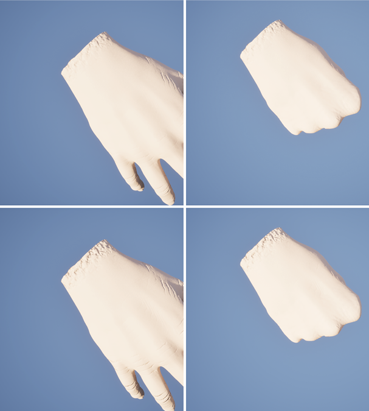</div>

<p align="center"><b>[그림 7]</b> 게이트 하나였을 때(위)와 둘로 나눈 뒤(아래). 왼쪽이 편 손, 오른쪽이 주먹입니다.<br/>수정 전에는 편 손이 매끈하고 주먹에서 주름이 보입니다. 수정 후에는 반대가 됩니다.</p>

<div align="center">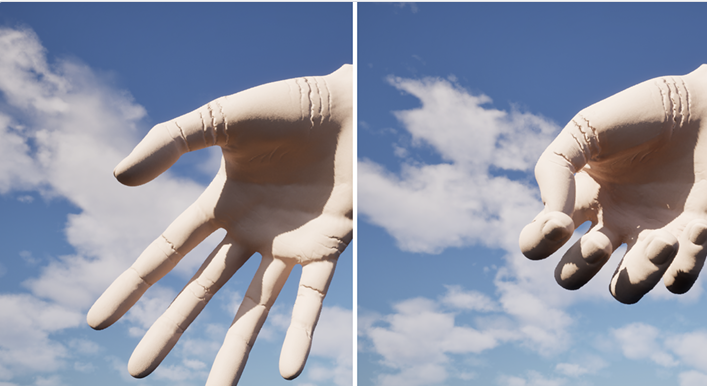</div>

<p align="center"><b>[그림 8]</b> 손바닥. 같은 베이크 데이터로 반대로 동작합니다. 쥘수록 주름이 깊어집니다.</p>

### 5.3.8 한계 및 향후 계획

- **손바닥 접힘선**(생명선 등)은 관절 밴드로 나오지 않습니다. 별도 채널이나 수작업 맵이 필요합니다.
- **성능 측정 미완료**: 정점 77k에 컴퓨트 패스 6개의 프레임 비용을 측정해야 합니다.
- **이력 효과 감쇠 약 0.9초**: 정지 화면으로는 확인이 어렵습니다. 시퀀서 렌더로 검증할 예정입니다.
- **손목 절단면** 가장자리 노멀이 거칩니다. 커프를 씌우거나 경계를 평활할 계획입니다.
- 4.1·4.2 모듈의 실제 연주 모션 위에서 동작 확인 예정입니다.

> **3차 갱신 (11/19).** 위 한계 중 **손목 절단면**은 Phase 12의 UV 심 용접으로, **손바닥 접힘선**은 Phase 4의 손바닥 선 채널로 처리되었습니다. **성능 측정**은 전체 GPU 시간(3.7~4.6 ms)만 확인되었고 패스별 분해는 아직 미측정입니다. 이하 5.3.9~5.3.12는 2차·3차 기간에 더해진 내용입니다.

### 5.3.9 Phase 4~7 — 피부 셰이딩, 손 비율, 그래프 주름 (10/12 ~ 10/13)

| Phase | 내용 |
|---|---|
| 4 | 피부 v3 — 셰이딩 모델, 주름 선 모양, 부위별 요철, 손바닥 선, 색 반응, 거리 페이드 |
| 5 | 개인별 손 비율 구조체 `FPianoHandProportions` — 마디별 길이·두께를 데이터로 분리 |
| 6 | 주름을 수식이 아니라 **그래프 위의 길**로 생성 |
| 7 | 관절 접촉과 부피 보존 불룩함 (Brunel 2021 계열) |

### 5.3.10 Phase 8~12 — Implicit Skinning과 UV 심 용접 (10/14 ~ 10/18)

**Phase 8 — Implicit Skinning (Vaillant et al., SIGGRAPH 2013).** 그때까지 접촉과 롤업은 "스키닝 결과의 변형률"에서 **사후 추정**한 값이었습니다(`1/J` 두께, 캡슐 밀기). Phase 8부터는 **뼈마다 붙은 HRBF 음함수 볼륨**을 강체로 움직이고, LBS/DQS로 옮긴 정점이 그 볼륨의 자기 등위값으로 ∇f를 따라 되돌아갑니다. 두 볼륨이 만나는 접힘 안쪽은 합집합(max)의 그라디언트 불연속이 곧 **접촉면**이 되고(55° 정지), 접힘 옆은 gradient-based bulge-in-contact로 부풉니다. 이후의 변형률·주름·디테일 패스는 모두 이 보정된 기하를 읽습니다.

**Phase 9~10 — 손등 잔주름 격자.** 편 손의 손등 관절에 모이는 살과 손금을 정리하고, 손가락 등의 잔주름 망을 레퍼런스(주먹 PIP 접사) 수준으로 맞췄습니다. 한 줄 간격 약 0.1 cm의 가로선과 사선 두 가족이 만드는 다이아몬드 격자입니다.

> 이 과정에서 **셰이더 `.ush` 수정이 에디터 재시작 없이는 반영되지 않는다**는 것을 발견하였습니다. 엔진이 include 해시를 시작 시점에 캐시하기 때문입니다. 저녁 스윕의 절반이 옛 셰이더로 찍혔던 것이 원인이었고, 이후 `.ush` 수정 뒤에는 반드시 재시작하는 절차를 세웠습니다.

**Phase 11 — 접힘부의 "꾸겨진 종이".** 주먹을 쥘 때 접힘부 노멀이 깨지는 현상을 세 원인으로 분리하였습니다. (1) 접힘 안쪽 **기하**가 implicit 단계에서 울퉁불퉁해짐, (2) 그 위에 **셰이더**의 압축 게이트가 2차 주름·격자·미세 이방성을 한꺼번에 포화시킴, (3) 반쯤 쥔 자세의 검은 틈은 두 지골 피부가 서로를 **관통**한 자리. Vaillant et al. 2014(*Robust iso-surface tracking*)의 **증분 추적**(매 프레임 DQS에서 새로 시작하지 않고 이전 프레임 결과를 뼈 변환 차이로 이동), **접촉 연산자**, **ARAP 접선 완화**를 적용하였습니다.

**Phase 12 — UV 심 쌍둥이 정점.** Play에서 주먹을 쥘 때 손가락 옆면을 따라 금이 가고 접힘부에서 빛이 새는 현상의 원인이 **UV 심**이었습니다. Dense 손 메시(74,186 렌더 정점)는 MetaHuman 바디 UV가 손가락마다 옆면을 따라 갈라져 있어, **같은 위치의 정점이 둘로 나뉘어** 서로 다르게 투영되고 있었습니다. rest 위치 해시(0.0005 cm)로 정점마다 대표 정점을 만드는 용접 맵(`BuildWeldMap`)을 도입하여 금과 틈이 사라졌습니다.

### 5.3.11 Phase 13 / 13c — Chaos Flesh를 접힘부 결합으로 받기 (11/07 ~ 11/15)

**합의.** Flesh로 손 전체를 덮어쓰지 않고, **살이 접히고 펴지는 부위의 저주파 변형만** 받아 우리 파이프라인 위에 얹기로 하였습니다. 04_Flesh의 어댑터는 그대로 두고 디포머 쪽만 바꾸었습니다.

**구현 (Phase 13).** 어댑터의 블렌드 패스를 위치 버퍼 **사본**에 돌려 Flesh 표면을 별도 버퍼로 얻습니다(어댑터 시그니처 변경 없음). 휴지 자세에서 Flesh 표면을 캡처해 두고, 신호는

```
D = Flesh − (Skinned + R_v·(FleshRest − Rest))
```

즉 정점 스키닝 회전으로 옮긴 **휴지 두께 오프셋을 뺀 "살이 더 움직인 양"** 입니다. 관절별 `FoldSide × 굽힘 게이트` 마스크로 접힘 안쪽만 거르고, 1-링 Jacobi 평활 24회로 사면체 격자 잡음을 없앤 뒤 implicit 뒤·텐션 앞에 더합니다. 변위 길이는 `FleshMaxCm`(0.4 cm)으로 제한합니다.

**Phase 13c — 텐션맵 유도 (11/15).** 마스크가 `FoldSide × 굽힘`뿐이어서 굽힌 마디의 **굴곡측 전체**(손끝 패드 포함)에 같은 세기로 들어갔고, IK 클립에서 손끝이 뾰족하게 늘어지는 문제가 생겼습니다. 보정 블록을 텐션 단계 뒤로 옮기고(`implicit → 텐션 → Flesh 보정 → 디테일`), 우리 텐션맵(평활된 변형 텐서)의 **최소 주신장**으로 가중하였습니다. 텐서 `C = (면내 Cauchy-Green) + n nᵀ`의 고유값이 λ₁², λ₂², 1이므로 `trace − 1`과 `det`만으로 λmin을 구할 수 있어 접선 프레임이 필요 없습니다. 압축량 `1 − λmin`이 0~0.04를 지나는 동안 가중치가 0→1이 되어, Flesh는 **피부가 실제로 눌리는 곳에만** 들어갑니다. 범위가 좁아진 만큼 강도를 0.5 → **0.75**로 올렸습니다.

**채택 기본값:** `FleshStrength` 0.75 · `FleshMaxCm` 0.4 · `FleshSmoothIterations` 24 · `FleshTensionFull` 0.04.

### 5.3.12 마디 기준 정확도 측정과 최종 레벨 (11/15)

Flesh를 쓰는 곳이 마디(접힘 안쪽)이므로 정확도도 거기서 측정하였습니다. `FleshStatsCS`가 마디 마스크로 가중하여 휴지 두께를 뺀 Flesh 표면까지의 거리를 단계별로 누적하고 20프레임마다 읽어 옵니다.

`A_IK_DebClai` 측정, 스키닝 대비 최종(cm):

| 설정 | 스키닝 | 최종 | 변화 |
|---|---|---|---|
| 고르게 0.5 (Phase 13) | 0.483 | 0.393 | −19% |
| 텐션 0.03..0.18, 0.5 | 0.531 | 0.506 | −5% |
| 텐션 0..0.04, 0.5 | 0.519 | 0.469 | −10% |
| **텐션 0..0.04, 0.75 (채택)** | 0.501 | 0.415 | **−17%** |

세션마다 Flesh가 조금씩 달라 스키닝 값 자체가 0.48~0.55로 흔들리므로 **절대값이 아니라 비율로** 비교하였습니다. 측정 가중치가 굴곡측 전체라서, 일부러 Flesh를 따르지 않게 한 손끝 패드도 오차로 잡힙니다.

**최종 레벨.** `create_final_level.py`가 `L_FleshTest`의 **사본**인 `L_PianoHandFinal`을 만듭니다. Flesh 표면·구동용 손은 게임에서 숨기고 최종 손만 보입니다(숨겨도 시뮬레이션은 계속 동작).

**한계.** Flesh를 켠 것과 끈 것의 차이는 여전히 작습니다. 손 전체가 매끈한 고무관처럼 보이는 것은 Flesh가 아니라 우리 쪽(암시적 투영 + SSS 머티리얼)과 **IK가 만든 과굽힘 자세**에서 옵니다. 이 장면에서는 Flesh와 implicit을 모두 꺼도 손끝 덩어리가 남습니다. Flesh 쪽에서 접힘 마스크를 사면체 강성으로 구워 접히는 곳만 무르게 만드는 방법이 후보이며, 이는 Flesh 에셋 재생성이 필요해 04_Flesh 작업입니다.

---

## 5.4 Chaos Flesh PBD Skinning — 곽경민

### 5.4.1 목표 및 역할 분담

손가락이 굽혀질 때 살이 실제 물리처럼 눌리고 밀리게 하는 것이 목표입니다. LBS는 정점을 본 행렬로 옮기기만 합니다. 관절 안쪽 살이 서로 파고들고, 부피가 줄어듭니다. Chaos Flesh는 손 내부를 사면체로 채워 뼈에 묶고 물리로 시뮬레이션합니다. 눌린 살은 부피를 유지하려고 옆으로 밀려납니다.

이번 기간에는 통합 프로젝트에서 Flesh 에셋을 다시 만들고, 굴곡 애니메이션을 따라 Flesh가 변형되는 것까지 확인하였습니다.

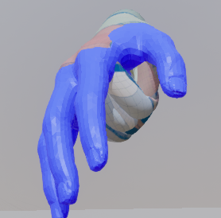

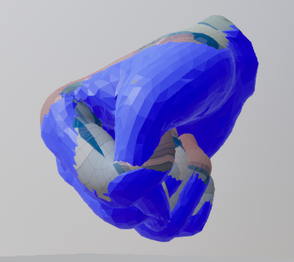

*그림 1. 주먹을 쥐는 애니메이션을 Flesh(파랑)가 따라갑니다.*

중간보고 이후 5.3의 커스텀 GPU 스키닝이 주름·핏줄까지 만들게 되었습니다. 두 모듈이 같은 일을 하지 않도록 역할을 나눴습니다.

| | 5.3 커스텀 GPU 스키닝 | 5.4 Chaos Flesh |
|---|---|---|
| 변형 계산 근거 | 스킨 웨이트 (LBS/DQS) + 변 신장률 | 사면체 볼륨의 물리 시뮬레이션 |
| 표현 대상 | 주름·핏줄·미세 노멀 | 살 눌림·부피 보존 |
| 스케일 | 미시 디테일 | 거시 변형 |

5.3의 부피 보존 항은 `1/λ²`라는 가정으로 계산한 **추정값**입니다. Flesh는 사면체끼리 서로 밀어내며 **실제로 계산**합니다. 최종 구조: **Flesh가 계산한 표면 위치 → 5.3 파이프라인 입력**으로 연결하여, 물리 변형된 표면 위에 주름·핏줄이 올라가는 구조를 목표로 합니다.

### 5.4.2 손 모델

5.3과 같은 메시를 씁니다. 나중에 결과를 합쳐야 하기 때문입니다. 5.3의 손 모델이 바뀔 때마다 따라갔습니다.

| 시기 | 메시 | 정점 | 비고 |
|---|---|---:|---|
| 1학기 | `fbx_Clean` | — | 전신 모델, Bone Filter로 손·팔만 사면체화 |
| 2학기 초 | `SKM_MannyXR_right` | 3,239 | UE 5.6 VR 템플릿 손 |
| 현재 | `SKM_MH_Hand_R` | 4,834 | MetaHuman 바디에서 오른손만 추출 |

같은 메시가 필요한 이유는 5.4.6에 있습니다. Flesh는 **메시 이름**으로 애니메이션 뼈를 찾습니다. 시뮬레이션에는 PN 테셀레이션 전 원본 메시(`4,834 정점`)를 씁니다. 고밀도 메시(`77k 정점`)는 렌더링용입니다.

### 5.4.3 Dataflow 그래프

Flesh 에셋은 Dataflow 그래프로 만듭니다. 1학기에는 Geometry 생성과 바인딩을 그래프 두 개로 나눴습니다. 지금은 대상이 손 하나뿐이고 파라미터를 자주 바꿔야 해서 **하나로 통합**하였습니다.

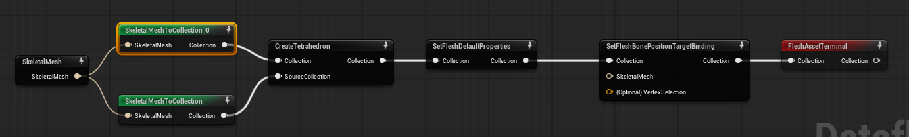

*그림 2. SkeletalMesh → SkeletalMeshToCollection_0(Import Transform Only) + SkeletalMeshToCollection → CreateTetrahedron → SetFleshDefaultProperties → SetFleshBonePositionTargetBinding → FleshAssetTerminal*

| 노드 | 역할 | 설정 |
|---|---|---|
| `SkeletalMesh` | 입력 모델 | `SKM_MH_Hand_R` |
| `SkeletalMeshToCollection_0` (위) | 뼈 계층만 변환 | **Import Transform Only ✔** |
| `SkeletalMeshToCollection` (아래) | 표면 형상 변환 | 기본값 |
| `CreateTetrahedron` | 표면 내부를 사면체로 채움 | Method: **TetWild** |
| `SetFleshDefaultProperties` | 물성 초기값 설정 | 아래 표 |
| `SetFleshBonePositionTargetBinding` | 사면체 정점 → 뼈 스프링 | Stiffness 10,000 / Search Radius 1.0 |
| `FleshAssetTerminal` | Flesh 에셋으로 저장 | — |

`CreateTetrahedron`의 두 입력은 역할이 다릅니다. 엔진 소스를 확인하였습니다.

```cpp
// ChaosFleshCreateTetrahedronNode.cpp (UE 5.6, 발췌)
TUniquePtr<FFleshCollection> InCollectionVal(
    GetValue<DataType>(Context, &Collection).NewCopy<FFleshCollection>());
TUniquePtr<FFleshCollection> InSourceCollectionVal(
    GetValue<DataType>(Context, &SourceCollection).NewCopy<FFleshCollection>());
// SourceCollection의 형상으로 사면체를 만들어 InCollectionVal에 덧붙인다
SetValue<const DataType&>(Context, *InCollectionVal, &Collection);  // 출력 = Collection 입력의 복사본 + 사면체
```

출력은 `Collection` 입력을 **그대로 복사한 것**에 사면체를 붙인 것입니다. 뼈 정보는 반드시 `Collection` 포트로 들어가야 합니다. 형상까지 든 컬렉션을 넣으면 원래 표면 메시가 사면체와 함께 중복으로 들어갑니다. 그래서 `Collection` 쪽은 **Import Transform Only**로 뼈만 넣습니다.

**물성 파라미터:**

| 파라미터 | 의미 | 값 |
|---|---|---:|
| `Density` | 밀도 | 0.1 |
| `Vertex Stiffness` | 형태 유지 강성 | 1,000,000 |
| `Vertex Damping` | 진동 감쇠 | 0.1 |
| `Vertex Incompressibility` | 부피 보존 강도 | 0.6 |
| `Vertex Inflation` | 내부 압력 | 0.5 |

### 5.4.4 사면체 생성 — IsoStuffing에서 TetWild로

기본 방식은 IsoStuffing입니다. 바운딩 박스를 격자로 나누고 메시 안쪽에 있는 칸에 사면체를 채웁니다.

**격자 해상도 문제:** `Num Cells` 기본값 32에서 칸 크기는 약 0.6 cm(손 길이 약 19 cm 기준)입니다. 손가락 두께가 1.5~2 cm라 단면에 2~3칸밖에 안 들어갑니다. 48로 올려 칸을 약 0.4 cm로 줄였습니다. 3차원 격자라 칸 수는 `(48/32)³ ≈ 3.4`배가 됩니다.

**MetaHuman 손에서 실패:** 손 모델을 바꾸자 손바닥만 채워지고 손가락은 끝 조각만 남았습니다. IsoStuffing은 칸마다 "메시 안쪽인가"를 판정하므로 틈이 없는 닫힌 메시가 필요합니다. 이 메시는 전신 바디에서 잘라낸 것으로 표면에 틈이 남아 있어 안팎 판정이 실패한 것으로 분석됩니다.

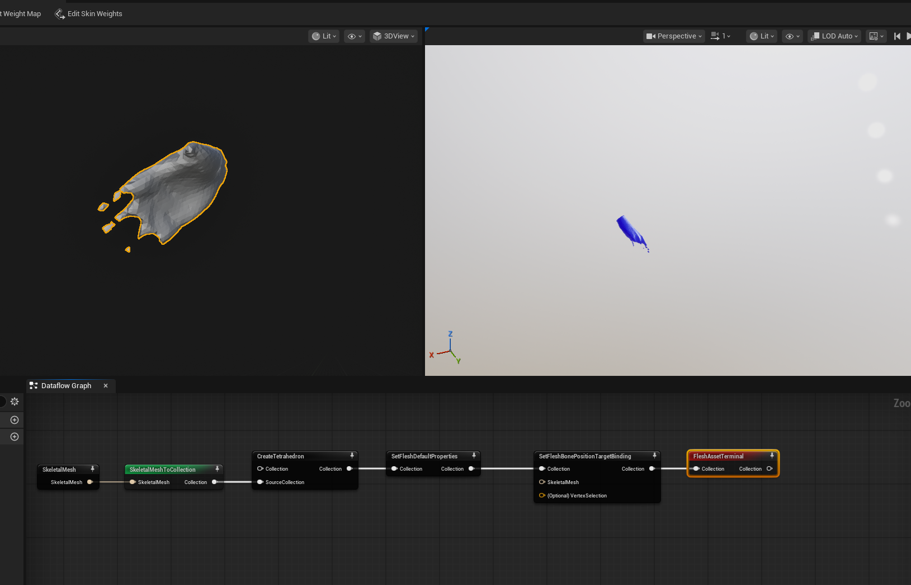

틈이 있는 메시에도 안정적인 **TetWild**로 전환하였습니다.

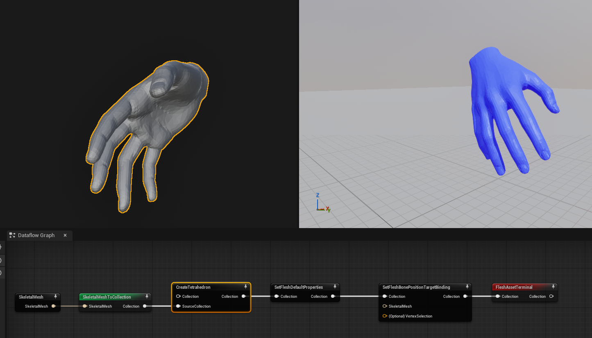

**메시가 바뀐 뒤 재확인:** 이수민이 베이스 메시(`SKM_MH_Hand_R`)를 수정한 뒤(UV 심 용접) 그래프를 다시 계산했습니다. 사면체 정점 5,688개, 사면체 22,467개, 질량 분포가 이전과 모두 같았고 뼈 에러는 0건이었습니다.

### 5.4.5 뼈 바인딩

`SetFleshBonePositionTargetBinding`은 사면체 정점을 가까운 뼈에 스프링으로 묶습니다. **Position Target** 모드는 완전히 고정하지 않고 목표 위치로 당깁니다.

처음에는 손가락 끝이 아래로 처지고 뭉개졌습니다. 손끝은 마지막 뼈(`_03`)보다 바깥에 있어, 탐색 반경이 0이면 손끝 정점이 바인딩 범위 밖에 남는 것으로 판단하고 Search Radius를 1.0으로 올렸습니다.


단, 이 조정은 뼈 정보가 빠진 상태(5.4.6)에서 한 것이므로 뼈 정보 복원 후 다시 검증해야 합니다.

### 5.4.6 애니메이션 추종

Flesh 에셋 에디터의 Preview Scene에서 굴곡 애니메이션(`A_MH_Hand_Cycle`, 4초 굴곡 사이클)을 재생하였습니다.

| 위치 | 항목 | 값 |
|---|---|---|
| Asset Details → Animation | Skeletal Mesh | `SKM_MH_Hand_R` |
| Asset Details → Animation | Skeleton | `metahuman_base_skel` |
| Preview Scene | Animation Asset | `A_MH_Hand_Cycle` |

처음에는 스켈레탈 메시만 주먹을 쥐고 Flesh는 기본 자세에 멈춰 있었습니다.


에디터 로그에 손의 뼈 22개 전부에 대해 같은 에러가 있었습니다.

```
ChaosFleshSetFleshBonePositionTargetBindingNodeLog: Error: Collection does not contain bone[hand_r].
ChaosFleshSetFleshBonePositionTargetBindingNodeLog: Error: Collection does not contain bone[index_01_r].
...
```

바인딩 노드는 컬렉션 안에서 **뼈 이름**으로 뼈를 찾습니다. 런타임에도 동일하게 동작합니다.

```cpp
// ChaosDeformableTetrahedralComponent.cpp (UE 5.6, 발췌)
TSet<int32> Roots = TransformSource.GetTransformSource(
    Skeleton->GetName(), Skeleton->GetGuid().ToString(), SkeletalMesh->GetName());
if (!Roots.IsEmpty() && ...)
{
    const TArray<FTransform>& ComponentTransforms = SkeletalMeshComponent->GetComponentSpaceTransforms();
    AnimationTransforms[Adx] = ComponentTransforms[Cdx];   // 찾으면 애니메이션 뼈 사용
}
// 못 찾으면 AnimationTransforms는 기준 자세 그대로 → 경고 없이 멈춰 있는다
```

**스켈레톤 이름 + GUID + 메시 이름**으로 조회합니다. 5.4.2에서 5.3과 같은 메시를 써야 한다고 한 이유가 이것입니다. 그래프 통합 과정에서 `CreateTetrahedron`의 `Collection` 포트에 뼈 정보가 누락된 것이 원인이었습니다. `Import Transform Only` 갈래를 `Collection` 포트에 올바르게 연결하여 에러가 해소되고 Flesh가 애니메이션을 따라가는 것을 확인하였습니다.

**손끝 지연.** 다만 손끝 기준으로 Flesh가 스켈레탈 메시보다 약간 늦게 따라옵니다. 값을 바꿔 가며 원인을 찾아봤습니다.

| 조정 | 결과 |
|---|---|
| 솔버 반복 5→15, 서브스텝 2→4 | 오히려 지연이 커져 기본값으로 되돌림 |
| `Vertex Stiffness` 1억 ↔ 100만 | 차이 없음 |
| `Position Target Stiffness` 1만 → 5만 | 개선 없음, 1만 유지 |
| `Skeletal Binding Mode` Position Target → Kinematic | 뚜렷한 차이를 확인하지 못함 |

재질·솔버 값에 반응하지 않아, 처음에는 **자세를 읽는 타이밍** 문제를 의심했습니다. 엔진 코드에서 Flesh 컴포넌트가 스켈레탈 메시 뒤에 실행되도록 순서를 지정하는 부분은 소유 액터가 `ASkeletalMeshActor`일 때만 동작하는데(`ChaosDeformableTetrahedralComponent.cpp`, `BeginPlay`), 프리뷰에 쓰이는 `BP_FleshPreview`의 부모 클래스는 일반 `Actor`입니다.

이어서 레벨(`L_FleshTest`, 기존 재생 레벨의 복사본)에서 같은 현상이 나오는지, 타이밍과 바인딩 영역을 바꿔 가며 확인했습니다. 지연은 레벨에서도 같았습니다.

| 조정 | 결과 |
|---|---|
| `Do Threaded Advance` 끄기 | 아주 조금 줄어듦 |
| `Execution Model` PrePhysics / DuringPhysics | 차이 없음 / 더 느려짐 |
| `Time Step Size` 0.05 → 0.0167 | 차이 없음 |
| 중력 끄기 | 차이 없음 |
| 손가락을 바인딩에서 제외 (`VertexSelection`) | 차이 없음 |

바인딩 제외는 선택이 적용됨을 확인한 뒤의 결과입니다(전부 0이면 손이 바로 떨어짐). 손가락 안의 사면체가 단단해서 손바닥을 따라 같이 끌려가는 것으로 보입니다. 또 애니메이션을 멈추고 기다려도 Flesh와 스켈레탈 메시가 겹치지 않았고 Flesh가 더 두껍게 나와 있었습니다. 시간 지연이라면 멈춘 뒤 수렴해야 하므로, 눈에 띄는 어긋남의 상당 부분은 **지연이 아니라 부피 유지에 따른 형태 차이**로 보입니다. 위치를 숫자로 비교한 것은 아니어서 확정하지 못했습니다.

### 5.4.7 한계 및 향후 계획

- **바인딩 파라미터**: `Position Target Stiffness`는 1만과 5만을 비교해 1만을 유지했습니다. `Search Radius`는 뼈 정보를 복원한 뒤 0과 1.0을 다시 비교하지 못했습니다.
- **부위별 바인딩 효과 미확인**: `PaintWeightMap`으로 손바닥·손등은 묶고 손가락은 풀어 `VertexSelection`에 연결했고 적용되는 것은 확인했습니다. 다만 손가락 움직임이 거의 같아, `Vertex Stiffness`를 낮추는 시험이 남았습니다.
- **레벨 배치 조건**: Flesh 컴포넌트는 같은 액터의 스켈레탈 메시 컴포넌트에서만 뼈를 읽고, 메시 이름이 Flesh 에셋과 같아야 하며(`SKM_MH_Hand_R`), 솔버 액터가 필요합니다.
- **물성**: `Vertex Damping`을 0.1로 올렸습니다. `Vertex Inflation`은 0.5 그대로이며 얇은 손가락을 부풀릴 가능성이 있어, 추가 테스트 후 조정 여부를 결정할 예정입니다.
- **손끝 지연**: 5.4.6에서 본 어긋남은 타이밍·중력·바인딩 영역을 바꿔도 같았고 정지 상태에서도 남았습니다. 시간 지연보다 형태 차이일 가능성이 높지만 숫자로 확인하지 못했습니다. 프레임별 Flesh 위치를 추출해 뼈 메시와 비교해 분리할 예정입니다.
- **LBS 대비 비교 미완료**: 같은 프레임에서 관절부 형상을 나란히 비교할 예정입니다.
- **5.3 파이프라인 연동**: Flesh가 계산한 표면 위치를 5.3의 입력으로 넘기는 어댑터를 만들 예정입니다.
- **IK 연동 준비**: IK 결과는 프레임별 관절 각도 CSV로 받는 형식을 제안했고, 검증기와 `AnimSequence` 임포터를 만들었습니다. 샘플 CSV로 계산한 회전값이 기존 `A_MH_Hand_Cycle` 스크립트와 모든 프레임·뼈에서 일치함을 확인했습니다(최대 오차 0.00005도). 엔진 안에서의 임포트 테스트와 한승현의 실제 각도 데이터는 아직 남아 있습니다.
- **시뮬레이션 전용 메시**: TetWild는 생성이 느립니다. 틈을 메운 전용 메시를 따로 만들면 IsoStuffing으로 되돌릴 수 있습니다.

> **3차 정정 (11/19).** 위 한계 중 **손끝 어긋남**은 "지연보다 형태 차이일 가능성이 높다"고 추정하였으나, 정량 측정 결과 **둘이 섞여 있었습니다** (5.4.9절). **LBS 대비 비교**, **5.3 파이프라인 연동**, **IK 연동**은 완료되었습니다. 이하 5.4.8~5.4.11은 2차·3차 기간에 더해진 내용입니다.

### 5.4.8 Flesh → GPU 스키닝 어댑터 (2학기 신규)

Chaos Flesh의 살 변형 결과를 5.3의 스키닝 파이프라인에 섞는 어댑터를 구현하였습니다.

| 구성 | 역할 |
|---|---|
| `UPianoHandFleshInputComponent` | 게임 스레드. Flesh 읽기 → 렌더 스레드 게시 |
| `PianoHandFlesh::AddFleshBlendPass` | 렌더 스레드. `Position = lerp(Skinned, Flesh, Blend)` |
| `PianoHandFleshBlend.usf` | 블렌드 컴퓨트 셰이더 |

**매 프레임 흐름:** 애니메이션 → 뼈 자세 → Flesh 솔버가 사면체 5,688 정점 시뮬레이션 → 바인딩으로 렌더 정점 **74,186개** 위치 계산 → 렌더 스레드 게시 → 스키닝 직후 블렌드.

정점 수·순서 일치를 첫 프레임 로그로 검증하였고(휴지 자세 편차 평균 **0.27 cm**), 렌더 패스가 매 프레임 실행됨을 확인하였습니다. `GenerateSurfaceBindings`가 렌더 메시 LOD0 정점마다 바인딩을 만들어 순서가 같으므로 별도 매핑이 필요 없습니다. 섞는 것은 **위치만**이며 노멀·탄젠트는 섞지 않습니다. Flesh 데이터가 없으면 아무 일도 하지 않으므로 디포머는 Flesh가 없는 레벨에서도 그대로 동작합니다.

### 5.4.9 손끝 어긋남 정량 측정 — 지연과 형태 차이의 분리

2차까지 손끝 어긋남의 원인을 가르지 못했습니다. 손끝 정점을 잡아 Flesh와 스켈레탈 메시(LBS)의 거리를 프레임마다 기록하여 분리하였습니다.

| 상태 | 거리 | 성격 |
|---|---|---|
| 정지에 가까울 때 | 0.2 ~ 0.7 cm | **형태 차이** — Flesh가 부피를 유지해 더 두꺼움 |
| 10 cm/s 이상 이동 | 1.3 ~ 4.6 cm | **시간 지연** — 약 한 프레임 분량, 이동 반대 방향으로 뒤처짐 |

**둘 다였습니다.** 2차 보고서의 "지연이 아니라 형태 차이"라는 추정은 절반만 맞았습니다. 손가락을 뼈에 묶으면 정지 시 어긋남이 30~40% 줄지만 움직일 때의 지연은 그대로였습니다.

성능 최적화(5.4.10절) 이후 재측정한 값은 다음과 같습니다.

| 상태 | 최적화 전 | 최적화 후 |
|---|---|---|
| 정지 | 0.2 ~ 0.7 cm | 0.35 ~ 0.50 cm |
| 이동 | 1.3 ~ 4.6 cm | 대부분 **0.3 ~ 0.9 cm** |
| 빠른 순간 (100 cm/s 이상, IK 급점프) | — | 최대 약 3 cm |

프레임이 빨라지면서 한 프레임 분량의 지연 자체가 줄어든 결과입니다.

### 5.4.10 성능 최적화 — 60 FPS 달성 (W10)

2차 시점 프레임은 약 20 FPS(약 70 ms)로 목표에 크게 못 미쳤고, 병목이 Flesh 시뮬레이션인지 애니메이션 평가인지 에디터 오버헤드인지 가르지 못한 상태였습니다. `stat Chaos`로 분해하였습니다.

**측정:** 게임 스레드 약 44 ms 중 **Flesh 솔버가 41.8 ms**로 거의 전부였습니다.

| 항목 | 전 | 후 | 방법 |
|---|---|---|---|
| Flesh 솔버 | 41.8 ms | **12.0 ms** | 서브스텝 2 → **1**, 솔버 반복 5 → **2** |
| 어댑터 Flesh 읽기 | 6.8 ms | **0.2 ms** | 엔진 함수의 정점별 문자열 생성이 원인 → 직접 계산으로 교체 (엔진 결과와 차이 **0**) |
| **프레임 전체** | 약 70 ms | **약 16.6 ms (60 FPS)** | |

앞서 바인딩 평가기 재사용과 병렬 계산으로 46 ms → 약 7 ms로 줄인 데 이어, 남은 문자열 생성 비용까지 제거한 결과입니다. PIE 첫 프레임 접근 위반도 수정하였습니다.

**목표는 달성하였으나 여유가 0.1~0.7 ms뿐입니다.** PIE에서는 흔들릴 수 있고, 다른 프로그램이 켜져 있으면 프레임이 두 배가 되므로 측정은 다른 프로그램을 끄고 수행합니다. 솔버 반복 1회 시험과 사면체 수 축소로 여유를 확보할 예정입니다.

### 5.4.11 합치기 인계 문서 (W11)

03_Skinning이 결합 방식을 바꾸는 작업을 할 수 있도록 인계 문서(`Docs/Kyungmin/Flesh_Handoff_to_Sumin.md`)를 작성하였습니다. 9개 절로 구성됩니다.

| 절 | 내용 |
|---|---|
| 1~3 | 한 줄 요약, 담당 파일 목록, 상대 코드와 맞닿는 지점(2줄) |
| 4~5 | 매 프레임 데이터 흐름, 컴포넌트 속성 8개 |
| 6 | **정점별 가중치가 필요할 때의 방법 2가지** (제안) |
| 7~8 | 씬 구성 4액터, 재생 후 확인용 로그 |
| 9 | 알려진 상태와 한계 |

6절에서 "지금 API는 전역 Blend 하나뿐이므로 접힘 안쪽만 받으려면 정점별 가중치가 필요하다"는 점을 미리 짚고 두 가지 방법(마스크 인자 추가 / SRV 꺼내기)을 제안하였습니다. 03_Skinning은 제3의 방법인 **위치 버퍼 사본**을 택하여 어댑터 시그니처를 바꾸지 않고 결합하였습니다 (5.3.11절).

---

# 6. 주요 기술적 도전 및 해결

## 6.1 왼손 운지법 역전 문제 (01_Fingering)

**현상:** 왼손의 엄지(1번)가 가장 낮은 피치를, 새끼(5번)가 가장 높은 피치를 누르는 X자 꼬임 발생

**원인:** "낮은 피치 = 낮은 번호 손가락"이라는 오른손 중심 논리를 양손에 동일하게 적용. 왼손은 오른손의 거울상이므로 매핑 반전 필요.

**해결:** 왼손 연산 시 손가락 번호 조합 역순 배정 `(1,2,3)` → `(5,4,3)`, 교차 판정 로직 방향별 재구축.

## 6.2 IK 특이점 문제 (02_IK)

**현상:** 특정 자세에서 IK 계산값이 발산하여 불안정한 모션 생성

**원인:** 표준 Jacobian 역행렬 계산 시 특이점(Singularity) 근방에서 역행렬이 수치적으로 불안정합니다.

**해결:** $JJ^T + \lambda^2 I$ 형태의 **DLS** 역행렬을 적용하였습니다 ($\lambda = 0.05$). 또한 각도 변화량에 최대 스텝 제한을 두어 과도한 발산을 방지하였습니다. (이후 관절별 제한에서 9-DOF 전체 스텝 제한으로 변경 → 6.7절 참고)

## 6.3 GPU 셰이더 노멀 갱신 누락 (03_Skinning)

**현상:** 정점은 움직여도 주름이 화면에 전혀 보이지 않음

**원인:** 초기 구현에서 ⑤⑥ 노멀 재계산 패스 누락. 정점 위치가 변해도 노멀이 그대로면 라이팅 계산에 반영되지 않음.

**해결:** NormalAccumulateCS + NormalResolveCS 2개 패스 추가

## 6.4 손등·손바닥 주름 방향 반전 문제 (03_Skinning)

**현상:** 편 손에서 매끈하고 주먹에서만 주름이 보이는 비정상 동작. 실제 피부는 반대.

**원인:** 주름 게이트가 "눌리면 깊어진다" 단일 로직이었음. 손등과 손바닥의 구분 없이 같은 gate 적용.

**해결:** 베이크 단계에서 손등/손바닥 판별값(`dorsality`) 마스크를 구워 셰이더 게이트를 양면 분리. `corr(dorsality, strain) = +0.68` 검증.

## 6.5 IsoStuffing 손가락 볼륨 생성 실패 (04_Flesh)

**현상:** MetaHuman 손 모델 적용 후 손가락 볼륨이 완전히 빔

**원인:** IsoStuffing의 안팎 판정이 표면 틈이 있는 메시에서 실패

**해결:** 비유사 메시에 안정적인 **TetWild** 방식으로 전환하여 5개 손가락 전체 볼륨 생성 확인

## 6.6 Chaos Flesh 애니메이션 추종 불가 (04_Flesh)

**현상:** 스켈레탈 메시만 움직이고 Flesh는 기본 자세에 멈춤

**원인:** 그래프 통합 과정에서 `CreateTetrahedron`의 `Collection` 포트에 뼈 정보가 누락됨. 바인딩 노드가 컬렉션 내 뼈 이름으로 탐색하는 구조.

**해결:** `Import Transform Only` 갈래를 `Collection` 포트에 올바르게 연결하여 뼈 계층 복원. 에러 해소 및 애니메이션 추종 확인.

## 6.7 IK 국소해 고착 문제 (02_IK)

**현상:** 양손 10개 손가락으로 확장한 뒤, 일부 손가락이 관절 한계각에 걸린 채 목표에 도달하지 못하였고, 이후 타임스텝에서도 이 상태에서 빠져나오지 못하였습니다.

**원인:** 반복별 디버그 출력으로 세 가지 원인을 확인하였습니다.

1. `std::clamp`만으로 관절 한계를 처리하여, 이미 한계에 닿은 관절에도 계속 움직임이 배정되고 클램프로 잘리는 무의미한 스텝이 반복되었습니다.
2. 최대 스텝 제한(0.1 rad)을 관절마다 따로 적용하여, 길이 1.0인 Joint0과 0.25인 Joint2가 매 반복 같은 각도만큼만 움직였습니다. 짧은 관절이 필요 이상으로 빨리 한계각에 닿았습니다.
3. 이전 타임스텝의 관절 각도에서 IK를 시작(웜스타트)하여, 한 번 빠진 나쁜 상태가 계속 이어졌습니다.

**해결:**

1. 관절 한계에 가까울수록 해당 관절의 참여를 줄이는 **Weighted DLS**를 적용하였습니다(5.2.3절). 하드 클램프는 마지막 안전장치로만 남겼습니다.
2. 9개 자유도 전체를 하나의 벡터로 보고 **전체 스텝 길이만** 제한하여, 관절 간 분배 비율을 유지하였습니다.
3. 각 타임스텝마다 관절 각도를 **0°로 초기화**한 뒤 새로 풀도록 하였습니다.

## 6.8 검은 건반 도달 실패 (02_IK)

**현상:** 일반 손가락이 검은 건반을 정확히 누르지 못하였고, 한 손가락만 건반을 누를 때도 옆으로 크게 뻗는 부자연스러운 자세가 나왔습니다.

**원인:** 검은 건반은 흰 건반 사이, 더 안쪽에 더 높게 있어 손가락이 옆과 앞으로 더 뻗어야 합니다. 그런데 MCP 외전 한계가 ±20°로 좁았습니다. 또한 손목을 누르는 건반들의 **평균 위치**에 두어, 각 손가락이 자기 `rootOffset`(최대 0.8)만큼 옆으로 더 뻗어야 했습니다.

**해결:**

1. MCP 외전 범위를 ±20°에서 **±35°**로 넓혔습니다(5.2.2절).
2. 손목을 **누르는 손가락의 뿌리가 건반 바로 위에 오는 위치**에 두도록 바꾸었습니다(5.2.6절).
3. 검은 건반을 누를 때는 손목이 앞쪽으로 차이의 30%만 이동하고 살짝 들리도록 하여, 나머지 거리는 손가락이 뻗어서 처리하게 하였습니다.

## 6.9 하드 제약과 선호도의 가산 결합 (01_Fingering)

**현상:** 절대 위반해서는 안 되는 제약이 선호도 항과 같은 스칼라에 더해지고 있어, 다른 항이 낮아지면 위반이 선택될 수 있는 구조였습니다. 2차 중간발표에서 지적받았습니다.

**원인:** DP가 하드 제약을 후보에서 배제하지 않고 큰 수(5,000 / 4,000 / 1,500)를 더하는 방식으로 다루었습니다. `is_chord_playable()` 주석에 "DP는 +5000 패널티를 물고 물리적으로 불가능한 운지를 출력한다"고 이 실패 양상이 이미 적혀 있었으나, 이 함수는 화음 분리 전처리에서만 쓰이고 DP 내부에서는 쓰이지 않았습니다.

**대응:** 고치기 전에 먼저 측정하였습니다(5.1.8절). 연주 가능함이 보장된 입력에서는 **교환 현상이 재현되지 않았고**, 압박용 네 곡을 더해도 마찬가지였습니다. 전면 재설계의 근거가 없어 보류하고, 함께 관측된 빔 가지치기 문제만 고쳤습니다(6.10절). 결합 방식 비교는 재현 입력 확보 후로 미루었습니다.

## 6.10 빔 가지치기에서 깨끗한 상태 소실 (01_Fingering)

**현상:** `ref_04`에서 화음의 53.3%에 빔이 포화되며, 제약 위반이 없는 상태 **455개**를 버리고 위반 있는 상태 1,247개를 남기고 있었습니다.

**원인:** 상태 폭발을 막는 빔 가지치기(화음당 상위 120개)가 **비용 스칼라 하나로만** 정렬하고 있었습니다. 위반이 없는 상태가 선호도 때문에 순위에서 밀리면 잘려 나가고 복구되지 않습니다.

**해결:** 정렬 기준을 `(위반 여부, 비용)`으로 바꾸었습니다. 불가능은 양이 아니므로 두 번 어긴 상태를 한 번 어긴 상태의 두 배로 다루지 않습니다. 버려지는 깨끗한 상태가 **455 → 0**이 되었고, 21곡 재처리 결과 출력이 내용상 완전히 동일하며 회귀 테스트 5종을 통과하였습니다.

> 첫 시도는 판정 범위를 현재 화음 안으로만 좁게 잡아 오히려 결과가 나빠졌습니다(위반 2,384 → 2,389, 음표 −1). 좁은 기준으로 "깨끗하다"고 남긴 상태 중에 실제로는 점유 중인 음과 손 범위를 어기는 것이 섞여 있어, 그것들이 진짜 깨끗한 상태를 밀어낸 것이었습니다. 판정 범위를 사후 측정과 같게 맞추어 해결하였습니다.

## 6.11 DP 점유 모델과 출력 점유 모델의 불일치 (01_Fingering)

**현상:** `ref_12`(페달 지속음 + 선율)에서 제약 위반 281건이 나왔습니다. 교환도 빔 포화(0%)도 `HELD_DEPTH_LIMIT`도 원인이 아니었습니다.

**원인:** DP는 점유를 **`required_hold_ms`**(페달을 고려한 최소 의무 시간)로 평가하는데, 출력은 **실제 손가락 점유 시간**을 씁니다. 페달 구간에서 `required_hold_ms`가 30 ms까지 내려가 겹침이 보이지 않는 반면, 출력에서는 850~1,050 ms 동안 눌려 있습니다. 운지가 정해져야 `key_hold_ms`를 알 수 있는 순환 구조 때문에 DP 단계에서는 최소 의무로 평가할 수밖에 없습니다.

**해결:** 사후 해소가 점유 단축 111건으로 **음을 버리거나 소리를 자르지 않고** 전부 처리함을 확인하고, 회귀 테스트의 판정 기준을 DP 직후가 아닌 **최종 출력**으로 정정하였습니다. 기존 판정이 과하게 엄격했던 것입니다.

## 6.12 Metal의 `StructuredBuffer<float3>` 간격 문제 (03_Skinning · 04_Flesh)

**현상:** Play에서 Flesh를 섞으면 손이 **원점으로 뻗는 긴 줄기로 터졌습니다.** 처음에는 "Flesh 표면 바인딩 결함"으로 진단하여 2차 이후 보고에 그렇게 기재하였습니다.

**원인:** 바인딩은 정상이었습니다(어댑터 자체 검증에서 엔진 계산과 차이 0). 실제 원인은 **Metal(macOS)이 `StructuredBuffer<float3>` 원소를 16바이트 간격으로 읽는 것**이었습니다. 어댑터는 정점당 12바이트로 올리고 있어 모든 위치가 어긋나고 뒤쪽 1/4은 0을 읽었습니다. Windows(D3D)는 12바이트로 읽으므로 **04_Flesh 담당자 PC에서는 보이지 않던 문제**였습니다.

**해결:** 위치를 정점당 **float 3개(`StructuredBuffer<float>`)** 로 올리고 읽도록 `PianoHandFleshInput.cpp`와 `PianoHandFleshBlend.usf` 두 곳을 수정하였습니다. 두 플랫폼에서 동일하게 동작하며 결과 값은 같습니다.

> **교훈.** 자체 검증이 통과하는데도 화면이 깨지는 것을 보고 찾은 문제입니다. "검증이 통과했으니 이 단계는 아니다"라는 추론이 플랫폼별 메모리 레이아웃 차이 앞에서 깨졌습니다. 앞선 보고의 "표면 바인딩 결함" 진단은 오진이었으며 본 보고서에서 정정합니다.

## 6.13 Flesh 솔버 비용의 정체 (04_Flesh)

**현상:** 통합 프레임이 약 20 FPS(70 ms)로 목표 60 FPS에 크게 못 미쳤고, 게임 스레드 약 44 ms의 원인을 Flesh 시뮬레이션·애니메이션 평가·에디터 오버헤드 중 어느 것인지 가르지 못했습니다.

**원인:** `stat Chaos`로 분해한 결과 **44 ms 중 41.8 ms가 Flesh 솔버**였습니다. 추가로 어댑터의 Flesh 위치 읽기 6.8 ms는 엔진 함수가 **정점마다 문자열을 생성**하는 데서 나왔습니다.

**해결:** 솔버 서브스텝 2→1, 반복 5→2로 12.0 ms. 위치 읽기를 직접 계산으로 교체해 0.2 ms(엔진 결과와 차이 0). 프레임 약 70 ms → **약 16.6 ms(60 FPS)**. 여유가 0.1~0.7 ms뿐이라 추가 확보가 필요합니다.

## 6.14 디포머가 레벨에 저장되지 않던 문제 (03_Skinning)

**현상:** 최종 레벨 `L_PianoHandFinal`을 만든 세션에서는 커스텀 스키닝이 보였으나, 에디터를 다시 켜면 손이 **엔진 기본 스키닝으로** 재생되었습니다.

**원인:** `ApplyCustomSkinning`이 디포머를 `RF_Transient`로 만들어 레벨에 저장되지 않았습니다.

**해결:** `RF_Transactional`로 바꾸고 레벨을 다시 저장하였습니다. 에디터 재시작 후 `get_custom_skin_deformer`와 Play 로그로 확인하였습니다.

---

# 7. 결과물 분석

> **3차 갱신 (11/19).** 7.1~7.5는 1차 시점(12곡) 집계입니다. 2학기 작업 이후의 지표는 7.8절에, Flesh–스키닝 결합과 통합 성능은 7.9~7.10절에 추가하였습니다.

## 7.1 운지법 처리 결과 (12개 MIDI)

| 곡명 | 음표 수 | 곡 길이 | 왼손/오른손 | 흑건 비율 |
|------|---------|---------|------------|---------|
| 드뷔시 Clair de Lune | 1,466 | 6.5분 | 763 / 703 | 73.9% |
| Super Mario 64 Medley | 5,435 | 15.7분 | 996 / 4,439 | 17.8% |
| Queen Bohemian Rhapsody | — | — | — | — |
| Driftveil City BW | — | — | — | — |
| Wii Sports Theme | — | — | — | — |
| 외 7곡 | — | — | — | — |

## 7.2 손가락 사용 분포

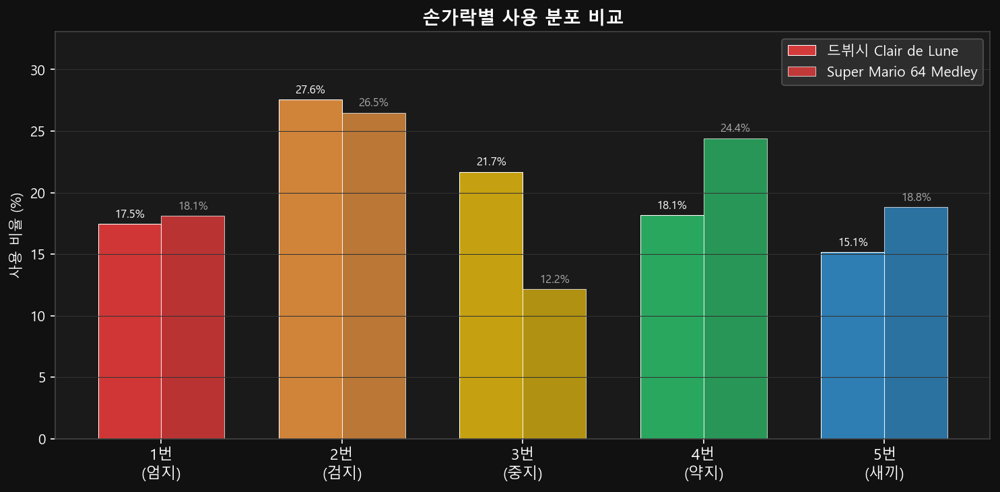

- 드뷔시: 흑건 비율 73.9%로 모든 손가락이 고르게 사용됨
- 마리오: 주선율이 오른손 집중 → 2번(26.5%), 4번(24.4%) 높음
- 약지(4번) 기피 패턴이 DP 비용(+6)으로 적절히 억제됨

## 7.3 피아노 롤 시각화

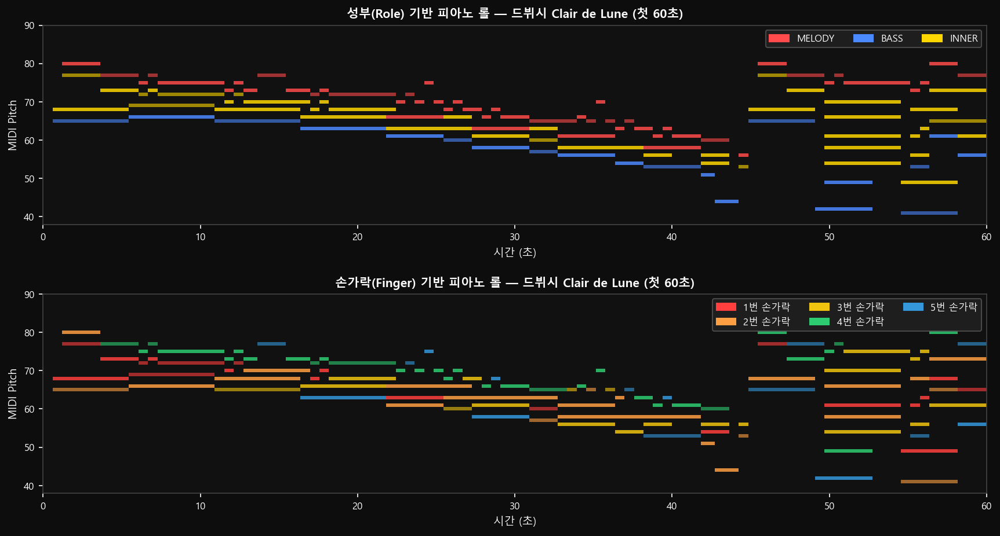

위: 성부(MELODY/BASS/INNER) 기반 채색 / 아래: 손가락 번호 기반 채색

## 7.4 손목 Yaw 각도 분포

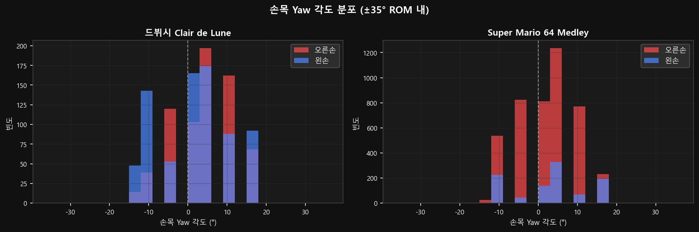

손목 Yaw 각도가 ±35° ROM 내에서 정규 분포. 드뷔시의 분포가 더 넓은 것은 흑건 음형이 손목 회전을 더 많이 요구하기 때문입니다.

## 7.5 성부 역할 분포

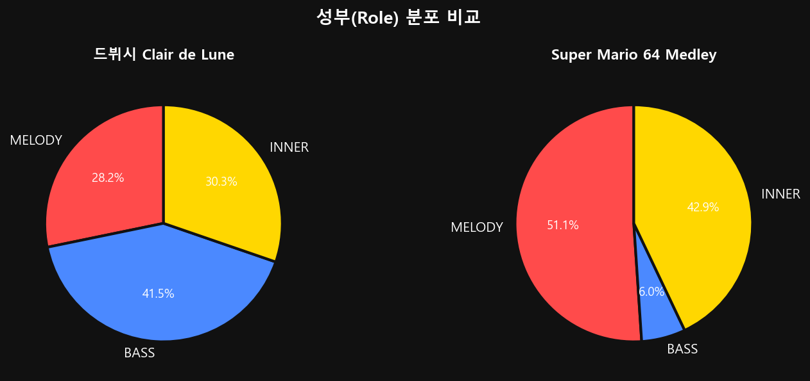

## 7.6 GPU 스키닝 결과

- 편 손 상태에서 마디마다 가로 주름이 관찰됨 (손등 기본 주름)
- 주먹 시 손바닥 주름 깊어짐, 손등은 팽팽해지며 주름 사라짐
- 막 편 직후 약 0.9초간 이력 주름이 남아있다 서서히 소멸

## 7.7 Chaos Flesh 결과

- 주먹 쥐는 4초 굴곡 사이클 애니메이션에서 Flesh가 정상 추종 확인
- 사면체 5개 손가락 전체 채움 (TetWild, 방법 전환 후)
- 손끝 기준으로 Flesh가 스켈레탈 메시보다 약간 늦게 따라옴 (원인 미확정, 5.4.6 참조)

> **3차 정정.** 원인이 확정되었습니다. 정지 시 형태 차이와 이동 시 한 프레임 지연이 **둘 다** 있었습니다 (5.4.9절).

## 7.8 운지법 정량 지표 (2학기)

| 지표 | 값 | 비고 |
|---|---|---|
| 처리 곡 수 | 실곡 13곡 + 기준 코퍼스 12곡 | |
| 물리 제약 위반 (최종 출력) | **0건** | 순간 단위 재설계 후 |
| 음표 보존율 | **85.2%** | 잔여 손실은 밴드 편곡 곡에 집중 |
| 화음 분리 단계 음표 유실 | 2,525 → **1,394개** | 성부 중요도 순 배정 적용 |
| 위반 시점 중 연주 불가 구간 비율 | **81.6%** | 입력 자체가 두 손으로 불가능 |
| 빔 가지치기에서 버려진 깨끗한 상태 | 455 → **0개** | `ref_04` 기준 |
| 엄지 흑건 음 / 그중 롤이 0인 음 | 1,758 / 251 | 엄지·소지 동시 흑건 시 상쇄 |

## 7.9 Flesh – GPU 스키닝 결합 결과 (3차 신규)

마디(접힘 안쪽)에서 휴지 두께를 뺀 Flesh 표면까지의 거리, `A_IK_DebClai` 측정 (cm):

| 단계 | 거리 | 스키닝 대비 |
|---|---|---|
| 스키닝(DQS)만 | 0.501 | 기준 |
| 최종 (마디 Flesh 결합, 강도 0.75) | **0.415** | **−17%** |

- Flesh 전체 블렌드는 주먹에서 손 전체가 구겨집니다(접힘 안쪽 지글거림이 그대로 표면에 나옴).
- 접힘부 결합은 강도 1.0에서 일부 찢어지고, 0.75 / 0.4 cm / 평활 24회에서 깨끗합니다.
- **효과는 아직 미묘합니다.** Flesh가 접힘부에서 주는 정보의 질이 낮아(자기충돌이 없어 지글거림) 더 올리면 깨집니다.

## 7.10 통합 성능 (3차 신규)

| 항목 | 2차 시점 | 3차 시점 |
|---|---|---|
| 프레임 | 약 70 ms (약 20 FPS) | **약 16.0~16.6 ms (60~62 FPS)** |
| 게임 스레드 Flesh 솔버 | 41.8 ms | 12.0 ms |
| 어댑터 Flesh 읽기 | 46 ms → 6.8 ms | **0.2 ms** |
| GPU 스키닝 전체 | 미측정 | 3.7~4.6 ms (패스별 분해는 미측정) |
| 목표(16.7 ms) 대비 여유 | 미달 | **0.1~0.7 ms** |

측정은 에디터 PIE, 다른 프로그램을 끈 상태 기준입니다.

---

# 8. 2차 중간발표 지도교수 피드백 및 대응

10월 30일 2차 중간발표에서 받은 피드백입니다. 발표 녹취를 전사하여 발언을 그대로 옮기고, 각 항목에 대한 대응을 함께 적었습니다.

## 8.1 코스트 함수의 결합 방식 — 가산의 한계

발표 중 두 차례, 마무리에서 한 차례 더 언급된 가장 비중 있는 지적입니다.

> "여기는 덧셈을 하려고 했잖아요. 덧셈을 하면 사실 **문제가 절대 안 되는 것은 없어지거든요.** 안 되는 건데 덧셈을 하니까 그런 거에도 불구하고 전체 코스트는 낮아져서 그런 부분이 문제가 되지 않을까."

> "저 코스트를 **max를 잡아서 하는 방법**도 있고 **곱을 통해서 하는 방법**도 있고 여러 가지 방법이 있거든. 그것에 따라서 좀 **비교를 해보는 게 필요**하니까."

> "물론 터지는 거 아예 안 생기게는 힘들어. 그거는 이제 **제약을 가해서 터지는 경우에 대한 제약을 가해서, 그 다음 코스트로 선택하게 하는** 방법을 써야 하는데, 그 전에 하면은 많이 줄일 수 있는."

**대응.** 코드 확인 결과 지적한 구조가 그대로 있었습니다(6.9절). 고치기 전에 계측 도구 2종으로 먼저 측정하였고, 결과가 둘로 갈렸습니다.

- 교환 현상(위반이 선호도와 맞바꿔짐)은 **연주 가능함이 보장된 입력에서 재현되지 않았습니다.** 압박용 네 곡을 추가해 재측정해도 마찬가지였습니다.
- 빔 가지치기에서 깨끗한 상태가 사라지는 현상은 **관측되었고, 수정하였습니다**(455 → 0).

전면 재설계(후보 배제 · 전이 배제 · 사전식 비교)는 근거가 될 입력이 없어 보류하였습니다. 교수님이 말씀하신 **"제약을 먼저 걸러 내고 남은 후보에 코스트를 적용"** 하는 방식과 결합 방식 비교(가산 / max / 곱)는, 문제가 실제로 드러나는 입력을 확보한 뒤 수행할 계획입니다. 측정 설계와 결과는 `01_Design/13_Cost_Function_Design.md`에 정리하였습니다.

## 8.2 IK 결과와 모델 간의 괴리

> "IK가 저 손 모양에서 **더 많이 굽어지는 걸로 나오나 봐요.** 그냥 스틱에서도 괜찮은데. **파라미터하고 위치나 길이 같은 것도 다시 한번 좀 봐야 돼요.**"

> "손가락이 너무 두껍거나 그런 거 아니에요? … 손가락이 짧고 굵으면 움직이기 힘들어. **손 모양에 따라서도 애니메이션이 굉장히 달라지기 때문에.**"

**대응.** 이 지적은 발표 전 측정값과 일치합니다. 손가락 마디 길이를 MetaHuman 실측값으로 바꾼 뒤 소지 오차가 35%에서 57%로 증가하였고, 프레임 0에서 중간 마디가 84~97° 굽은 채 시작하는 현상이 확인되어 있습니다(5.2.12절). W10에 모듈 간 손 모델 불일치를 검토하여 **UE5 MetaHuman 손 모델 기준으로 통일**하기로 정하였습니다(5.2.14절). 기본 굽힘이 각도에 포함된 것인지는 아직 확인이 필요합니다.

## 8.3 Chaos Flesh 지연

> "**지연 따라온다는 게 무슨 얘기인지 알겠다.**"

**대응.** 육안 확인이 측정값과 일치합니다. 정량 측정으로 정지 시 형태 차이와 이동 시 한 프레임 지연을 분리하였고(5.4.9절), 성능 최적화로 프레임을 약 70 ms에서 약 16.6 ms로 줄여 **이동 시 어긋남이 4.6 cm에서 대부분 0.3~0.9 cm로** 감소하였습니다(5.4.10절).

## 8.4 긍정 평가와 경진대회 제안

> "상당히 좀 괜찮다. **텍스처만 조금만 입히면** 진짜 잘 나오는데. 텍스처 해상도 올리고 주름만 조금 더 그려 주면."

> "하여튼 결과 잘 나왔는데 **어디 경진대회 한번 내 볼 수 없을까.**"
> — (팀) "일단 결과물이 아직 이쁘게 안 나와서 조금 더…"
> — "**나올 거라고 난 믿고.**" → (팀) "**그래요, 준비해 보겠습니다.**"

**대응.** 텍스처 해상도와 주름 품질은 03_Skinning의 진행 중 과제입니다(Phase 9~13c). 경진대회 출품은 발표 자리에서 준비하겠다고 답하였으나, **아직 구체적인 대회를 정하거나 담당을 나누지 않았습니다.** 최종 발표 일정과 함께 정할 사항입니다.

## 8.5 발표 전 자체 정정 4건

각 파트의 측정값을 문서에 반영하면서 발표 자료의 수치 서술을 검증한 결과, 추정으로 적어 두었던 네 건이 실제와 달라 발표 전에 바로잡았습니다.

| # | 잘못 적었던 것 | 실제 |
|---|---|---|
| ① | IK 수렴 허용 오차 0.01을 **cm**로 이해 | IK 내부 단위(약 **0.05 cm**). 수렴 실패 풀이의 남은 오차 중앙값은 1.4 cm |
| ② | 손목 회전 유실은 "**롤을 반영하면** 해결된다" | 롤 단독으로는 효과 없음. **요를 함께** 넣어야 1.54 → 1.10 cm |
| ③ | Flesh 손끝 어긋남은 "**지연이 아니라 형태 차이**" | **둘 다**. 정지 0.2~0.7 cm(형태), 이동 1.3~4.6 cm(약 한 프레임 지연) |
| ④ | 설계서의 "**2차 베지어 곡선**으로 손목 궤적 생성" | 실제 코드는 **지수 감쇠 보간** |

> 이 네 건은 모두 **측정값을 받아 문서에 넣는 과정에서** 드러났습니다. 추정으로 적어 둔 문장이 검증 없이 발표 자료까지 올라가 있었던 것으로, 이후 "먼저 측정하고 그 다음에 쓴다"는 절차를 파트 공통으로 적용하고 있습니다.

## 8.6 발표 시점의 미구현 사항 (발표 중 공지)

> "아직 저희가 피아노나 **손목 이동 구현이 좀 덜 돼서**, 일단 손가락 움직이는 것만 보여 드리겠습니다."

발표 영상에서는 손가락 움직임만 시연하였습니다. 손목 이동은 운지법이 목표값을 내고 IK가 궤적을 만드는 경계를 확정한 뒤(5.1.9절) IK 반영을 기다리는 단계입니다.

---

# 9. 현재 상태 및 향후 계획

## 9.1 완료 항목

- [x] V5 Polyphonic DP 운지법 엔진
- [x] Pygame 실시간 시뮬레이터
- [x] shared_constants.py 공유 상수 분리 (W04)
- [x] IK 인터페이스 파라미터 전항목 확정 (W03)
- [x] 12곡 MIDI 운지법 일괄 계산
- [x] UE5 DataTable CSV 출력 파이프라인
- [x] 6-Pass GPU 스키닝 컴퓨트 셰이더 (DeformCS~NormalResolveCS)
- [x] 텐션 맵 계산 (atomic int 고정소수점 누적)
- [x] 이력 주름 효과 (RelaxState 프레임 간 버퍼 유지)
- [x] 손등/손바닥 이중 주름 게이트
- [x] MetaHuman 손 모델 추출 및 UV 재패킹
- [x] Chaos Flesh Dataflow 그래프 (TetWild, 통합 단일)
- [x] Chaos Flesh 애니메이션 추종 확인

**2차·3차 기간 추가 (W05 ~ W11)**

- [x] 물리 제약의 순간 단위 재설계 (0~4단계) — 실곡 13곡 위반 0건
- [x] 엄지 넘기기(thumb-under) 지원
- [x] 연주 가능함이 보장된 기준 코퍼스 12곡 구축
- [x] 코스트 함수 구조 계측 도구 2종, 빔 가지치기 정렬 수정 (깨끗한 상태 소실 455 → 0)
- [x] 건반 좌표 공유 모듈(`piano_keyboard.py`) — 좌표 산출 경로 단일화
- [x] 손목 출력 `WristXMm` 추가, 회전 부호 규약 확정, IK 인계 요청서 전달
- [x] IK 관절 각도 CSV 내보내기 (내부 60 Hz / 기록 30 FPS)
- [x] IK 품질 정량 측정 (손끝 오차·수렴율·관절 제한·프레임 간 점프)
- [x] IK → `AnimSequence` 임포터, 실제 곡 7,447프레임 검증
- [x] GPU 스키닝 Phase 4~12 — 피부 v3, 손 비율, 그래프 주름, Implicit Skinning, UV 심 용접
- [x] Flesh → GPU 스키닝 어댑터 (렌더 정점 74,186개, 스키닝 직후 블렌드)
- [x] 손끝 어긋남 정량 분리 (형태 차이 / 시간 지연)
- [x] **통합 프레임 60 FPS 달성** (약 70 ms → 약 16.6 ms)
- [x] Flesh 접힘부 결합 (Phase 13 / 13c) — 마디 거리 −17%
- [x] 최종 레벨 `L_PianoHandFinal` (최종 손만 렌더)
- [x] Flesh ↔ 스키닝 합치기 인계 문서

## 9.2 진행 중

- [x] 04_Flesh: 재생 레벨 복사본(`L_FleshTest`)에서 Flesh 구동 확인
- [x] 03+04: Flesh → GPU 스키닝 어댑터 연결 (3차에서 완료)
- [x] 02_IK: UE5 Animation 시스템 연동 (CSV → `AnimSequence` 경로 완료)
- [ ] **02_IK: 손목 회전(`WristYawDeg`·`WristRollDeg`) 반영** — 요청서 전달 11/08, 3주째 대기
- [ ] 02_IK: 손가락 마디 길이·기본 굽힘 파라미터 재검토
- [ ] 02_IK: 프레임 간 각도 점프 해소 (매 프레임 0° 초기화 구조 재검토)
- [ ] 03_Skinning: 패스별 GPU 시간 측정 — 2차 제출 문서 공란 상태
- [ ] 03_Skinning: 피부 정적 디테일 맵 확보 후 UV 전사
- [ ] 04_Flesh: 접힘 안쪽 안정화 (자기충돌 또는 Damping) → 결합 강도 상향
- [ ] 04_Flesh: 60 FPS 여유 확보 (반복 1회, 사면체 수 축소)
- [ ] 01_Fingering: 피아노 트랙 자동 선별 (음표 손실의 주원인)
- [ ] 01_Fingering: 손 크기 프리셋

## 9.3 다음 마일스톤

| 우선순위 | 모듈 | 항목 | 비고 |
|---|---|---|---|
| 1 | 02_IK | **손목 회전 반영 및 전후 비교 측정** | 요청서 전달 완료, 대기 중 |
| 2 | 02_IK · 전체 | UE5 MetaHuman 기준으로 손 모델 통일 | 8.2절 지적 |
| 3 | 03_Skinning | 패스별 GPU 시간 측정 | 제출 문서 공란 해소 |
| 4 | 04_Flesh | 접힘 안쪽 안정화 → 결합 강도 상향, 60 FPS 여유 확보 | 7.9 · 7.10절 |
| 5 | 전체 | **엔드-투-엔드 데모** — 최종 레벨에 운지법 실데이터 연결 | `L_PianoHandFinal` |
| 6 | 01_Fingering | 코스트 결합 방식 비교 (가산 / max / 곱) | 재현 입력 확보 후 |
| 7 | 전체 | 최종 발표 일정 확정, 경진대회 출품 검토 | 8.4절 |

## 9.4 알려진 한계

| 모듈 | 한계 | 3차 시점 상태 |
|---|---|---|
| 01_Fingering | 복잡한 대위법·현대 곡 대응력 추가 향상 여지 | 유지 |
| 01_Fingering | **피아노 트랙 자동 선별 미구현** — 음표 손실 약 15%가 밴드 편곡 곡에 집중 | 미착수 |
| 01_Fingering | 코스트 결합 방식 비교 — 교환 현상이 재현되는 입력을 아직 확보하지 못함 | 보류 |
| 01_Fingering | 손 크기 프리셋 미구현 | 미착수 |
| 02_IK | **40회 내 수렴 실패 60.7%**, 실패 시 남은 오차 중앙값 1.4 cm | 미해결 |
| 02_IK | 인접 프레임 각도 점프 최대 39.1°(달빛 123.5°) — 매 프레임 0° 초기화 구조에서 기인 | 미해결 |
| 02_IK | 손목 회전값이 정의되어 있으나 **소비되지 않음** | 요청서 전달, 대기 |
| 03_Skinning | 손바닥 접힘선 | Phase 4 손바닥 선 채널로 처리 |
| 03_Skinning | 손목 절단면 노멀 거침 | Phase 12 UV 심 용접으로 해소 |
| 03_Skinning | 이력 주름 감쇠 약 0.9s — 정지 화면 확인 불가 | 시퀀서 렌더 미실시 |
| 03_Skinning | **패스별 GPU 시간 미측정** — 전체 3.7~4.6 ms만 확인 | 미측정 |
| 03_Skinning | Flesh 결합 효과가 아직 미묘함. 손끝 덩어리감은 Flesh가 아니라 implicit 투영·SSS·IK 과굽힘에서 기인 | 7.9절 |
| 04_Flesh | 손끝 어긋남 — 정지 시 형태 차이와 이동 시 한 프레임 지연이 **둘 다** 존재 | 원인 확정, 이동 시 0.3~0.9 cm로 감소 |
| 04_Flesh | 주먹 쥘 때 안쪽 살 지글거림 (자기충돌 없음), Damping·Inflation 미튜닝 | 미해결 |
| 04_Flesh | **60 FPS 여유가 0.1~0.7 ms뿐** — PIE에서 흔들릴 수 있음 | 추가 확보 필요 |
| 전체 | 엔드-투-엔드(운지법 → IK → Flesh → 스키닝) 통합 시연 미완료 | 최종 발표 목표 |

---

# 10. 결론

본 보고서는 피아노 연주 시뮬레이션 시스템의 2학기 **W01 ~ W11** 진행 현황을 정리한 것입니다. 1차(9/29)는 W01~W04, 2차(10/29)는 모듈별 구현 상세를 다루었고, 3차인 본 보고서는 **2차 중간발표 피드백에 대한 대응과 모듈 간 통합**을 중심으로 정리하였습니다.

**01_Fingering** 모듈은 물리 제약의 검사 기준을 화음 단위에서 **시간상의 한 순간**으로 재설계하여 실곡 13곡 기준 위반 0건을 달성하였습니다. 발표에서 지적받은 코스트 함수의 가산 결합 문제는 **고치기 전에 먼저 측정**하였고, 교환 현상은 연주 가능함이 보장된 입력에서 재현되지 않은 반면 빔 가지치기에서 깨끗한 상태가 사라지는 문제는 실재하여 수정하였습니다(455 → 0). 손목 출력의 단위와 부호 규약을 확정하고 IK와의 역할 경계를 정리하여 인계하였습니다.

**02_IK** 모듈은 관절 각도 CSV 내보내기 경로를 구현하여 다른 파트가 실제로 소비할 수 있게 하였고, 계측 빌드로 **품질을 수치화**하였습니다. 그 결과 40회 내 수렴 실패 60.7%, 프레임 간 각도 점프 최대 39.1° 등 그동안 눈으로만 보던 문제가 숫자로 드러났습니다. 손목 회전 반영과 마디 파라미터 재검토가 남은 과제입니다.

**03_Skinning (GPU)** 모듈은 Phase 4~13c에 걸쳐 Implicit Skinning(Vaillant 2013/2014) 도입, UV 심 용접, 그래프 기반 주름 격자를 구현하였고, 3차 기간에는 **Chaos Flesh를 접힘부의 저주파 변형으로만 받는 결합**을 완성하여 마디 기준 거리를 17% 줄였습니다.

**03_Skinning (Flesh)** 모듈은 Flesh 표면을 스키닝 파이프라인에 섞는 어댑터를 구현하고, 손끝 어긋남을 형태 차이와 시간 지연으로 **정량 분리**하였습니다. 솔버 비용을 분해하여 병목을 찾아낸 결과 **통합 프레임이 약 70 ms에서 약 16.6 ms(60 FPS)로** 개선되어 목표를 달성하였습니다.

**이번 기간에 얻은 것은 기능보다 측정 체계입니다.** 발표 전 자체 검증에서 추정으로 적어 둔 네 건이 실제와 달랐던 것(8.5절), "표면 바인딩 결함"이라는 진단이 실제로는 플랫폼별 버퍼 간격 문제였던 것(6.12절), 그리고 코스트 함수 지적을 측정으로 확인한 뒤에야 무엇을 고쳐야 하는지 알 수 있었던 것(5.1.8절)이 공통적으로 같은 교훈을 남겼습니다. **추측으로 고치지 않고 먼저 측정한다**는 절차를 파트 공통으로 적용하고 있습니다.

2학기 최종 발표까지 손목 회전 IK 반영, 손 모델 통일, 패스별 성능 측정을 마치고, **MIDI 입력부터 최종 렌더링까지의 엔드-투-엔드 데모**를 완성하는 것을 목표로 합니다.

---

*졸업프로젝트[3201] 2팀 | 정근녕, 한승현, 이수민, 곽경민*

*본 보고서는 2026년 11월 19일 기준으로 작성되었습니다 (3차). 1차 9/29 · 2차 10/29 본문은 그대로 보존하고 그 위에 보완하였습니다.*
