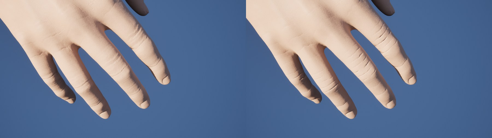
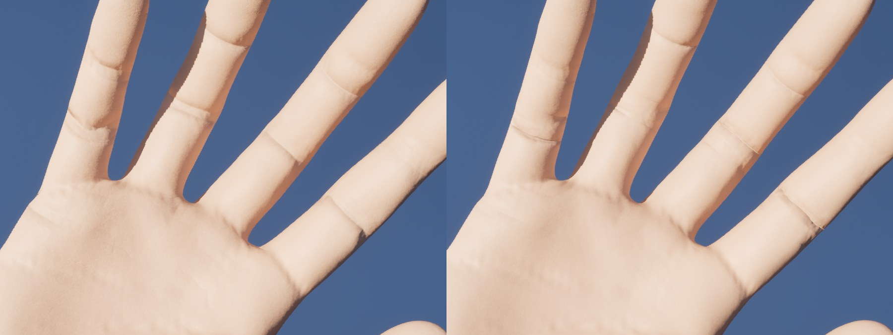
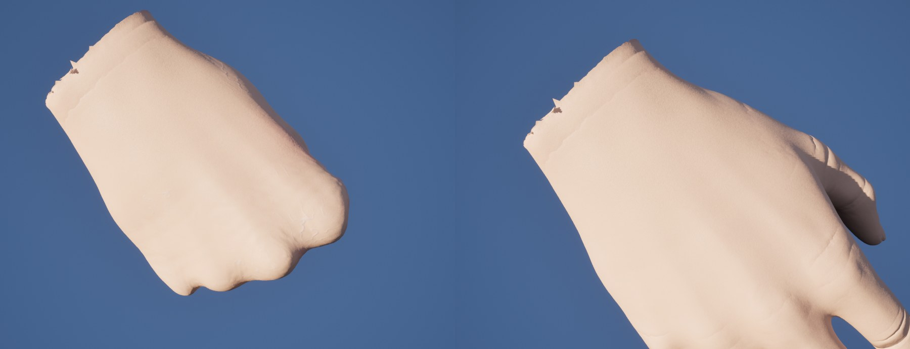

# 커스텀 스키닝 셰이더 파이프라인 (UE 5.6)

`06_Project/pianohand_simulator` 안에서 스켈레탈 메시의 스키닝을 엔진 기본 GPU Skin Cache 대신
**직접 작성한 컴퓨트 셰이더**로 처리하기 위한 기반 코드와 로드맵.

관련 설계 문서: `01_Design/06_Skinning_Detailed_Design.md` (텐션맵 · 핏줄맵 · 노멀맵 디테일 모듈)

---

## 1. 현재 구성 (Phase 0 — 파이프라인 골격)

| 파일 | 역할 |
|---|---|
| `pianohand_simulator.uproject` | 모듈 `LoadingPhase = PostConfigInit` (글로벌 셰이더 등록에 필수), 플러그인 ComputeFramework / DeformerGraph / ChaosFlesh 활성화 |
| `Source/pianohand_simulator/pianohand_simulator.Build.cs` | `RenderCore`, `RHI`, `Renderer`, `Projects` 의존성 추가 |
| `Source/pianohand_simulator/pianohand_simulator.{h,cpp}` | 모듈 시작 시 가상 셰이더 경로 `/PianoHand` → `<Project>/Shaders` 매핑 등록, `LogPianoHand` 로그 카테고리 |
| `Shaders/Public/SkinningCommon.ush` | HLSL 공용 타입 `FBoneTransform`(3행 아핀 행렬), 듀얼 쿼터니언 유틸 |
| `Shaders/Private/CustomSkinning.usf` | 스키닝 커널 `MainCS`. `SKIN_MODE 0` = LBS, `SKIN_MODE 1` = DQS. 정점당 본 4개 |
| `Source/.../Skinning/CustomSkinningShader.{h,cpp}` | `FCustomSkinningCS` 글로벌 컴퓨트 셰이더, `CustomSkinning::AddSkinningPass()` RDG 패스 추가 헬퍼 |
| `Source/.../Skinning/CustomSkinningSmokeTest.cpp` | 콘솔 커맨드 `PianoHand.SkinningSmokeTest` : 2본 테스트 메시로 LBS/DQS 디스패치 → GPU 리드백 → CPU 레퍼런스 비교 |

### 데이터 레이아웃 (C++ ↔ HLSL)

```
RestPositions   StructuredBuffer<float3>          FVector3f          (rest/bind 공간)
RestNormals     StructuredBuffer<float3>          FVector3f
BoneIndices     StructuredBuffer<uint4>           FIntVector4        정점당 4개
BoneWeights     StructuredBuffer<float4>          FVector4f          합 = 1
BoneTransforms  StructuredBuffer<FBoneTransform>  FSkinBoneTransform 48 bytes, RefPoseInverse * CurrentPose
OutPositions    RWStructuredBuffer<float3>
OutNormals      RWStructuredBuffer<float3>
```

`FSkinBoneTransform::FromMatrix(FMatrix44f)` 가 UE의 행벡터 행렬(`v' = v * M`)을 HLSL의 `p' = M * [p,1]` 행 형식으로 전치해 준다.

### 검증 방법

1. 에디터 실행 후 `~` 콘솔에서 `PianoHand.SkinningSmokeTest` 입력
2. Output Log 에서 `LogPianoHand` 필터:
   - `[SkinningSmokeTest] LBS: PASS (12 vertices)`
   - `[SkinningSmokeTest] DQS: PASS (12 vertices)`
   - `[SkinningSmokeTest] RESULT: PASS`
3. 헤드리스 실행 (에디터를 닫은 뒤): `Scripts\RunSkinningSmokeTest.bat`
   → 에디터 타깃 빌드 후 아래 명령을 실행하고 로그를 요약한다.
   ```
   UnrealEditor-Cmd.exe <uproject> -ExecCmds="PianoHand.SkinningSmokeTest" -SkinningTestAutoQuit -unattended -nosplash -log
   ```
   종료 코드 0 = PASS, 1 = FAIL.
4. HLSL 문법만 빠르게 확인하려면 Windows SDK `fxc.exe /T cs_5_0 /E MainCS /D SKIN_MODE=0|1` 로 컴파일해 볼 수 있다
   (`/Engine/Public/Platform.ush` include 를 제거하고 `#define UNROLL [unroll]` 추가).

> 참고: standalone 게임 exe(`Binaries/Win64/pianohand_simulator.exe`)로는 이 테스트를 돌릴 수 없다.
> 쿠킹된 글로벌 셰이더 라이브러리를 요구해 `FShaderCodeLibrary::InitForRuntime` 에서 종료된다. 반드시 에디터(-Cmd)로 실행한다.

셰이더(.usf/.ush)를 수정했을 때는 에디터 콘솔에서 `RecompileShaders Changed` 로 재컴파일할 수 있다.

---

## 1-B. Phase 1 구현 (2026-09-13) — MeshDeformer 연결

| 파일 | 역할 |
|---|---|
| `Shaders/Private/CustomSkinningDeformer.usf` | 커널 `DeformCS`. 섹션 단위 디스패치. 엔진 LOD 버퍼(rest position, packed tangent, skin weight stream)를 직접 읽고 패스스루 정점 팩토리의 position/tangent 버퍼에 기록. `SKIN_MODE`, `GPUSKIN_BONE_INDEX_UINT16`, `GPUSKIN_BONE_WEIGHTS_UINT16` 퍼뮤테이션 |
| `Source/.../Skinning/PianoHandSkinDeformer.{h,cpp}` | `UPianoHandSkinDeformer`(UMeshDeformer) / `UPianoHandSkinDeformerInstance` / `UPianoHandSkinningLibrary`(BP·Python 헬퍼) |
| `Scripts/skin_deformer_demo.py` | Emil 메시 2개(커스텀 vs 엔진) 나란히 스폰해 A/B 비교하는 데모 |
| `Scripts/BuildEditor.bat` | 에디터 종료 후 풀 빌드 |

동작 흐름
1. `UPianoHandSkinningLibrary::ApplyCustomSkinning(Component, Mode)` → `NewObject<UPianoHandSkinDeformer>` + `SetMeshDeformer()`.
2. 엔진이 매 프레임 `UMeshDeformerInstance::EnqueueWork()` 호출 → 게임 스레드에서 `RefBasesInvMatrix[i] * ComponentSpaceTransforms[i]` 로 본 행렬(`FSkinBoneTransform`)을 계산.
3. 렌더 스레드: `FSkeletalMeshDeformerHelpers::AllocateVertexFactory{Position,Tangent}Buffer` 로 출력 버퍼 확보 → 섹션마다 BoneMap 순서의 본 버퍼 업로드 + `DeformCS` 디스패치 → `UpdateVertexFactoryBufferOverrides` 로 패스스루 정점 팩토리에 바인딩.
4. 실패(CPU 스키닝, unlimited bone influence 등) 시 엔진 fallback delegate 호출 → 기본 스키닝으로 복귀.

검증
- 빌드 후 에디터에서 `skin_deformer_demo.py` 실행 → Output Log `LogPianoHand: [SkinDeformer] ... LOD0 verts=... influences=... index16=... mode=LBS` 라인 확인.
- `unreal.PianoHandSkinningLibrary.get_custom_skinning_frame_count(comp)` 가 프레임마다 증가하면 디스패치 중.
- 두 액터의 포즈가 일치하면 커스텀 커널이 엔진 스키닝과 동일한 결과. DQS 모드는 관절 부위 부피 보존 차이로 미세하게 다름(의도된 차이).

### Phase 1 검증 결과 (2026-09-13 02:50~03:00, 에디터 5.6.1)

| 항목 | 결과 |
|---|---|
| 빌드 | `Scripts\BuildEditor.bat` → 에러 0, 경고 0. 유일한 수정: `PianoHandSkinDeformer.cpp` 의 `#include "pianohand_simulator.h"` → `"../pianohand_simulator.h"` (Skinning/ 하위 폴더에서는 모듈 루트가 include 경로에 없음. `CustomSkinningSmokeTest.cpp` 와 동일 방식) |
| 셰이더 | `FPianoHandSkinDeformerCS` 8개 퍼뮤테이션(SKIN_MODE×INDEX16×WEIGHT16) 전부 컴파일 성공 |
| 레이아웃 로그 | `[SkinDeformer] SKM_skin_coarse: LOD0 verts=33739 sections=1 influences=8 stride=16 index16=0 weight16=0 bones=87 mode=LBS` |
| 디스패치 | `get_custom_skinning_frame_count` 가 매 프레임 증가 (에디터 포그라운드일 때 ~1500 frames/1분) |
| 정확도 | 같은 포즈·같은 카메라 1280x720 HighResShot 픽셀 비교 — 메시 영역 엔진 vs 커스텀 LBS 평균 차이 1.4 (배경 TAA 노이즈 1.1 수준, 32 이상 차이 픽셀 0개) → **엔진 스킨캐시와 동일**. DQS 는 관절부 93픽셀만 32 이상 차이 (의도된 부피 보존 차이) |
| 로그 | 디포머/RDG/RHI 관련 경고·에러 0건 |

스크린샷: `Saved/Screenshots/WindowsEditor/PH_engine_LBS.png`, `PH_custom_LBS.png`, `PH_custom_DQS.png`

검증 시 주의
- `skin_deformer_demo.py` 는 UE 5.6 API 에 맞게 `set_animation()` / `set_update_animation_in_editor()` 를 쓴다 (`anim_to_play`, `update_animation_in_editor` 프로퍼티는 Python 에서 직접 설정 불가).
- 에디터 창이 **최소화되어 있으면 렌더/틱이 멈춰** 프레임 카운트가 1에서 증가하지 않는다. 창을 복원하면 바로 증가한다.
- 두 액터를 150cm 떨어뜨려 놓고 한 카메라로 보면 원근 차이 때문에 포즈가 달라 보인다. 정확한 A/B 는 같은 위치에 두고 visibility 를 토글해 HighResShot 을 찍어 비교한다.

알려진 제약
- Unlimited bone influence 웨이트 레이아웃은 미지원(엔진 스키닝으로 fallback).
- 모프 타겟·클로스 입력은 아직 커널에 합성하지 않음.
- 디스패치를 ComputeFramework 실행 그룹이 아니라 `ENQUEUE_RENDER_COMMAND` 로 바로 실행하므로, 본 행렬은 엔진 본 버퍼가 아니라 자체 업로드 값을 쓴다(타이밍 의존 없음).

---

## 1-C. Phase 2 구현 (2026-09-20) — 정점 텐션(엣지 신장률) → Vertex Color

| 파일 | 역할 |
|---|---|
| `Shaders/Private/CustomSkinningTension.usf` | `AccumulateCS`(삼각형당 1스레드: 3개 엣지의 `|skinned|/|rest| - 1` 을 고정소수점(×65536) `InterlockedAdd` 로 양 끝 정점에 누적 + 기여 횟수) / `ResolveCS`(정점당 평균 → 컬러 버퍼) |
| `PianoHandSkinDeformer.{h,cpp}` | `bComputeTension`, `TensionScale` 프로퍼티(매 프레임 재읽기 → Details/Python 에서 즉시 반영), `AllocateVertexFactoryColorBuffer` 로 컬러 스트림 오버라이드, `GetOutputBuffers()` 에 `SkinnedMeshVertexColor` 추가, `GetCustomSkinDeformer()` 헬퍼 |
| `Scripts/create_tension_material.py` | `/Game/PianoHand/M_PianoHandTension` 생성 (BaseColor = lerp(lerp(회색, 빨강, R), 파랑, G)) |
| `Scripts/skin_deformer_demo.py` | `SHOW_TENSION`, `TENSION_SCALE` 옵션 — 커스텀 액터에 텐션 머티리얼 적용 |

Vertex Color 레이아웃 (머티리얼 VertexColor 노드로 읽음)

| 채널 | 값 |
|---|---|
| R | `saturate( strain * TensionScale)` — 신장 (0..1) |
| G | `saturate(-strain * TensionScale)` — 압축 (0..1) |
| B | `0.5 + 0.5 * clamp(strain * TensionScale, -1, 1)` — 부호 포함 (0.5 = rest) |
| A | 1 |

`strain = |p_i - p_j| / |r_i - r_j| - 1` (정점에 닿는 모든 엣지 평균). CPU 인접 정보 없이 LOD 인덱스 버퍼 SRV 만 사용하므로 임의 스켈레탈 메시에 바로 적용된다. 컬러 버퍼는 엔진 패스스루 정점 팩토리의 컬러 스트림을 그대로 오버라이드하므로 메시 자체에 정점 컬러가 없어도 된다.

검증 (SKM_skin_coarse, TensionScale=8)
- 정지 포즈(t=0): 거의 회색(신장/압축 없음). 관절 굽힘 포즈(t=12, 20): 어깨·목·겨드랑이·팔꿈치에 빨강/파랑 분포 — `Saved/Screenshots/WindowsEditor/PH_tension_scale8_t{0,12b,20}.png`
- 전 셰이더(`FPianoHandTensionAccumulateCS`, `FPianoHandTensionResolveCS`) 컴파일 성공, 디포머/RDG 경고·에러 0.
- `TensionScale` 을 Python 에서 `deformer.set_editor_property('tension_scale', 8.0)` 으로 바꾸면 다음 프레임부터 반영.

알려진 제약 / 다음
- 부드러운 결과를 원하면 정점 이웃 평활 패스(라플라시안 1~2회) 추가 가능 — 현재는 1-ring 엣지 평균만.
- 텐션은 삼각형 단위 등방 근사(엣지 길이)라 방향성(주 신장 방향)은 없다. 주름 방향이 필요하면 삼각형 변형 그래디언트의 주축을 추가 스트림(UV)으로 내보내야 한다.
- 머티리얼에서 B(부호 포함)로 `disp_w`(주름, 압축 시), `disp_v`(핏줄, 신장 시)를 구동하는 것이 Phase 3.

## 1-D. 손 메시 적용 (2026-09-20)

Emil `SKM_skin_coarse` 는 손목에서 잘린 상반신 스킨이라 손가락이 없다. 손가락이 있는 메시가 필요해
UE 5.6 VR 템플릿의 손 메시를 프로젝트로 복사했다.

| 항목 | 값 |
|---|---|
| 원본 | `C:\Program Files\Epic Games\UE_5.6\Templates\TP_VirtualRealityBP\Content\Characters\MannequinsXR` (39MB) |
| 복사 위치 | `Content/Characters/MannequinsXR` (패키지 경로가 `/Game/Characters/MannequinsXR/...` 로 그대로 맞음) |
| 메시 | `SKM_MannyXR_right` — 손 단독 메시, 47본(손가락 5개 × 3마디 + metacarpal) |
| 포즈 | `A_MannequinsXR_{Idle,IndexCurl,Point,ThumbUp,Grasp}_Right` — 1프레임짜리 포즈 시퀀스 |
| 데모 | `Scripts/hand_tension_demo.py` (`set_pose` / `set_scale` / `look_at_hand` / `compare_with_engine`) |

검증 결과
- **텐션**: Idle 포즈는 전면 회색(텐션 ≈ 0), Grasp(주먹)에서 너클 바깥쪽이 빨강(신장) · 관절 주름이 파랑(압축) — 피부 물리와 일치. `Saved/Screenshots/WindowsEditor/HAND_final_{idle,grasp}.png`
- **스키닝 정확도**: 같은 포즈를 프레임 0에 고정하고 메시 원본 머티리얼 + 텐션 OFF 로 A/B — 손 영역 픽셀 차이 평균 1.18, 32 초과 8픽셀. 같은 이미지의 배경(TAA 노이즈)이 평균 4.97 / 4144픽셀이므로 **렌더러 자체 노이즈보다 작은 차이 = 일치**. `HANDAB_{custom,engine}.png`

주의 (실수하기 쉬운 지점)
- 1~2프레임짜리 포즈 시퀀스를 `play(True)` 로 두면 루프하며 프레임이 흔들려 A/B 비교가 어긋난다. 반드시 `play(False)` + `set_position(0)` 으로 고정할 것.
- 파이썬 `unreal.Rotator(a, b, c)` 는 **(roll, pitch, yaw)** 순서다. `Rotator(pitch, 0, 0)` 은 roll 을 설정한다 — 키워드 인자를 쓸 것.

## 1-E. 크래시 수정 — LOD 스트리밍 가드 (2026-09-20)

새 손 메시를 임포트한 직후 포즈/가시성/머티리얼을 연달아 바꾸자 에디터가 죽었다.

```
Assertion failed: (Index >= 0) & (Index < ArrayNum)  Array index out of bounds: 0 into an array of size 0
  PianoHandSkinDeformer::Execute_RenderThread()   <- FSkeletalMeshDeformerHelpers::AllocateVertexFactoryPositionBuffer
```

원인: `AllocateVertexFactoryPositionBuffer` 내부의 `GetBaseSkinVertexFactory(LodIndex, Section)` 이
`LODs[LodIndex].GPUSkinVertexFactories.VertexFactories[0]` 을 인덱싱하는데, **LOD 스트리밍이 끝나지 않은
LOD 는 이 배열이 비어 있다.** 방금 39MB 를 임포트해 스트리밍이 한창일 때 그 LOD 로 디스패치해서 터졌다.
엔진 Optimus 는 ComputeFramework 실행 그룹에서 돌아 이 구간을 피하지만, 우리는 `ENQUEUE_RENDER_COMMAND`
로 직접 디스패치하므로 직접 막아야 한다.

`Execute_RenderThread` 앞에 가드 추가:
- `IsGPUSkinMesh()` (헬퍼가 `FSkeletalMeshObjectGPUSkin` 으로 static_cast 하므로 Nanite/CPU 스킨 제외)
- `HaveValidDynamicData()` (렌더 스테이트 재생성 중이면 스킵)
- `RenderData.IsInitialized()` + `LODRenderData.IsValidIndex(LodIndex)`
- **`LodIndex >= max(CurrentFirstLODIdx, GetPendingFirstLODIdx(0))`** ← 실제 원인을 막는 가드
- `Lod.GetNumVertices() > 0 && RenderSections.Num() > 0`

가드에 걸리면 `false` 를 반환해 엔진 fallback(기본 스키닝)으로 1프레임 넘어간다. 수정 후 포즈·가시성·
머티리얼을 반복 토글하는 동일 시퀀스에서 크래시 재현되지 않음.

빌드 참고: 에디터가 크래시로 죽으면 `UnrealEditor.exe` / `LiveCodingConsole.exe` 좀비가 남아
DLL 잠금(LNK1104)과 "Unable to build while Live Coding is active" 를 일으킨다. 이 좀비는 **포트 30010 도
잡고 있어 새로 띄운 에디터의 Remote Control 이 MCP 에서 안 보인다.** `Scripts/BuildEditorClean.bat` 이
빌드 전에 이 프로세스들을 정리하고 결과를 `Scripts/build_report.txt` 로 남긴다.

## 1-F. Phase 3 구현 (2026-09-20) — 부피 보존 + 관절 주름 (셰이더 전용)

목표: **손가락을 쫙 편 상태에서도 마디마다 보이는 주름**을, 텐션맵·주름맵 같은 저작 리소스 없이
셰이더만으로 만든다. 설계서의 `disp_w`(주름) 항을, 절차적 사인파 대신 **부피 보존 + 관절 밴드**로 구성.

| 파일 | 역할 |
|---|---|
| `Shaders/Private/CustomSkinningDetail.usf` | `DisplaceCS`(정점당, 노멀 방향 변위) / `NormalAccumulateCS`(삼각형당 face normal atomic 누적) / `NormalResolveCS`(정점당 정규화 + 탄젠트 재직교화) |
| `PianoHandSkinDeformer.{h,cpp}` | `bDetailDisplacement`, `bRecomputeNormals`, `VolumeBulge`, `CreaseDepth`, `CreaseSharpness`, `CreaseCompressionGain`, `WrinkleAmplitude`, `WrinkleFrequency` — 전부 매 프레임 재읽기 |
| `Scripts/create_clay_material.py` | `/Game/PianoHand/M_PianoHandClay` — 무광 점토 머티리얼(기하 형상만 보려고) |

패스 순서: `DeformCS`(스키닝) → `TensionAccumulate` → `TensionResolve`(컬러 + **raw strain 버퍼**)
→ `DisplaceCS` → `NormalAccumulate` → `NormalResolve` → `UpdateVertexFactoryBufferOverrides`

### 변위 세 항

**① 부피 보존 (`d_volume`)**
`lambda = 1 + strain` 이 국소 면내 신축률. 비압축성 물질은 면내로 눌리면 법선 방향으로 부풀어야 하고,
등방 신축 lambda 에 대해 두께 배율은 `1/lambda^2`. 그래서
`d_volume = VolumeBulge * clamp(1/lambda^2 - 1, -2, 2)` — 압축(lambda<1)이면 바깥으로, 신장이면 안으로.
LBS 가 관절에서 부피를 잃고 납작해지는 것을 되밀어준다.

**② 관절 주름 (`d_crease`) ← "편 상태에서도 보이는 마디 주름"**
핵심 아이디어: **관절 위의 정점은 정의상 두 본 사이를 블렌딩하는 정점이다.** 가장 큰 두 영향 가중치를
`w0 >= w1` 이라 하면 `4*w0*w1` 은 강체 부위에서 0, 관절을 따라 달리는 50/50 블렌드 선에서 정확히 1 이 된다.
즉 **스킨 웨이트만으로 관절 밴드가 공짜로 나온다** — 저작한 마스크도, UV 도, 텍스처도 필요 없고
어떤 스켈레탈 메시에도 그대로 적용된다.

```
JointBand = pow(saturate(4*w0*w1), CreaseSharpness)
d_crease  = -CreaseDepth * JointBand * (1 + CreaseCompressionGain * compression * 10)
```

`compression = max(-strain, 0)` 이므로 **strain 이 0 인 rest 포즈에서도 `-CreaseDepth * JointBand` 만큼
홈이 남는다** — 이게 편 손에서도 마디마다 보이는 주름이다. 굽히면 압축이 더해져 깊어진다.

**③ 굽힘 전용 잔주름 (`d_wrinkle`)**
관절 밴드 안에서, 본 로컬 축을 따라 사인 리플. `compression` 을 곱하므로 편 손에서는 사라진다.
본 로컬 좌표를 얻으려고 `RefBasesInvMatrix` 를 섹션 BoneMap 순서로 별도 업로드한다
(기존 본 버퍼는 `RefPoseInverse * ComponentSpace` 라 rest 좌표를 못 준다).

### 노멀 재계산이 필수
정점을 밀어도 노멀을 그대로 두면 주름이 **셰이딩에 전혀 안 나타난다**. 그래서 변위 후
인덱스 버퍼로 face normal 을 고정소수점 atomic 누적(`NORMAL_FIXED_SCALE 4096`)하고, 정점당 정규화한 뒤
기존 탄젠트를 새 노멀에 대해 Gram-Schmidt 재직교화해서 탄젠트 버퍼에 다시 쓴다. `bRecomputeNormals` 로 끌 수 있다.

### 검증 (SKM_MannyXR_right, 3239 verts, 무광 clay 머티리얼)
- **편 손(Idle)**: OFF 는 매끈, `CreaseDepth 0.06` 에서 마디 윤곽이 생기고, `0.14 / Sharpness 4` 에서 각
  손가락 마디마다 뚜렷한 주름. `Saved/Screenshots/WindowsEditor/P3_dorsal_{off,on,deep}.png`
- **굽힌 손(Grasp)**: 주름이 깊어지고, `VolumeBulge 0.35` 를 더하면 눌린 쪽이 다시 밀려나온다
  (크리즈만 vs 부피항 추가 사이 10,426 픽셀 변화). `P3_grasp_{off,crease,volume}.png`
- 포즈·가시성·`bDetailDisplacement`·`bRecomputeNormals` 를 반복 토글해도 크래시 없음, 디포머 경고/에러 0.

### 권장 기본값과 한계
`VolumeBulge 0.18` · `CreaseDepth 0.08` · `CreaseSharpness 3.5` · `CreaseCompressionGain 2.0` ·
`WrinkleAmplitude 0.04` · `WrinkleFrequency 6.0` (cm 단위, 손 크기 ~19cm 기준)

- **정점 밀도가 한계다.** 3239 정점 손에서는 마디당 굵은 주름 1~2줄이 한계고, 깊게 주면 실루엣에 계단이
  보인다. 설계서 UC5 의 Nanite 테셀레이션이 이 항 아래에 깔려야 진짜 피부 잔주름이 된다.
- 관절 밴드는 정점별 웨이트에서 바로 나오므로 저폴리 메시에서 다소 울퉁불퉁하다. 라플라시안 평활 패스를
  한 번 넣으면 부드러워진다(미구현).
- 변위는 등방 근사라 주름의 **방향성**이 없다. 방향이 필요하면 삼각형 변형 그래디언트의 주축을 추가 스트림으로.

## 1-G. Phase 3b 구현 (2026-09-20) — 테셀레이션 + 텐션 구동 핏줄/디테일 노멀

1-F 의 결론이 "정점 밀도가 한계다" 였으므로, 밀도를 먼저 올리고 그 위에 머티리얼 디테일을 얹었다.

### 왜 Nanite 테셀레이션이 아닌가

설계서 UC5 는 Nanite 테셀레이션을 전제했지만 **이 파이프라인과 호환되지 않는다.** 커스텀 스키닝은
`FSkeletalMeshDeformerHelpers` 가 잡아 주는 GPU skin **passthrough 정점 팩토리** 버퍼에 결과를 쓰는데,
Nanite 메시는 그 정점 팩토리를 거쳐 그려지지 않는다. Nanite 를 켜는 순간 커스텀 스키닝 전체가 우회된다
(5.6 기준 `r.Nanite.AllowTessellation` 도 기본 0). 따라서 밀도는 **에셋 단계에서** 올려야 한다.

### 1) 에셋 테셀레이션 — `Scripts/subdivide_hand.py`

GeometryScripting 플러그인(`.uproject` 에 추가)으로 PN 테셀레이션을 건다. PN 은 실루엣을 부드럽게
유지하면서 정점 속성(스킨 웨이트 포함)을 보간하므로 스켈레탈 메시에 그대로 쓸 수 있다.

```
copy_mesh_from_skeletal_mesh(LOD0) -> DynamicMesh
apply_pn_tessellation(level=3)     -> 삼각형 (N+1)^2 배
create_new_skeletal_mesh_asset_from_mesh(dyn, Skeleton, path, opts)
```

| | 삼각형 | 정점(렌더) |
|---|---|---|
| `SKM_MannyXR_right` | 11,462 | 3,239 |
| `SKM_MannyXR_right_Dense` | 183,392 | 93,725 |

스킨 웨이트는 그대로 따라오고(`mesh_has_bone_weights` = true), 스켈레톤과 머티리얼 슬롯도 원본을 재사용한다.

Python API 주의: 클래스는 `GeometryScript_AssetUtils` / `GeometryScript_NewAssetUtils` 이고
(`GeometryScript_SkeletalMeshes` · `GeometryScript_CreateNewAsset` 는 없다), 삼각형 수는
`GeometryScript_MeshQueries.get_num_triangle_i_ds` 다 (`get_triangle_count` 없음).
`create_new_skeletal_mesh_asset_from_mesh` 는 스켈레톤을 **옵션이 아니라 인자로** 받고
경로는 패키지+이름이 아니라 전체 경로 문자열 하나다.

### 2) 머티리얼 디테일 — `Scripts/create_skin_material.py` → `M_PianoHandSkin` / `MI_PianoHandSkin`

92k 정점에서도 주름 한 줄은 정점 몇 개 폭이다. 실제 피부 요철은 그보다 한 자릿수 미세하므로
셰이딩 노멀로 간다(설계서 UC4). 텍스처는 하나도 쓰지 않고 전부 절차적이며, 지오메트리와 **같은
스트레인 필드**(1-C 의 Vertex Color)로 구동되므로 둘이 어긋나지 않는다.

Custom HLSL 노드 하나가 높이장을 만들고 유한차분으로 탄젠트 공간 노멀을 뽑는다. 높이장은 세 층이다.

- **macro** — 저주파 굵은 굴곡 주름. 압축(G)으로 진폭이 커진다.
- **micro** — ±60° 로 교차하는 고주파 선 두 벌의 **합집합**(`max`)→ 피부 다이아몬드 미세 요철. 항상 켜짐.
- **veins** — 성긴 넓은 융기. **신장(R)** 으로 드러난다. 주름과 정반대 조건이라 서로 겹치지 않는다.

세 층 모두 `-pow(1-abs(sin(...)), k)` 형태다. 부호가 음수여야 선이 **골**이 되고(양수면 두둑),
`pow` 가 골을 가늘게 만든다.

시행착오에서 나온 세 가지 함정:

1. **순수 사인은 직물처럼 보인다.** fbm 도메인 워프를 반드시 섞어야 선이 사행·분기한다.
2. **워프는 2D 여야 한다.** fbm 을 한 번만 뽑아 `float2` 로 브로드캐스트하면 대각선으로만 밀리고
   격자가 그대로 남는다. 서로 다른 오프셋으로 **두 번** 뽑아 `float2` 를 만든다.
3. **텐션 게이팅은 한 번만.** 높이에 `Blend` 를 곱한 뒤 최종 노멀을 다시 `lerp(float3(0,0,1), N, Blend)`
   하면 이중으로 눌려서(0.3 × 0.3 ≈ 0.09) 디테일이 사라진다. 게이팅은 **높이장에서만** 한다 —
   작은 기울기에서는 진폭 블렌딩과 노멀 블렌딩이 같고, 미세 요철을 게이팅에서 빼 둘 수 있다.

`Blend = saturate(WrinkleBase + Compress * CompressGain)`. `WrinkleBase` 가 안정 상태에서 남는
주름 양이라 **손가락을 쫙 폈을 때도 마디 주름이 보인다**(Phase 3 요구사항). 압축이 들어오면 깊어진다.

### 권장 기본값 (dense 메시 기준)

머티리얼 (`MI_PianoHandSkin`, 인스턴스라 재컴파일 없이 `set_skin()` 로 즉시 조정):

`WrinkleDepth 0.009` · `MicroDepth 0.0012` · `WrinkleTiling 60` · `MicroRatio 6` ·
`WrinkleWarp 2.2` · `WrinkleBase 0.30` · `CompressGain 2.2` · `NormalStrength 0.55` ·
`VeinDepth 0.020` · `VeinTiling 26` · `Eps 0.0015`

디포머 (`hand_tension_demo.py` 의 `DETAIL`):

`CreaseDepth 0.05` · `CreaseSharpness 3.0` · `CreaseCompressionGain 0.6` ·
`WrinkleAmplitude 0.035` · `WrinkleFrequency 6.0` · `VolumeBulge 0.15`

C++ 기본값은 3.2k 정점 메시 기준이라 92k 에서는 크리즈가 과하게 먹어 손가락이 깊게 접히는 곳에서
표면이 찢어진다. 압축 게인을 2.0 → 0.6 으로 내리는 것이 핵심이다.

### 검증

| 스크린샷 | 내용 |
|---|---|
| `phase3b_base_clay.png` | 3.2k 정점 + clay — 마디 주름이 뭉개지고 면이 드러난다 |
| `phase3b_dense_clay.png` | 93.7k 정점 + clay — 마디마다 실제 기하 주름이 잡힌다 |
| `phase3b_dense_skin_idle.png` | 편 손 — 마디 주름 유지, 핏줄은 신장부에만 |
| `phase3b_dense_skin_grasp.png` | 쥔 손 — 압축부 주름이 확연히 깊고 조밀해진다 |
| `phase3b_tuned_grasp.png` | 압축 게인 0.6 — 접히는 부위 표면 찢김 해소 |

`GetCustomSkinningFrameCount` 가 계속 증가하고 디포머 경고/에러 0. 뷰포트가 백그라운드면 렌더가
스로틀링되어 프레임 카운트가 멈추므로, 확인 전에 에디터 창에 포커스를 줘야 한다.

### 남은 한계

- ~~주름에 방향성이 없다(등방 근사).~~ → 1-H 에서 변형 텐서로 해결.
- 테셀레이션은 오프라인 1회성이다. 카메라 거리에 따른 적응적 밀도는 없다.
- 머티리얼 주름은 UV 공간이라 UV 가 늘어난 영역에서 밀도가 달라진다. 트라이플래너나
  UV 면적 보정이 필요하면 추가 항으로.

## 1-H. Phase 3c 구현 (2026-10-10) — 변형 텐서 + 관절별 주름 패턴

이전까지의 주름은 세 가지가 부족했다. 변형을 스칼라(엣지 신장률 평균)로만 알아 **압축 방향**을
몰랐다. 관절 종류와 무관하게 **같은 주름 모양**을 썼다. 주름 단면이 사인파라 **골이 아니라 주름골판**처럼
읽혔다. 논문을 기준으로 세 가지를 바꿨다.

| 참고 자료 | 가져온 것 |
|---|---|
| Rohmer et al. 2010, *Animation Wrinkling* (SIGGRAPH Asia) | 삼각형 변형 그래디언트 F, C = FᵀF 의 고유벡터 = 압축/신장 축. 주름은 압축 축에 수직 |
| Bando, Kuratate, Nishita 2002, *A Simple Method for Modeling Wrinkles on Human Skin* (PG) | 손 주름 단면 S(l)=d(l/w−1)e^(−l/w). 관절에서 두 주름 가족이 교차 |
| Nagano et al. 2015, *Skin Microstructure Deformation with Displacement Map Convolution* (SIGGRAPH) | 압축 축 방향 미세 요철은 가파르게, 신장 축은 평평하게 |
| 손 해부학 자료 | 손등 PIP 3~6개 불규칙 가로 주름(편 상태에서 가장 깊음), DIP 1~2개, MCP 희미. 손바닥 PIP 2줄, DIP 1줄 |

### 1) 변형 텐서 패스 — `CustomSkinningTension.usf`, `PianoHandSkinDeformer.{h,cpp}`

`AccumulateCS` 가 삼각형마다 rest 평면 기저 (e1, e2) 에서 F = [p1 p2][u1 u2]⁻¹ 를 만들고 C = FᵀF 를
구한다. 이것을 rest 컴포넌트 공간의 3×3 텐서 C3 = Σ C_ij e_i e_jᵀ 로 올려 6개 성분을 고정소수점
원자 덧셈한다. 컴포넌트 공간을 쓰는 이유는 이웃 삼각형의 기저가 제각각이라도 회전 없이 평균할 수
있어서다. `ResolveCS` 는 평균 C3 를 정점 rest 탄젠트 평면(T, B)에 투영해 2×2 고유분해하고, 주신장
λ_max / λ_min 을 낸다. 릴랙스 슬랙은 이제 λ_max−1 로 계산한다.

`DisplaceCS` 는 뼈 축을 아는 유일한 패스라 여기서 뼈 기준 양을 만든다. 뼈 축을 탄젠트 평면에
투영해 λ_bone(뼈 방향 신장)과 λ_perp(가로 방향)를 구하고, 넓이비 J = λ₁λ₂ 로 부피 보존을 1/J 로
바꿨다(전에는 1/λ² 등방 근사). 정점 컬러도 여기서 덮어쓴다.

```
R = 신장 (λ_max−1)   G = 뼈 방향 압축 (1−λ_bone)   B = 가로 방향 압축 (1−λ_perp)   A = 릴랙스 슬랙
```

관절 주름은 G 로만 구동한다. 손가락을 굽히면 손바닥 쪽은 뼈 방향으로만 줄어들고, 옆으로 눌리는
것은 가로 주름을 만들지 않기 때문이다.

### 2) 관절 종류 베이크 — `Tools/bake_skin_maps.py`

마스크 B 채널은 셰이더가 읽지 않던 raw band 였다. 여기에 관절 코드를 넣었다 (0.2 MCP, 0.4 PIP,
0.6 DIP, 0.8 엄지 MP, 1.0 그 외). 범주형 값이라 보간하지 않고 가장 가까운 정점 값을 쓰고, 팽창 뒤
다시 양자화한다. 같이 고친 것 두 가지:

- s 좌표의 원점을 뼈 피벗이 아니라 **밴드 중심**(50/50 스킨웨이트 선)으로 옮겼다. MetaHuman 손가락은
  이 선이 피벗보다 0.5 cm 쯤 몸쪽에 있어서, 손바닥 주름이 밴드 가장자리에 걸려 잘 안 보였다.
- 마스크를 **16비트 PNG** 로 쓰고 `TC_HDR`(RGBA16F) 로 가져온다. s 범위 ±2 cm 를 8비트로 쓰면 한 단계가
  0.016 cm 라 폭 0.08 cm 짜리 PIP 주름이 계단으로 보인다.

### 3) 머티리얼 — `PianoHandSkin.ush`, `create_skin_material.py`

- 단면을 Bando 식 `PH_Furrow` 로 바꿨다. 바닥이 V 자로 날카롭고 둔덕이 낮다. 둔덕은 0.4배로 눌렀다.
  두 주름이 이웃하면 둔덕이 겹쳐 띠처럼 솟아 보였다.
- 관절별 패턴: 손등은 `FoldsMCP/PIP/DIP` 로 주름 밀도를, `DepthMCP/PIP/DIP` 로 깊이를 나눈다. PIP 는
  밀도 2.2배에 `Irregularity` 로 끊기고 비뚤어진다. 손바닥은 밴드 중심의 깊은 주름 하나(PIP 는
  `PalmSplit`=±0.3 cm 두 줄)에 약한 보조 가족을 더한다.
- 측면: `SideFolds`. dorsality(A)를 손가락 둘레 좌표로 써서 ±60° 사선 주름 두 가족을 만들고, 굽힘
  압축이 있을 때 옆면에만 보이게 한다. 추가 베이크 없이 Bando 의 교차 주름을 얻는다.
- 미세 노멀 이방성 `PH_AnisoDetail`: Nagano 는 UV 를 축 방향으로 재스케일하지만, 픽셀마다 UV 를
  돌리면 깨진다(헤더 참고). 대신 샘플한 **기울기**를 뼈 방향(마스크 G 의 그래디언트)으로 분해해
  압축 축은 `MicroAniso`, 신장은 `MicroFlatten` 으로 스케일한다.
- 주름 기울기 스케일을 물리 단위로 고쳤다. `G = ΔH/Eps · CreaseDepth / UVScaleCm`. 이 손은 UV 1 단위가
  약 25 cm 라(베이크 데이터의 엣지 비율 중앙값) `UVScaleCm`=25, `Eps`=0.0008(≈0.02 cm). 전에는 Eps 가
  0.05 cm 라 0.08 cm 주름을 분해하지 못했고 기울기가 포화돼 밴드 전체가 평평한 띠로 보였다.
- 파라미터는 Custom 노드 안에서 `FPHSkinParams` 구조체에 담아 넘긴다. 입력 30개를 함수 인자로
  늘어놓지 않기 위해서다.

### 검증 — `Scripts/capture_wrinkle_v2.py`

| 스크린샷 | 내용 |
|---|---|
| `w2_tension_fist`, `w2_tension_palm` | 주먹: 손등 신장(R). 쥐는 중: 손바닥 PIP/MCP 뼈 방향 압축(G, 파랑) |
| `w2_v1_close` vs `w2_v2_close` | 편 손 손등 근접. v1 은 모든 마디에 같은 띠. v2 는 PIP 잔주름 묶음, DIP 1~2줄, MCP 희미 |
| `w2_v1_palm` vs `w2_v2_palm` | 반쯤 굽힌 손바닥. v2 는 PIP 두 줄, DIP 한 줄 |
| `w2_v2_fist`, `w2_v2_released` | 주먹에서 손등이 팽팽해지고, 편 직후 릴랙스 주름이 돌아온다 |

비교 이미지는 `Docs/images/wrinkle_v2_*.jpg` (왼쪽 v1 / 오른쪽 v2).





캡처 메모. HighResShot 은 에디터 창이 전경일 때만 찍힌다(백그라운드 스로틀링). 손바닥은 아래를
향하므로 태양을 아래로 돌리면 하늘이 꺼진다 — 대신 액터를 180° 롤해서 찍는다. `r.DefaultFeature.AutoExposure 0`
으로 노출을 고정해야 피부색이 석고처럼 날아가지 않는다. 뷰포트 near plane 이 10 cm 라 근접샷은 13 cm 이상.

### 남은 한계

- 손목 캡 가장자리의 뾰족한 삼각형(추출 단계 산물)이 사진마다 보인다. `extract_metahuman_hand.py` 쪽 수정 필요.
- 관절 handover(두 번째 영향 뼈가 바뀌는 선)에서 s 가 불연속이라 밴드가 0 이 아니면 가는 선이 남는다.
  밴드 지수(`MaskSharpness`)로 가리고 있다.
- 압축 축 자체(각도)는 머티리얼로 안 보낸다. 정점 컬러 채널이 모자라서다. 현재는 뼈 방향/가로 방향 두 스칼라로 충분하다.

## 1-I. Phase 3c-2 (2026-10-10) — "다 깊고 울퉁불퉁하다"를 고침: 2단계 깊이 + 좌굴 진폭

1-H 결과를 보고 받은 피드백: 주름이 전부 깊게 파이고 표면이 울퉁불퉁하다. 원인은 넷이었다.
모든 주름이 같은 깊이였다. 잔주름의 on/off 노이즈가 덩어리를 만들었다. 디포머의 기하 홈이 밴드
폭의 평평한 도랑이었다. 관절 handover 선에서 s 가 불연속이라 가는 지그재그 선이 남았다.

| 참고 자료 | 가져온 것 |
|---|---|
| Piérard / Lagarde 등 피부 표면 지형 분류 (EEMCO 가이드) | 1차 선(수십 µm)과 표정 주름(수백 µm)은 **차수가 다르다**. 깊은 주름 몇 개 위에 얕은 선 망 |
| Cerda & Mahadevan 2003, *Geometry and Physics of Wrinkling* (PRL) | 얇은 막 좌굴: 파장은 재료가 정하고 **진폭 ∝ √압축** |
| Weiss et al. 2024, *Fast Dynamic Facial Wrinkles* (Disney Research, EG) | 주름은 피부의 여유분. 가로질러 **압축되면 좁고 깊게, 늘어나면 넓고 얕게** |
| Weiss et al. 2023, *Graph-Based Synthesis for Skin Micro Wrinkles* (CGF) | 미세 주름 망은 깊이가 작고 연속적 — 끊긴 덩어리가 아님 |

### 바뀐 것
- **2단계 깊이** (`PianoHandSkin.ush`): 밴드 중심의 1차 주름(PIP 는 ±`PalmSplit` 두 줄) 은 전체 깊이,
  관절별 잔주름 가족은 `SecondaryDepth`(0.4) 배. 1차 주름 위에는 잔주름을 두지 않는다.
- **좌굴 진폭**: 잔주름 진폭을 게이트의 √ 로. 작은 변형에서 빨리 생기고 그 뒤로는 포화한다.
- **폭–깊이 결합**: 주름 폭 `W *= (1 + StretchWiden·신장) / (1 + CompressNarrow·압축)`.
- **부드러운 불규칙성**: 잔주름 가중치를 0.45~0.95 사이에서만 완만하게 흔든다. 전에는 saturate 로
  0/1 클리핑이 돼서 덩어리로 보였다.
- **관절 창** `JointReach`(1.2 cm): 밴드 중심에서 멀어지면 주름이 사라진다. 관절별 패턴이 바뀌는
  이음선(손가락 마디 중간)은 이 창 밖이라 보이지 않는다.
- **마스크 G = 부호 없는 최근접 밴드 거리** (`bake_skin_maps.py`): 영향 본이 바뀌는 선에서 0.4 cm 씩
  뛰던 s 가 연속이 됐다. 주름 모델은 애초에 |s| 만 썼다.
- **디포머 기하 홈 끄기** (`crease_depth 0`), 리플 0.035 → 0.012 cm, 부피 보존 0.15 → 0.10. 주름의
  "모양"은 노멀맵 몫, 기하는 실루엣 몫.
- 기울기 상한 ±3 → ±2 (약 63°). 더 가파르면 베인 자국처럼 보인다. `CreaseDepth` 0.45 → 0.35,
  `DetailStrength` 0.8 → 0.55, `MicroAniso` 1.5 → 1.0.

### 결과
`Docs/images/wrinkle_v2_*.jpg` 를 갱신했다 (왼쪽 = 모든 주름 같은 깊이 / 오른쪽 = 2단계).
PIP 에 또렷한 주름 1~2개와 얕은 잔주름, DIP 에 한 줄, MCP 는 희미. 손바닥은 매끈하고 마디에
가는 선만 남는다. 손등 PIP 의 잔주름을 더 보이게 하려면 `SecondaryDepth` 를 올리면 된다.

## 1-J. Phase 4 구현 (2026-10-12) — 피부 v3: 셰이딩 모델 · 주름 선 모양 · 부위별 요철 · 손바닥 선 · 색 반응 · 거리 페이드

1-I 결과를 두고 받은 피드백 일곱 가지를 한 번에 올렸다. 머티리얼(1·2·3·4·5·6)은 `PianoHandSkin.ush` +
`create_skin_material.py` + `bake_skin_maps.py`, 기하(7)는 디포머 C++/컴퓨트 패스다. 이번 작업은 Mac(UE 5.6.1,
Metal)에서 진행했고, 에디터는 PythonScriptPlugin 원격 실행으로 구동했다(§3 참고).

| 참고 자료 | 가져온 것 |
|---|---|
| Jimenez et al. 2009/2015, *Screen-Space Perceptual Rendering of Human Skin* / *Separable SSS* | 서브서피스 프로파일. 빛이 살 속으로 퍼져 주름 가장자리가 부드러워진다 |
| Kumar et al. 2020 (손 주름 해부), Bando 2002 | 1차 주름은 관절 둘레를 따라 **휘고**, 측면으로 **가늘어지며**, 끝에서 **갈라진다** |
| Nagano 2015, MetaHuman 피부 텍스처 구성 | 너클은 굵은 그물, 손가락 옆은 고운 그물, 손바닥은 융선 |
| 손바닥 해부(원위·근위 손바닥선, 엄지두덩선) | 세 접힘선을 뼈 랜드마크에서 절차적으로 배치 |
| Kelly 1967 (피부 혈류), 임상 관찰 | 당겨진 너클은 하얘지고 눌린 살은 붉어진다 |

### 1) 셰이딩 모델 — Subsurface Profile
`M_PianoHandSkin`의 셰이딩 모델을 `MSM_SubsurfaceProfile`로 바꾸고 `SSP_PianoHandSkin` 프로파일 에셋을 스크립트로
만든다(스크립트가 없으면 엔진 기본 프로파일). 손은 볼보다 얇아서 산란 반경 0.5 cm, 평균 자유 경로 0.6 cm.
**Burley 모드는 Metal 에디터 뷰포트에서 모래알 같은 노이즈로 깨지고 요철을 전부 삼켰다** — 분리형(separable)
모드는 깨끗하다. 프로파일 에셋의 `enable_burley=False`가 그 결과다.

표면 응답은 Custom 노드 `PH_SkinSurface` 하나가 (cavity, blanch, flush, vein) 네 값을 내고, 베이스컬러·거칠기·
스페큘러·AO·불투명도(SSS 양)가 전부 그 함수다. 주름 골은 어둡고(`CavityDarken`), 거칠고(`CavityRough`), 덜 번들거리며
(`CavitySpecLoss`), 가려진다(`CavityAO`). 전에는 `CreaseShadow` 색만 섞었다.

### 2) 주름 선 모양 — 휨 · 테이퍼 · Y자 가지 · 관절별 시드
- **휨**: 1차 주름의 양 끝(손가락 옆, |cos| → 0)이 `CreaseBow` cm만큼 뼈 방향으로 밀린다. 이를 위해 부호 있는 s가
  필요한데 마스크 1의 s는 부호가 없다. 마스크 2의 A 채널에 **손 전체의 연속적인 원위 좌표 L**을 굽고, 셰이더가
  ∇s·∇L의 부호로 "이 텍셀이 가장 가까운 관절의 원위인지 근위인지"를 복원한다. 처음엔 정점별 플래그를 구웠는데
  범주형 값은 정점 보로노이 경계에서 뒤집혀 삼각형 안에서 sign·|s|가 튀어 지그재그가 됐다. 두 매끄러운 장의
  그래디언트는 정확히 s=0 선에서 뒤집힌다. 부호는 **하드** 부호여야 한다 — 소프트 부호는 |s|를 줄여 골이 쐐기로 부푼다.
- 휨은 **1차 주름에만** 건다. 주기적인 잔주름 가족에 걸면 손가락 중간 handover에서 위상이 튄다.
- **테이퍼** `SideTaper`: 둘레 |cos|가 0.2 아래로 내려가면 1차 주름이 사라진다. 잔주름은 절반까지만 줄인다.
- **Y자 가지** `ForkStrength`/`ForkAngle`: 1차 주름이 사라지는 지점에서 짧은 가지가 뼈 방향으로 비스듬히 뻗는다.
  방향은 관절 시드가 정한다.
- **관절 시드** (마스크 2 R, 관절별 해시): 잔주름 개수 ±25 %, 위상, 불규칙성, 깊이 ±10 %, 휨 크기, 가지 방향이
  관절마다 다르다. `SeedVariation` 0이면 예전처럼 모든 관절이 같다.
- **1차 주름 폭을 cm 단위 파라미터로** (`PrimaryWidth` 0.14). 잔주름 간격에 묶여 있을 때는 0.27 cm라 손가락 폭의
  1/4짜리 도랑이었다.

### 3) 부위별 미세 요철
같은 `T_SkinMicroNormal`을 **고정된 세 타일링**으로 샘플한다 — 기본, 너클(×0.7 성김, ×1.25 강도), 손가락 옆(×1.5
촘촘, ×0.6 강도) — 그리고 손바닥 쪽은 `T_PH_PalmRidge_N`(융선, 타일당 40줄, 타일링 12 → 간격 ≈ 0.05 cm)을 쓴다.
부위 가중치는 마스크 1의 밴드(R)·둘레(A)·관절 종류(B)에서 나온다. 타일링을 픽셀마다 바꾸면 룩업이 끌려 소용돌이가
생기므로, 타일링은 고정하고 **기울기**를 가중 혼합한다.

### 4) 손바닥 큰 접힘선
`bake_skin_maps.py`가 마스크 2의 G에 **원위·근위 손바닥선과 엄지두덩선까지의 거리(cm)**, B에 그 선의 깊이 프로파일
(끝으로 갈수록 가늘어짐)을 굽는다. 선은 손으로 그린 스플라인이 아니라 **MCP 네 개와 손목 랜드마크에서 놓은 2차
베지어**라 리그를 바꿔도 따라온다(`palm_creases()`; 디버그 그림 `Tools`). 셰이더는 같은 Bando 단면으로 그리고
(`PalmLineDepth`, `PalmLineWidth`), 손바닥이 오므려지면 깊어지고 펴면 얕아진다(`PalmLineBase/Compress/Iron`).

### 5) 색 반응
`PH_SkinSurface`의 blanch = 너클 밴드 위 신장(R), flush = 압축(G·B) × 손바닥 쪽 × 골. 베이스컬러는 `SkinColor` →
`BlanchColor`(창백) → `FlushColor`(붉음) → 정맥 → 골 어둡기 순으로 섞는다. 비용은 사실상 0.

### 6) 거리 페이드
그래프의 DDX/DDY 노드가 UV 미분을 주고, 셰이더가 `cm/pixel = max(|dUV/dx|, |dUV/dy|) × UVScaleCm`을 만든다.
잔주름·미세 요철은 `FadeStartCm`(0.05)~`FadeEndCm`(0.18)에서, 1차 주름·손바닥선은 그 2.5배 거리에서, 융선은 0.3배
거리에서 사라진다. 멀어질 때 깜빡임이 없다.

### 7) 기하 — 1차 주름에만 홈 (`CustomSkinningDetail.usf`, 디포머 `WrinkleMask`)
디포머가 `T_PH_WrinkleMask`를 샘플한다(정점 UV 스트림 `GetTexCoordsSRV()` + 텍스처 SRV). 밴드 폭 전체의 도랑 대신
**밴드 중심선 위 Bando 홈 하나**(`MaskCreaseDepth` 0.035 cm, 폭 0.12 cm), 게이트는 머티리얼과 같다(손바닥은 압축으로
깊어지고 너클은 신장으로 펴짐). 머티리얼의 1차 주름과 같은 좌표(마스크 G)라 셰이딩 선과 기하 홈이 겹친다.
`WrinkleMask`가 비어 있으면 예전 밴드 홈(`CreaseDepth`)으로 돌아간다.

### 베이크 툴 수정 두 가지 (쐐기 아티팩트)
검지 PIP 옆면에 넓은 어두운 쐐기가 생겼다. 원인은 둘이었다.
- 가장 가까운 밴드 후보에 **두 번째 영향 본**이 들어가 있었다. 손가락 옆면에서 그 본이 **옆 손가락** 뼈일 수 있어,
  옆 손가락 관절의 비스듬한 축으로 잰 거리가 넓은 영역에서 0이 됐다. 후보를 지배 본의 사슬(자기 관절 + 자식)로 제한.
- 관절 축을 **근위 마디 방향**으로만 잡았다. MetaHuman 기본 자세는 PIP가 12~20° 굽어 있어, 근위 축에 수직인
  평면이 중간 마디를 비스듬히 잘랐다. 축을 두 마디의 **이등분선(mitre)**으로 바꿨다.

### 검증 — `Scripts/capture_wrinkle_v3.py`
| 스크린샷 | 내용 |
|---|---|
| `v3_close_idle` vs `v2_close_idle` | 손등 근접. v3: SSS로 부드러운 골, 휘어진 1차 주름, 관절마다 다른 잔주름, 너클 굵은 그물 (주먹 근접샷은 15 cm 이상: 12.5 cm에서는 너클이 10 cm near plane에 잘린다) |
| `v3_palm_open`, `v3_palm_close`, `v3_palm_half`, `v3_palm_fist` | 손바닥 세 접힘선, 오므릴수록 깊어짐, 융선 |
| `v3_far` | 60 cm: 잔주름이 사라지고 1차 주름만 남는다 |
| `v3_groove_on` / `v3_groove_off` / `v3_groove_band` | 주먹 실루엣(clay): 마스크 홈 / 홈 없음 / 예전 밴드 홈 |
| `v3_prop_*` | §1-K 참고 |

비교 이미지는 `Docs/images/skin_v3_*.jpg`.

### 남은 한계
- 검지 PIP 옆면의 1차 주름이 여전히 꺾쇠(>) 모양으로 꺾인다. 휨 부호가 관절 중심선 근처에서 한 번 더 뒤집히는
  곳이 있다. `CreaseBow`를 0으로 두면 사라진다.
- Burley SSS는 Metal 에디터에서 노이즈. Windows/D3D12에서는 확인하지 않았다.
- 손바닥선 배치는 MCP·손목 랜드마크 기반 근사다. 사진 기준 보정은 안 했다.

## 1-K. Phase 5 구현 (2026-10-12) — 개인별 손 비율 (`FPianoHandProportions`)

파라미터로 **각 손가락 마디 길이·두께, 손바닥 길이·폭·두께, 전체 크기**를 바꾼다. 애니메이션·스켈레톤 에셋·엔진
스키닝은 손대지 않고 **디포머 안에서** 처리한다.

### 원리
- 스케일은 뼈의 **로컬 프레임**에서 산다(x = 뼈 방향, +y = 손바닥 쪽, z = 손가락 가로). 마디 길이 = 그 뼈의 x,
  두께 = y·z. 손바닥 길이 = `hand_r`과 중수골의 x, 폭 = z, 두께 = y. 전체 = 손 서브트리 전부.
- 자식의 로컬 이동은 **부모 프레임**에 표현돼 있으므로 부모 스케일을 곱하면 관절이 늘어난 마디를 따라 이동한다.
  자식 프레임은 부모 스케일을 **상속하지 않는다**(사슬 아래로 누적되지 않음). 컴포넌트 공간을 부모 우선으로 다시
  조립한다. 애니메이션 자세와 기준 자세 모두.
- 스키닝 행렬 `M = RefInv · S · CS'`, 노멀은 역전치 `(M⁻¹)ᵀ`(새 버퍼 `BoneNormalTransforms`). DQS는 스케일을
  담을 수 없어 경고 후 무시.
- **변형 텐서의 기준은 스케일된 기준 자세**다. 그렇지 않으면 10 % 긴 손가락이 전부 10 % 신장으로 읽혀 핏줄이 돋는다.
  `RefInv · S · RefCS'`로 기준 자세를 한 번 더 스키닝해(`ProportionedRest` 패스) 텐션·디테일 패스에 rest로 넘긴다.

### 측정에서 비율로
`UPianoHandSkinningLibrary::MeasureHand()`는 기준 자세에서 손바닥 길이(hand_r→middle_01)·폭(index_01↔pinky_01),
손가락별 근위·중간·원위 길이를 cm로 잰다. 원위 마디는 자식 뼈가 없어 DIP에서 뼈 축 방향으로 가장 먼 피부 정점까지
(CPU 접근 가능한 위치 버퍼; 없으면 중간 마디의 0.75배). `ProportionsFromMeasurements(target)`가 목표 cm를 비율로
바꾼다(0이면 그대로). 이 메시: 손바닥 7.65 × 5.60, 검지 4.01 / 1.96 / 2.11, 새끼 2.55 / 1.56 / 1.91 cm.

Python (`mh_hand_demo.py`):
```
measure()
set_proportions(index=(1.15, 1.15, 1.1), pinky=(0.9, 0.9, 0.9), palm_length=1.06)
set_proportions(thickness=1.18, palm_width=1.15)
fit_measurements(palm_length=10.5, index=(4.6, 2.7, 2.3))
reset_proportions()
```

### 검증
| 스크린샷 | 내용 |
|---|---|
| `v3_prop_default` / `v3_prop_long` / `v3_prop_wide` / `v3_prop_small` | 기본 / 긴 손가락 + 짧은 새끼 / 넓고 두꺼운 손 / 85 % |
| `v3_prop_long_tension` | 검지 1.2배, 텐션 뷰: 스케일된 rest 덕에 신장(빨강)이 뜨지 않는다 |
| `v3_prop_long_fist` | 비율을 바꾼 손이 같은 애니메이션으로 주먹을 쥔다 |

### 한계
- 뼈 로컬 스케일이라 마디 경계에서 두께가 계단질 수 있다(스킨 웨이트 블렌드가 가려 준다).
- 원위 마디 길이 측정은 메시 정점 기반 근사.
- 손가락을 늘리면 피아노 IK 쪽(02_IK)의 도달 거리와 맞춰야 한다. 그쪽은 아직 이 비율을 읽지 않는다.

## 1-L. Phase 6 구현 (2026-10-13) — 주름을 수식이 아니라 그래프 위의 길로: 최신 논문 적용

1-J 까지의 주름은 전부 베이크한 좌표 s 의 **주기 함수**였다. 함수에는 정의역이 있고, 정의역이 끝나는 곳에서 선이
끊긴다 — 손가락 옆에서 잘리고, 부호가 뒤집히는 곳에서 꺾이고, 열 손가락에 같은 모양이 반복됐다. 이번에는 주름
생성 자체를 바꿨다. 텍스처로 굽지 않는다.

| 논문 | 가져온 것 |
|---|---|
| Weiss, Moulin, Chandran, Zoss, Gotardo, Bradley 2023, *Graph-Based Synthesis for Skin Micro Wrinkles* (SGP, CGF 42-5) | 주름 = 그래프 위의 길. 모공이 노드, kNN 연결이 후보 주름, 보행자 길 형성(Helbing 1997/2001)으로 가중치를 새김. 이어진 선을 이어 가고(αcont), T 자 교차를 벌하고(αsim), 교차를 벌하고(αcross), 방향 사전확률을 따른다. Bando 단면, mellow-max 합성 |
| Weiss, Chandran, Zoss, Bradley 2024, *Fast Dynamic Facial Wrinkles* (Eurographics short) | 주름마다 방향 θ. 신장 주축과 θ의 수직도 dᵢ=1−\|cos(θ−θᵢ)\| 로 가중한 r=Σdᵢ log ρᵢ/Σdᵢ 에서 σw=e^{αw r}(늘어나면 넓게), σd=e^{−αd r}(눌리면 깊게). 신장 축에 수직인 주름만 반응 |
| Montes Maestre, Kavan, Boyer, Goldade, Coros, Thomaszewski 2026, *Physics-Based Simulation of Contact-Induced Facial Wrinkling* (SCA, arXiv 2607.04768) | 점탄성: 로그 변형률을 E=E_e+E_v 로 나누고 E_v ← E_v+(1−e^{−Δt/τ})(E−E_v), τ=1/12 s. 주름이 생기고·머물고·풀리는 시간 법칙 |
| Maruyama, Larsson, Shen, Igarashi 2024, *Enhancing Mesh Deformation Realism for Synthesizing Wrinkles* (SIGGRAPH Asia TC) | 주변형 방향 정렬 이방성 노이즈. 1-H 의 미세 요철 이방성과 같은 계열(참고만) |

### 1) 그래프 시뮬레이션 — `Tools/simulate_wrinkle_graph.py`
- 손 UV 위에 Poisson 노드(1차 0.30 cm, 2차 0.14 cm 간격) → kNN(k=6) 후보 선분. UV 섬 경계를 가로지르는 선분은 버린다.
- **방향 사전확률**: 손가락은 손 전체 원위 좌표 L(마스크 2 A)의 그래디언트에 수직(=뼈 가로), 손바닥은 접힘선
  거리장의 등고선. 논문은 이 사전확률을 더하지만(얼굴 미세 주름은 방향이 느슨) 너클 주름은 뼈를 가로지르지
  않으면 너클 주름이 아니므로 **곱하기도** 한다(`prior_power`). 이걸로 사전확률 정렬이 49 % → 79~85 %.
- **새김 성향**: 관절 밴드(R)^p × 관절 종류 게인 × 밴드 중심 거리 창, 손바닥선 깊이 프로파일, 아주 작은 바닥값.
  걷기의 출발 노드도 이 성향으로 뽑는다. 한 스텝에 선분 수의 5 %만 걷게 해야 반복해서 선택된 선분만 포화한다
  (균일하게 많이 걸으면 전부 포화해 격자가 된다 — 첫 시도의 실패).
- 1차(깊은 주름, 손바닥선)와 2차(잔주름 망) 두 레벨. 결과는 `Textures/wrinkle_graph.json`(선분 목록: 점을 옮기면
  주름이 옮겨진다)과 **조회 테이블** 세 장: 셀 인덱스(512²: 시작/개수), 선분 끝점(셀 중심 기준 상대 좌표), 선분
  속성(가중치, 폭, 각도, 레벨). RGBA16F·밉 없음·`Load` 로 읽는 **벡터 데이터**다. 이미지가 아니다.

### 2) 셰이더 — `PH_GraphCreases()` (`PianoHandSkin.ush`)
픽셀의 셀에 등록된 선분(최대 48)을 순회해 선분까지의 거리 L, Bando 단면 S(L/w), **해석적 기울기**(∂S/∂UV)를
계산한다. 유한차분이 없으니 UV 섬 경계·Eps·탭 3개 문제가 전부 사라진다. 골끼리·둔덕끼리 mellow-max(β=20,
N̂=16)로 합치고 softmax 가중으로 기울기도 합친다. 선분마다 Weiss 2024 식으로 폭·깊이를 바꾼다: 뼈 방향 축
(∇s)과 가로 축에 대한 log ρ(정점 컬러 R/G/B에서), 선분 각도 θ. 게이트(손바닥/손등 regime, 릴랙스)는 1-H 와 같고
2차 레벨은 √게이트(좌굴 진폭). `GraphCreases` 0 이면 1-J 의 절차 경로로 돌아간다(비교용).

### 3) 점탄성 메모리 — `CustomSkinningTension.usf` ResolveCS
임시 "풀린 신장 카운터"를 Montes Maestre 식으로 바꿨다. E = log λ₁ + log λ₂(면적 로그 변형률), E_v 는 프레임마다
τ(`RelaxTau`)로 E 를 따라가고, 재료가 "느끼는" 것은 E_e = E − E_v. 당겼다 놓으면 E 는 0, E_v 는 아직 양수 →
E_e 가 음수(일시적 압축) → 주먹을 편 직후 너클에 잔주름이 모이고 같은 τ 로 사라진다. 한 법칙으로 양방향.
`RelaxGain` 은 그 일시적 압축을 0..1 색으로 보내는 게인.

### 검증
| 스크린샷 | 내용 |
|---|---|
| `v4_graph_close` vs `v4_proc_close` | 손등 근접. 그래프: 관절을 가로지르며 휘고, 갈라지고, 손가락마다 다른 선. 끊긴 곳이 없다. 절차: 띠와 쐐기 |
| `v4_graph_fist`, `v4_graph_released` | 주먹에서 선이 펴지고(σw), 편 직후 점탄성 잔주름 |
| `Docs/images/skin_v4_graph_debug.png` | UV 위의 그래프(빨강 1차, 초록 2차, 파랑 사전확률 방향) |

### 4) 길을 매끈한 곡선으로 — 참조 사진 기준 (2026-10-13)
첫 결과는 Poisson 노드를 잇는 꺾은선이라 선분 사이 각이 60°까지 벌어져 지그재그로 읽혔다. 참조 사진
(`Docs/images/ref_commons_*`, Wikimedia Commons 주먹·손바닥 사진)의 손등 PIP 주름은 **손가락 폭 전체를 가로지르는
2~3개의 길고 얕고 매끈한 평행선**이고, 가지는 끝에 짧게 하나 정도다. DIP 는 1~2줄 더 희미, MCP 는 주먹에서 팽팽하고
매끈하다. 손바닥 PIP 는 이중선, 골이 어둡지 않고 **분홍빛**이다. 그래서:
- 유지된 선분을 **체인**으로 잇는다(끝점·분기점에서 출발, 가장 곧게 이어지는 이웃으로 75° 이내만 계속). 분기점에
  매달린 짧은 토막(`prune_len_cm`)은 버린다. 체인마다 Chaikin 2회 + 재표본, 양 끝 `taper_cm` 구간에서 가중치를 0으로
  보내 선이 끝나지 않고 **사라지게** 한다.
- 방향 사전확률을 세 제곱으로 곱하고(`prior_power` 3), 교차·T자 벌점을 올려 PIP 에 선이 2~3개만 남게 했다(`keep` 0.68).
- 단면: Bando 의 V 바닥을 안쪽 1/3 에서 포물선으로 둥글리고 둔덕을 1/5 로 눌렀다(`PH_GraphProfile`). 참조의 주름은
  "베인 자국"이 아니라 "얕은 둥근 고랑"이다. 깊이 기본값 0.45 → 0.22. 골 색은 어둡기(`CavityDarken` 0.1)보다
  `CreaseColor` 분홍으로.
- **마디 길이별 변화**: 노드마다 지배 본의 마디 길이를 중지 근위 마디 대비 비율(0.55~1.15)로 구해 주름 영역 폭
  (`reach_cm`)에 곱한다. 새끼손가락의 주름 묶음은 중지보다 좁다. 디포머의 손 비율(§1-K)을 바꾸면 선은 UV 에 있으므로
  피부와 함께 늘어난다.

### 남은 한계
- 2차 망이 아직 다소 고르다. 논문의 다중 레벨(세 단계 이상)과 모공 노드 깊이(`αdmin`)는 안 넣었다.
- 그래프는 오프라인 30 초. 런타임 재시뮬레이션(사람마다 다른 손)은 CUDA/컴퓨트 포팅이 필요하다.
- 손바닥선은 1차 레벨의 긴 길로 나오지만 끝이 짧게 갈라진다. 손바닥 전용 레벨을 분리하면 나아진다.

## 1-M. Phase 7 구현 (2026-10-13) — 관절 접촉과 부피 보존 불룩함 (Implicit Skinning / Brunel 2021)

스키닝은 보간일 뿐이라 굽힌 손가락 안쪽에서 두 마디가 **닿고**, 사이의 살이 밀려 **말려 올라가는** 것은 못 만든다.
이번 목표였던 "부피 보존 기반으로 주변 살이 말려 올라가는" 변형을 디포머 컴퓨트 패스에 넣었다.

| 논문 | 가져온 것 |
|---|---|
| Vaillant, Barthe, Guennebaud, Cani, Rohmer, Wyvill, Gourmel, Paulin 2013, *Implicit Skinning* (SIGGRAPH) | 뼈마다 암시적 장, 이웃 쌍을 gradient-based **bulge-in-contact** 연산자로 합성. θ(α): 휴지 자세 union, 90° 에서 최대 불룩함. 정점은 자기 rest 등위값으로 투영(접촉면에서 멈춤) |
| Brunel, Bénard, Guennebaud 2021, *A Time-Independent Deformer for Elastic Contacts* (SIGGRAPH/TOG) | 접촉 영역 경계에서 바깥으로 1D 파라미터 u, 프로파일 곡선으로 **부피 보존 불룩함**을 변형 가능 영역에 퍼뜨림. 프레임 독립 |

### 구현
- **캡슐** (`PianoHandProportions::BuildCapsules`): 뼈마다 rest 메시에서 원점·축 끝(첫 자식 원점)·반지름(그 뼈가 지배하는
  정점들의 축 거리 65 백분위)을 잰다. CPU 접근 가능한 위치/웨이트 버퍼가 필요하다(에디터에서는 있음). 342 본 중 손 뼈 20개 측정.
- **접촉** (`ContactBulge()` in `CustomSkinningDetail.usf`): 정점의 지배 본 b 와 2차 영향 본 o 가 부모-자식이면 관절.
  파트너 캡슐 장 f_o = r_o − dist(x, axis_o). **휴지 자세에서의 f_o(rest) 를 빼서** 굽힘이 새로 만든 관통량만 민다
  (두 캡슐은 관절에서 원래 겹친다; 이걸 빼지 않으면 주먹에서 손가락이 터진다 — 첫 시도의 실패). 밀기 방향은 ∇f_o,
  크기는 θ(α)=smoothstep(BendStart, BendFull, 굽힘각) × 접힘 안쪽 가중.
- **접힘 안쪽**: 정점 자기 축에서 반지름 방향 r 와, 두 축이 굽어 드는 방향(−A_p + A_c 의 축 수직 성분)의 내적.
  관절 원점 기준으로 재면 관절 원위 전체가 "안쪽"이 되어 너클 등이 부풀었다(두 번째 실패).
- **불룩함**: 접촉 경계 바깥 u = −pen/`BulgeReach` ∈ [0,1] 에 `BulgeSpread` 에서 정점인 범프 × `BulgeGain`(0.12 cm) × θ.
  바깥쪽(너클 등)은 `DorsalTighten` 만큼 뼈 쪽으로 당겨 팽팽하게.
- 파라미터는 `UPianoHandSkinDeformer` 의 `PianoHand|Contact` 카테고리.

### 결과와 판단 (2026-10-13 새벽)
- 캡슐 **링 불룩함**(`BulgeGain`)은 마디 둘레를 한 바퀴 도는 띠라 "끈으로 묶은" 자국으로 읽혔다. 기본값 0 으로 끈다.
  접촉 밀기(`ContactMargin`, rest 상대 관통량)는 켜 둔다 — 주먹에서 손가락 안쪽이 서로 파고드는 것을 막는다.
- 대신 **부피 보존 항**(`VolumeBulge`, 1/J 두께)이 "주변 살이 말려 올라가는" 느낌을 제일 자연스럽게 낸다. 0.10 → 0.35.
  응답을 −40 %..+70 % 로 클램프(그 밖은 접힌 삼각형이 내는 가짜 변형).
- 올리고 보니 주먹 전체가 **자갈처럼** 울퉁불퉁했다. 원인은 정점 텐서가 인접 삼각형 평균이라 접힌 메시에서 정점마다
  튀는 것. **§7b: 1-ring 라플라시안 스무딩** (`SmoothScatterCS`/`SmoothResolveCS`, `TensorSmoothIterations` 2~4,
  λ 0.6) 을 텐션 패스 뒤에 넣자 자갈이 사라지고 관절 스케일의 변형만 남는다. 텐션 디버그 뷰에서도 줄무늬가 면으로 바뀐다.
- 캡슐은 **손가락 마디뼈만**(엄지 CMC·중수골 제외): 엄지 밑동이 부풀던 원인.

| 이미지 | 내용 |
|---|---|
| `skin_v4_volume_010_vs_035.jpg` | 반쯤 굽힌 손바닥, 부피 보존 0.10 vs 0.35 |
| `skin_v4_tensor_smooth_off_vs_on.jpg` | 주먹 손등, 텐서 스무딩 0 vs 4회 |
| `skin_v4_contact_profile_off_vs_on.jpg` | 검지 옆 실루엣, 접촉 off/on |
| `skin_v4_reference_vs_ours_pip.jpg` | 참조 사진(Commons 주먹) vs 우리 PIP |
| `skin_v4_graph_vs_v3_close.jpg` | v3 절차 주름 vs v4 그래프(체인 평활) |

### 한계
- 캡슐 하나로 마디를 근사하므로 손바닥 두덩·엄지 CMC 처럼 두꺼운 부위는 거칠다(그래서 제외).
- Brunel 의 정확한 부피 적분 대신 고정 프로파일. 접촉 면적에 비례한 부피 보존은 다음 단계.
- 손목 캡 가장자리의 톱니(추출 산물)는 여전히 모든 샷에 보인다. `extract_metahuman_hand.py` 수정 필요.

## 1-N. 손목 톱니 수정과 화질 패스 (2026-10-13)

**손목 톱니**의 원인은 둘이었다. (1) `extract_metahuman_hand.py` 가 스킨 웨이트 임계값으로 삼각형을 통째로
잘라 절단선이 팔 방향으로 0.7 cm 흔들리는 계단이었고, PN 테셀레이션이 계단마다 이를 만들었다. (2) 캡을 평면으로
닫은 뒤에도 가장자리에 가는 "털"이 남았는데, 이것은 메시가 아니라 **디포머**였다: 손목 캡의 부채꼴 삼각형(0.3 cm²,
피부 삼각형의 100배)이 링 정점에 엉뚱한 변형 텐서를 주고, 부피 보존 항이 그걸 가시로 밀어 올렸다
(`detail_displacement` off / `volume_bulge` 0 / 엔진 스키닝에서 사라지는 것으로 확인).

실제 원인은 세 번째였다. 엔진 스키닝(`remove_custom_skinning`)으로 보면 림이 깨끗하고, 디포머의 텐션 디버그
뷰는 **휴지 자세(t=0)에서도** 림 정점에 압축(파랑)을 찍었다. 강체(hand_r 100 %) 정점에 변형이 있을 리 없으니
커널의 문제다: `ResolveCS` 는 삼각형 평면에서 만든 C₃를 정점의 **접평면(T, B)** 에 투영해 2×2 를 만든다. 강체
삼각형은 C₃ = I − nnᵀ(자기 평면의 사영)인데, 캡과 옆면이 만나는 90° 꺾임에서 정점 노멀이 45° 기울어 있으면 투영된
면적비가 cos² 만큼 줄어 "압축"으로 읽히고, 부피 항이 그걸 가시로 밀어 올린다. 손톱 가장자리 같은 모든 날카로운
꺾임에서 같은 오류가 (작게) 있었다.

고친 것:
- `AccumulateCS` 가 각 삼각형의 **rest 노멀 외적 nnᵀ** 도 함께 누적하고(`NormalOuterAccum`), `ResolveCS` 가
  평균 C₃ 에 평균 nnᵀ 를 더한다. 강체 정점은 꺾임 각도와 무관하게 정확히 I 가 된다(변형은 꺾임에서 cos² 만큼
  과소평가되지만 가짜 변형은 없다).
- `plane_cut_wrist()`: hand_r 에서 0.35 cm 근위의 평면으로 자르고(`apply_mesh_plane_cut`), 절단 링의 짧은 변을
  접어(`repair_mesh_degenerate_geometry`, 0.12 cm) 리팩 뒤 평평하게 메운다. 캡은 상수 UV·hand_r 강체 웨이트.
  전완 트위스트 본 웨이트(링의 30 %)는 hand_r 로 접는다 — 전완이 없는 메시에서 손목 회전이 캡/링 경계에 변형
  단차를 만들었다. 테셀레이션 뒤 두 번째 절단은 슬리버를 만들어 버렸다.
- `AccumulateCS`: 슬리버(높이 < 0.012 cm)와 캡 삼각형(면적 > 0.1 cm²)은 텐서에 기여하지 않는다. `DeformCS` 는
  웨이트 합이 1 이 아니면 정규화한다(방어).
- 메시가 바뀌었으므로 베이크 데이터 → 마스크 → 그래프를 전부 다시 만들었다(스크립트는 이제 경로 독립).

**손바닥선 톱니** (같은 날): 4K 에서 손바닥 접힘선이 톱니로 보였다. 기하는 멀쩡했고(clay 에서 없음) 셰이딩 문제였다:
손바닥선 거리장을 베이스 메시 **정점**(4.8k)에서 계산해 삼각형 안에서 선형 보간했으므로 등고선이 0.6 cm 삼각형의
변을 따라 꺾였다. `bake_skin_maps.py` 가 이제 텍셀마다 보간한 손 프레임 좌표에서 거리를 계산한다(`palm_crease_texels`,
cKDTree). 곡선 표본도 64 → 2000 점: 점까지의 거리라 간격이 주름 폭보다 훨씬 좁아야 구슬 무늬가 안 생긴다.

| 이미지 | 내용 |
|---|---|
| `skin_v5_wrist_before_after.jpg` | 손목: 웨이트 절단 + PN(톱니) vs 평면 절단 + 보정 텐서 |
| `skin_v5_palm_field_vertex_vs_texel.jpg` | 손바닥선: 정점 거리장(톱니) vs 텍셀 거리장 |
| `skin_v5_close_4k.jpg`, `skin_v5_pip_1to1_4k.jpg` | 손등 근접 4K, PIP 1:1 크롭 |

**화질 패스**: 서브서피스 프로파일 `normal_scale` 0.08 → 0.25(얼굴 기본값은 0.1 cm 주름을 뭉갠다), 그래프 주름
깊이 0.22 → 0.30, 1차 선 폭 0.24 → 0.18 cm, 미세 요철 기본 0.55 → 0.45 에 너클 ×1.5 / 옆면 ×0.5, 골 AO 0.7.
검증은 4K HighResShot(`tools/hq.sh`)으로 한다 — 1080p 캡처는 선이 뭉개져 판단이 안 된다.

## 1-O. Phase 8 구현 (2026-10-14) — Implicit Skinning (Vaillant et al. SIGGRAPH 2013)

사용자가 제시한 목표 레퍼런스(2013 영상의 "Our method" 손)를 내는 기법 자체를 넣었다. 원리·원문 분석은
`Docs/ImplicitSkinning_Study.md`.

**무엇이 바뀌나.** 지금까지 접촉/롤업은 "스키닝 결과의 변형률"에서 사후 추정했다(1/J 두께, 캡슐 밀기).
이제는 뼈마다 붙은 HRBF 음함수 볼륨을 강체로 움직이고, LBS/DQS 로 옮긴 정점이 그 볼륨의 자기 등위값으로
∇f 를 따라 되돌아간다. 두 볼륨이 만나는 접힘 안쪽은 합집합(max)의 그라디언트 불연속 = 접촉면이 되고
(55° 정지), 접힘 옆은 gradient-based bulge-in-contact 로 부푼다. 이후의 변형률/주름/디테일 패스는 모두
이 보정된 기하를 읽는다.

**파일**
- `Source/.../Skinning/PianoHandImplicitSkinning.cpp` — 전처리: 분할(손바닥 그룹 = hand + 4 metacarpal), FPS 샘플
  50/100, 관절 h=0.05 컬링, 클로저 점(관절 ± sⱼ, 뼈 방향 법선), 정규화 좌표 HRBF 4N×4N LU(double), 정점별
  rest iso, 1-ring MVC 가중. 진단 로그(계수 크기, float32 평가 오차, 표면 가로 단조성).
- `Shaders/Private/ImplicitSkinning.usf` — `ImplicitProjectCS`(Newton 2 스텝/패스, σ 0.35, 55° 정지, 스텝 상한),
  `ImplicitRelaxCS`(MVC 접선 완화, µ = 1−(|f−iso|−1)⁴), `ImplicitBetaCS`(접촉 마스크 확산), `ImplicitSmoothCS`
  (국소 라플라시안). HRBF 는 3D 텍스처 대신 해석적으로 평가.
- `PianoHandSkinDeformer.{h,cpp}` — `bImplicitSkinning` + `Implicit*` 속성, 정적 테이블은 풀 버퍼로 1회 업로드,
  매 프레임 프림별 역변환과 관절쌍 굽힘각 업로드, DeformCS 직후 패스 삽입, detail 패스가 꺼져 있어도 노멀 재계산.
  `UPianoHandSkinningLibrary::GetImplicitSkinningSummary / RebuildImplicitSkinning`.
- `Scripts/mh_hand_demo.py` — `use_implicit(on, **implicit_*)`, `implicit_summary()`; 켜면 캡슐 접촉은 끔.

**첫 결과 (10-14 00:45).** 16 프림 / 880 중심, 74,186 정점 전부 스키닝, 피팅 잔차 5e-6, iso 0.444..0.628,
빌드 0.11 s. 손가락 PIP/DIP 는 바로 안정. 근접 캡처의 "찢어짐"은 디포머가 아니라 뷰포트 near plane 10 cm
클리핑(off 도 동일) — 캡처 시 `r.SetNearClipPlane 1.5`.

**밤새 반복 (10-14 01:00 ~ 04:00).** 디버그 색 패스(`ImplicitDebugMode` 1/2/3 = 정지·이동량·잔차 / 수렴 상태 /
이동 방향, `M_PianoHandVColor` 로 보기)로 원인을 하나씩 확인하며 아래를 바꿨다. 상세 추론은
`Docs/ImplicitSkinning_Study.md` §7.

1. bulge-in-contact 가 손등에서도 켜져 MCP 띠가 울퉁불퉁 → 관절 굽힘각 게이트 + 뼈 축 기준 접힘 안쪽 판정
   (`FoldSide`). 그래도 등쪽 누출이 남아 기본 `ImplicitBulge = 0`
   (`images/skin_v6_bulge_dorsal_leak_0_vs_03.jpg`).
2. 손바닥 그룹(hand + metacarpal 4개)을 한 강체 관으로 투영하면 손바닥 전체가 수 mm 움직이고 손가락 밑동
   물갈퀴가 늘어남 → 논문처럼 중수골을 별도 부위(21 부위)로 분리하고, **지골만 투영**(`bProjectPalm = false`:
   손바닥·중수골 정점은 DQS 를 유지하고 장애물로만 참여). 지골 가중치(0.45→0.85)와 |iso−0.5|(0.08→0.2)로
   보정을 페이드(`ImplicitFinalizeCS`).
3. 이웃 부위 장이 휴지 자세에서 덮는 정점(중수골 머리 위 손가락 밑동)이 관절을 펴면 이웃 장을 쫓아감 →
   등위값은 자기 부위 장만 쓰고, 이웃은 휴지 겹침값 c_o = max(f_o(v_rest), 0.5) 를 뺀 상대 장애물
   `max(f_P, f_o − c_o + iso)` 로 합성(`VertexOverlap`, 정점당 4개). 전역 합성(범위 안 모든 프림, 경계 구 테스트).
4. 꽉 쥔 주먹에서 엄지·손끝이 손가락에 1 cm 가까이 파묻히는 DQS 초기 자세는 장애물 밀기가 반대편 표면까지
   가서 손가락을 짓누름(학위논문 그림 4.15) → `ImplicitContactDepth`(기본 0.1 cm)로 프레임당 장애물 밀림을
   제한, 초과 정점은 접촉 정점으로 고정·평활. 그리고 그 위의 변형률 부피 항(VolumeBulge 0.35)이 접촉 압축을
   증폭해 "눌린" 모습을 만들던 것(`images/skin_v6_implicit_volume_amplification.jpg`) → implicit 사용 시
   VolumeBulge 0.15.
5. 초기해는 DQS(논문 권장; LBS 는 더 깊게 자기교차). 평활 β 확산 4 / 라플라시안 4 회.

**최종 비교 (`images/skin_v6_implicit_*_off_vs_on.jpg`, 왼쪽 DQS / 오른쪽 implicit).** 손등 주먹: 혹·톱니 없이
관절 윤곽이 뼈처럼 또렷하고 DQS 의 부풀기가 사라짐. 손바닥 주먹·느슨한 주먹: 마디 부피 유지, 엄지가 손가락에
닿는 곳에 접촉 자국. 휴지 자세: on/off 동일(등위값 임베딩이 정확). 남은 것: 꽉 쥔 주먹의 MCP 접힘 접촉 띠가 약간
계단형(접촉 깊이에서 고정된 정점), 엄지–검지 접촉은 깊은 교차라 부분 해결. 더 가려면 2014 Elastic(증분 추적)이
필요하다.

**파라미터 (deformer / `use_implicit()` 기본).** Iterations 12, σ 0.35, StopAngle 55°, MaxStep 0.3 cm, Tolerance
0.002, Relax 1, BetaDiffusion 4, SmoothIterations 4, Bulge 0 (Start/Full 15°/70°, BendStart/Full 10°/40°),
ContactDepth 0.1 cm, SamplesPerBone 50, PalmSamples 100; `use_implicit(True)` 는 DQS + VolumeBulge 0.15 +
캡슐 접촉 off 로 전환한다.

## 1-P. Phase 9 (2026-10-15 새벽) — 편 손의 손등 관절: 모이는 살, 손금 정리, 자세별 검증

사용자 질문 "손을 폈을 때 손가락 시작하는 손등 부분 살이 잘 말려 올라가나?" 에 대한 답은 **전에는 아니었다**:
implicit 단계는 휴지 자세 기준 상대 보정이라 편 손에서는 아무것도 하지 않고, 손등 주름은 셰이더 선 몇 개뿐이었다
(`images/skin_v6_open_mcp_before.jpg`). 실제 손은 편 상태에서 관절 등쪽 피부가 남아돌아 접힘선 양쪽에 평행한
융기 몇 줄로 모여 있고, 굽히면 팽팽해지며 펴진다. 이를 기하로 넣었다.

- **DorsalGatherDisplacement** (`CustomSkinningDetail.usf`): 관절 밴드의 등쪽에서 접힘선과 평행한 코사인 융기
  (`DorsalGather` 0.045 cm, 간격 0.24 cm, 도달 0.7 cm), 접힘선(S0=0)은 골로 남고 반 간격 떨어진 곳이 마루. 게이트는
  `DorsalGatherBase − stretch·DorsalGatherIron` 에 **실제 관절 굽힘각**(두 영향 뼈의 축 각 변화, `JointBendAngle`)
  1 − smoothstep(8°, 40°) 를 곱한다 — 변형률만으로는 implicit 의 강체 관 때문에 반쯤 굽힌 자세에서도 융기가 남았다.
- **BendStrainGain** 0.12: 같은 이유로 셰이더 게이트(DorsalIron, PalmarCompress 등)가 읽는 정점색 변형률에
  `max(측정값, 굽힘각·0.12)` 를 등쪽(stretch)/바닥쪽(compression)에 주입. 주먹의 손등 관절에서 2차 주름 선이
  "유약 갈라진" 듯 남던 것이 이것 때문이었다(핏줄이 아니었다).
- 핏줄: 손등(손목~MCP, 마스크 L < 8~9.5 cm)에만, 휴지 시에도 35 % 보이고 stretch 로 조금 더; 강도 0.6 → 0.35.
- 손금: 폭 0.16 → 0.24 cm, 깊이 1.3 → 0.9 (`images/skin_v6_palm_width_depth.jpg`: 좁고 깊은 쪽은 파낸 홈처럼 읽힘).
- 주름 그래프: MCP 비중 primary 0.3 → 0.6, secondary 0.4 → 0.9 로 재시뮬레이션(손등 MCP 선이 PIP 만큼 생김).

검증은 6 자세(settled/idle/half/closing/grasp/released) × 5 시점(손등, PIP 확대, MCP 확대, 손바닥, 손바닥 확대) 4K
스윕으로 했다(`tools/series_poses.sh`, 결과 `images/skin_v6_poses_*.jpg`).

**논문의 손 모델**: 31,750 정점·21 뼈의 비공개 아티스트 모델(출처 미표기, 배포 없음). `ImplicitSkinning_Study.md` §8.

## 1-Q. 크래시 감지와 회피 (2026-10-15)

10-15 00:27 KST 에디터 크래시 두 건의 원인과 대책:

1. **RDG 검증 ensure** `Pass PianoHand.ImplicitBeta(0) has a read dependency on PianoHandImplicitBetaB, but it was never
   written to` — β 확산의 시드 패스가 읽지 않는 입력 버퍼를 바인딩했는데 RDG 는 "생산된 적 없는 자원" 으로 ensure 를
   낸다(치명적이진 않지만 매 프레임 로그·스택워크). 시드 전에 `AddClearUAVPass` 로 버퍼를 생산해 해결.
2. **SIGSEGV** `TCppStructOps<FSkeletalMaterial>::Copy` — `Scripts/fill_nail_holes.py` 첫 버전이 원본 에셋을
   `delete_asset` 한 뒤 새 에셋에 원본의 `materials` 배열을 복사(삭제된 객체 참조). 이때 저장 전이라 작업 트리의
   `SKM_MH_Hand_R.uasset` 이 사라져 git(cfb8b69, 손목 평면 절단 이전 추출본)에서 복구했다. 런타임 메쉬(Dense)는 무사.
   스크립트는 **비파괴**(결과를 `<name>_Nails` 새 에셋으로, 원본 불변)로 바꿨고, 에셋 재작성류 작업의 규칙으로 삼는다:
   원본을 지우지 않는다 → 새 이름으로 쓴다 → 검증 후에 교체한다.

3. **SIGSEGV `ULevelInstanceSubsystem::OnAssetsPreDelete`** (10-15 23:30) — `create_demo_level.py` 첫 버전이 비켜설 임시
   레벨을 `new_level` 로 만들려다(이미 있어서 거부됨) 그대로 **열려 있는 레벨을 `delete_asset`** 했다. 규칙: 열려 있는
   맵은 지우지 않는다, `new_level` 은 기존 경로를 거부한다 → 기존 맵을 `load_level` 로 열고 액터만 비워 재사용한다.

**감시 도구** (scratchpad `tools/`):
- `crashcheck.sh [--strict]`: 에디터 생존 + 현재 로그의 Fatal/Assertion/Critical/StaticShutdownAfterError/ensure 집계.
  `EDITOR_OK` / `EDITOR_OK_WITH_ENSURES` / `EDITOR_FATAL` / `EDITOR_DOWN` 한 줄 판정.
- `ue_exec.py`: 원격 실행이 끊기면 `EDITOR_HEALTH:` 를 붙여 크래시 여부를 바로 알린다.
- `hq.sh` / `shot.sh`: 에디터가 죽어 있으면 120 s 대기 없이 `SHOT ABORTED` 로 즉시 종료.
- 세션 중에는 로그 tail Monitor 가 ensure/치명 오류 줄을 실시간으로 올린다.
- `restart2.sh` / `build_restart.sh`: 재시작 전에 `/Game/PianoHand` 저장, zenserver 정리, 스로틀링 해제.

## 1-R. Phase 10 (2026-10-15 밤) — 손등 잔주름 격자: 레퍼런스(Commons 주먹 PIP 접사) 수준으로

사용자 지시 "손톱 구멍 같은 세부보다 지금은 주름 퀄리티 괜찮은 것을 구해야" 에 맞춰, 그래프 주름의 **보이지 않던 세 가지
원인**을 찾아 고치고 손가락 등의 잔주름 망을 레퍼런스(`images/ref_commons_fist_pip.png`: 한 줄 간격 ≈ 0.1 cm 의
가로선 + 사선 두 가족이 만드는 다이아몬드 격자) 에 맞췄다. 결과 `images/skin_v7_pip_reference_vs_ours.jpg`,
`skin_v7_pip_before.jpg` → `skin_v7_pip_close.jpg`, 선만 본 것 `skin_v7_pip_graph_only.jpg`.

**1) 셰이더 include 는 에디터 재시작 없이는 반영되지 않는다.** `create_skin_material.py` 의 `recompile_material` 도,
콘솔 `RecompileShaders Changed`("No Shader changes found") 도 `/PianoHand/Private/PianoHandSkin.ush` 의 변경을 보지
않는다 — 엔진이 include 해시를 시작 시에 캐시하기 때문. 이날 저녁의 스윕 절반이 옛 셰이더로 찍혔고, `GraphDepth` 를 0.12
→ 2.0 으로 올려도 반응이 미미하던 것이 그 증거였다. **규칙: .ush 수정 후에는 `tools/restart2.sh`** (3~4 분). 머티리얼
스크립트의 파라미터 기본값도 한 번 실행에 하나씩 늦게 보고되므로(`get_material_default_scalar_parameter_value`), 스크립트가
이제 MI 에 모든 스칼라를 **명시적으로** 써 넣는다(`set_skin()` 이 읽고 쓰는 값이 곧 기준값).

**2) mellow-max 가 가는 선을 16 배 희석했다.** `PH_GraphCreases` 의 조각 합성 `log((16 + Σe^{βx}) / 16) / β` 는 비어 있는
16 슬롯을 x = 0 으로 세어서, 한 조각의 0.05 cm 선이 0.008 cm 로 나오고(선형 영역에서는 x/16), 지원 범위 안의 모든 조각이
깊이와 무관하게 0.003 cm 의 계단을 더했다. 조각 수에 따라 달라지는 상수 오프셋 때문에 `GraphFineDepth` 를 12 로 올려도
잔주름이 보이지 않았다. **p-norm 부드러운 최댓값** `(Σ|s|^p)^{1/p}` (p = `GraphBeta` = 8) 로 교체: 조각 하나는 정확히
자기 깊이, 같은 사슬의 이웃 두 선분이 겹치는 끝점은 2^{1/8} = +9 %, 교차는 깊은 쪽. 그래디언트는
`(Σ)^{1/p−1} Σ |s|^{p−1} d|s|`. 깊이 파라미터는 희석이 사라진 만큼 다시 잡았다: `GraphDepth` 0.30 → 0.16 (휴지 등쪽 게이트
0.4 에서 1차 선 ≈ 0.06 cm), `GraphFineDepth` 3 → 5.

**3) 잔주름은 trail formation 이 아니라 격자로 만든다.** Weiss 2023 의 trail 시뮬레이션은 정렬이 가장 좋은 몇 백 개 간선만
포화시키고 나머지를 굶겨서, 세 잔주름 레벨이 손가락당 몇 줄의 긁힌 자국(그리고 손바닥 쪽 관절 밴드에서는 짧은 토막 =
구슬 줄)으로만 나왔다. `simulate_wrinkle_graph.py` 에 **lattice 레벨**(`lattice=True`, `lattice_weights`) 을 추가:
가족 방향(가로 0°, 사선 ±43°) 과의 정렬 e^{−Δθ²/σ²}(σ 0.5/0.4) × 손가락 등 바닥 propensity(`dorsal_floor`, joint_gain 0 —
손바닥 쪽에는 생기지 않음) × 노드별 노이즈(0.45~1) 를 그대로 간선 가중치로 쓰고 임계(0.10/0.09) 로 거른다. 사슬 가중치는
**선분마다** 노드 가중치를 따라가게 바꿔(`node_w`), 한 줄이 길이를 따라 부풀었다 사라진다(균일한 긁힘 자국이 아니라).
간격 0.08/0.12 cm, 폭 0.055/0.05 cm(좁을 때 0.04 는 '스크래치' 로 읽힘), 깊이 0.14/0.06, 최소 길이 0.5 cm, 테이퍼 0.1 cm.
결과 fine_t 10,112 / fine_x 3,500×2 간선, 표 940,598 항목(셀당 최대 54, 셰이더 한계 64).
표를 셰이더와 똑같이 CPU 에서 평가하는 `Tools/eval_wrinkle_graph.py` 로 "표에는 있는데 화면에 없다" 를 가려냈다
(`images/skin_v7_lattice_table_eval.png`).

**같이 고친 것**
- **손바닥 쪽 손가락 주름은 거리장(해석) 주름으로** (`PH_SkinNormal`/`PH_SkinSurface` 에서 `DorsalMix` 로 lerp): trail
  이 손바닥 PIP 를 한두 노드짜리 토막으로 끊어 구슬 줄로 그렸다(`images/skin_v7_palmar_beads_before.jpg` →
  `skin_v7_palmar_after.jpg`). 손등은 그래프(사슬이 손가락 폭을 다 지나고, 2차 선과 잔주름 격자를 싣는다).
- **잔주름 거리 페이드** `PH_LatticeFade`: 픽셀이 0.012~0.035 cm 를 덮으면 사라진다. 실제 잔주름은 팔 길이에서 안 보이는데
  우리 것은 손등 전체가 구겨진 질감으로 읽혔다.
- **핏줄 색조는 손등(손목~MCP)에만**: 법선은 이미 그랬지만 색 경로(`PH_SkinSurface` 의 Vein) 는 아니어서 주먹 관절에
  `VeinStrength` 0 에서도 남는 창백한 벌레 무늬가 있었다(`images/skin_v7_grasp_knuckles.jpg` 는 고친 뒤).
- **SideSign 사각지대 0.03 cm**: 밴드 중심 2 텍셀 안에서 |s| 의 기울기 부호가 텍셀마다 뒤집혀 손바닥 PIP 에 계단형
  실선이 생겼다. `Ss = sign·max(S0 − 0.03, 0)` 로 양쪽에서 0 이 되게 했다. 그런데 **실선은 남았고 원인은 다른 것**이었다:
  `SeedVariation` 0 에서 사라진다 → 마스크 2 R 의 관절 시드 경계가 손바닥 PIP 밴드 **안**을 지나며 접힘 수/불규칙/깊이를
  건너뛴다. 베이크(`bake_skin_maps.py`, 지배 뼈 사슬의 최근접 관절) 쪽 문제이므로 미해결로 남긴다 — 접사에서만 보이는
  머리카락 굵기 선.

**검증** (4K, 동일 조명 `light_from('dorsal', 6, 40)`): PIP 접사 깊이 스윕(`GraphDepth` 0.08~0.8, `GraphFineDepth` 4~30),
선만(`DetailStrength` 0)·게이트 상수(`DorsalBase` 1)·정점색(vcolor) 분리 촬영으로 원인을 하나씩 떼어냈다. 자세별:
half/grasp 에서 격자가 굽힘 주입 변형률로 다려지고(`skin_v7_half_dorsal.jpg`), 주먹 관절은 매끈하며 창백한 선 없음,
편 손등/손바닥 전체(`skin_v7_dorsal_open.jpg`, `skin_v7_palm_open.jpg`) 에서는 격자가 거리 페이드로 질감 수준으로만.

**마무리 조정 (같은 밤)**: 격자 사슬을 `max_len_cm`(가로 1.4, 사선 0.9 cm) 에서 임의 길이(0.6~1×)의 획으로 잘라 각자
테이퍼를 주니 손가락 길이의 곧은 긁힘 대신 짧고 끊긴 선이 됐고, 격자 바닥을 MCP 열에서 1.5 cm 지나서 시작하게 해
(`finger = clip((L − 9.5)/1.5)`) 손등 관절 위의 '구겨진' 질감이 사라졌다(`images/skin_v7_mcp_close.jpg`,
`skin_v7_dorsal_open.jpg`). 손바닥 PIP 실선은 `Scripts/create_mask2_debug_material.py`(R = 시드, G = 관절형, B = 밴드) 로
확인: 시드 경계가 밴드 안을 톱니로 가로지른다(`images/skin_v7_palmar_seed_boundary.png`). 베이크의 최근접 정점 래스터
경계이므로 다음 베이크 때 고친다.

**남은 것**: 손바닥 PIP 시드 경계 실선(베이크), 레퍼런스보다 아직 사선 가족이 또렷함(깊이 0.06 → 0.04 검토).

## 1-S. 접었다 펴는 모션 비교 (2026-10-15 밤)

사용자 질문 "접었다 피는 모션 만들어서 비교해볼 수는 없는 건가?" — 정지 화면만 보던 검증을 사이클 전체로 넓혔다.
`A_MH_Hand_Cycle`(4 s: idle 0.25 → closing 0.85 → grasp 1.6 → released 2.55 → settled 3.6) 을 `set_t` 로 등분해
HighResShot 으로 찍고(`Tools/capture_motion_series.sh`) PIL 로 묶었다(`Tools/assemble_motion_strips.py`; ffmpeg 가
없어 GIF).

- `images/skin_v7_motion_pip_strip.jpg` — PIP 접사 16 프레임(카메라가 뼈를 따라감). 주름 게이트의 **연속성** 확인용:
  격자·2차 선·모이는 살이 닫히며 다려지고 펴지며 돌아오는데 프레임 사이 튐(popping)이 없다.
- `images/skin_v7_motion_dorsal_strip.jpg` — 손등 16 프레임. 거리 페이드 덕에 격자는 손가락에만 질감 수준.
- `images/skin_v7_motion_refview_strip.jpg`, `skin_v7_motion_refview.gif`(48 프레임, 12 fps) — 논문 영상과 같은 구도.
  구도는 `ph.py: ref_view2()`: 손목 프레임만으로 계산해 사이클 내내 **고정**되고(기존 `ref_view` 는 손가락 뼈를 따라가
  프레임마다 흔들렸다), `make_rot_from_xy` 로 카메라를 굴려 손가락이 화면 왼쪽을 향한다(논문 프레임과 같은 방향; 처음
  시도는 90° 돌아가 손가락이 아래를 향했다).
- `images/skin_v7_motion_reference_vs_ours.jpg` — 위 줄 논문 영상 4:01.0~4:06.0 (0.5 s 간격 11 프레임,
  `ref_vaillant2013_motion_strip.jpg`), 아래 줄 위상을 맞춘 우리 프레임(닫힘 4:01→4:04 ↔ 0.25→1.6 s, 펴짐 4:04.5→4:06
  ↔ 1.6→2.55 s). 논문 손은 잔주름이 전혀 없는 매끈한 피부라 비교 대상은 **관절 접힘의 기하와 접촉**이고, 거기서는
  주먹의 손등 관절 윤곽·손가락 사이 접촉이 같은 수준으로 읽힌다. 차이는 애니메이션 자체(논문은 엄지가 검지 위를 감싸고
  3 s 에 걸쳐 닫힘, 우리 사이클은 1.35 s 에 닫고 엄지가 아래로 들어감) 와 조명(논문은 뒤쪽 위 난색 키 + 한색 림).

**다음에 할 수 있는 것**: 논문과 같은 타이밍·엄지 경로의 애니메이션 한 개(IK 로 2~3 키), 같은 조명 리그, 그리고 PIP
접사를 세계 고정 카메라로 다시 찍어 선 하나하나의 시간적 연속성을 영상으로 보는 것.

## 1-T. 재생 가능한 레벨과 논문 구현 재확인 (2026-10-15 밤)

**Implicit Skinning 재확인** — 주먹(grasp)에서 DQS 만 vs implicit, 네 시점(`images/skin_v8_implicit_check_dqs_vs_implicit.jpg`).
DQS 는 손바닥 쪽에서 손가락이 손바닥을 파고들고 손등 관절이 부풀어 매끈한데, implicit 은 관절 윤곽이 뼈처럼 서고
손바닥 쪽은 접촉면과 접촉 주름으로 멈춘다. 엄지–검지 깊은 겹침은 여전히 남는다(2014 Elastic 의 증분 추적이 필요, 알려진
한계). 빌드 요약: 20 부위(1,088 중심), 53,917 / 74,186 정점 투영, HRBF 잔차 1.2e-5.

**플레이 버튼으로 실시간 스키닝** — `Scripts/setup_play_level.py`:
- 손 컴포넌트의 `AnimationData` 에 `A_MH_Hand_Cycle` 루프·재생을 저장(BeginPlay 에서 시작). 지금까지는 `set_animation`
  으로 런타임 인스턴스에만 걸려 있어 PIE 에서는 재생되지 않았다.
- `PH_PlayCamera`(CameraActor, `AutoActivateForPlayer = Player0`, FOV 60) 를 논문 영상 구도(`ref_view2`) 에 두어 Play 하면
  바로 그 시점으로 본다.
- 레벨을 `/Game/PianoHand/Maps/L_PianoHandDemo` 로 저장(데모는 Untitled 임시 레벨에서 돌고 있었다) 하고
  `DefaultEngine.ini` 의 `EditorStartupMap`/`GameDefaultMap` 을 이 맵으로.
- 디포머는 컴포넌트 안에 outer 된 객체라 레벨에 같이 저장되고 PIE 로 복제된다; implicit 데이터는 PIE 인스턴스가 첫 프레임에
  다시 만든다(약 1 s).

**첫 저장본은 검게 나왔다**: 데모가 OpenWorld 템플릿(World Partition + 랜드스케이프) 위에서 돌고 있어서 그대로 저장하니
PIE 월드에 템플릿의 조명이 하나도 로드되지 않았다. 그래서 `Scripts/create_demo_level.py` 가 **빈 템플릿의 평범한 레벨**을
만들어 거기에 DirectionalLight(손등을 향해 `light_from('dorsal', 6, 40)` 과 같은 각), SkyLight(실시간 캡처), SkyAtmosphere,
노출 볼륨(히스토그램 EV100 = 1 고정 — `exposure(1.0)` 과 같은 값; 수동 모드 + bias 1 은 물리 단위라 새까맣다), 중성
회색 배경 평면(`PH_Backdrop`), 손(`mh_hand_demo.py`), 카메라(`setup_play_level.py`) 를 넣고 저장한다. 맵이 이미 있으면
`load_level` 로 열어 액터만 비우고 재사용한다(열린 맵을 `delete_asset` 하면 크래시 — §1-Q 3).

검증은 Python 의 Simulate(`LevelEditorSubsystem.editor_play_simulate`) 로 했다 — 배경에서 보낸 클릭·단축키는 Slate 가
받지 않아 Play 버튼 자체는 눌러 보지 못했다. 게임 월드에서 PlayerController 의 카메라가 `PH_PlayCamera` 위치에 서고,
손 컴포넌트가 `playing`, 위치가 4 s 루프를 돌며, PIE 인스턴스의 디포머가 implicit 데이터(20 부위, 53,917 정점) 를
다시 만든 것을 확인했다(`images/skin_v8_play_level_simulate.png`). 에디터는 이제 이 맵으로 시작하고, 툴바 Play(⌥P) 를
누르면 손이 쥐었다 펴기를 반복하며 디포머(implicit + 변형률 + 주름) 가 매 프레임 돈다. `Content/PianoHand/Maps/L_Scratch.umap`
은 크래시 전 시도가 남긴 빈 맵이라 지워도 된다.

## 1-U. "접히면서 뭉개지고 뚫린다" — 자세와 투영 경계 (2026-10-16 새벽)

사용자가 재생 레벨에서 본 두 가지 증상의 원인은 메쉬가 아니었다.

**1) 자세가 스스로 관통했다.** `make_mh_hand_poses.py` 의 주먹은 손가락 68/82/46°, 엄지 22/30/34° 의 yaw 굽힘뿐이어서
엄지가 검지·중지 **안쪽을 그대로 지나가고** 손가락 끝이 손바닥 속으로 들어갔다. 논문의 접촉 처리는 표면이 서서히 닿는
경우만 다루고, 이미 깊이 들어간 자세는 못 푼다 — 들어간 폴리곤이 밝은 조각으로 보이고(뚫림) 그 주변 살이 implicit 밀기로
뭉개진다. 일곱 변형을 손바닥·논문 구도에서 비교(`images/skin_v8_grasp_pose_variants.jpg`): 엄지 중수골을 pitch 로 반대쪽
(+15°) 돌리면 엄지 밑이 손바닥을 뚫어 검은 구멍이 나고, **−12° pitch / −10° roll 로 바깥쪽**으로 돌리고 엄지 굽힘
16/24/28°, 손가락 62/72/32° 로 줄이면 엄지가 검지 옆에 붙고 손가락 끝이 손바닥 표면에서 멈춘다(변형 G, 기본값으로).
스크립트는 `PH_*` 전역으로 변형을 만들 수 있고, 기존 애니메이션 에셋을 지우지 않고 트랙만 다시 쓴다(레벨이 참조).

**2) 투영 경계의 절벽.** 자세를 고쳐도 손가락 옆면에 톱니 모양으로 찢어진 선이 남았고, 스무딩 24회·접촉 깊이 0·정지각 90°
로도 그대로였다(`images/skin_v8_fist_tear_debug.jpg`: 변위 방향이 선을 경계로 급변). 원인은 정점마다 **지배 뼈 하나의**
HRBF 장만 자기 표면으로 쓰던 것 — 굽힌 관절에서 지골 01 지배 정점과 02 지배 정점이 서로 다른 등위면에 투영되고, 스킨
가중치 경계가 들쭉날쭉하니 그 경계가 톱니 절벽이 된다. 논문처럼 **합집합**으로 바꿨다: 정점이 0.15 이상 가중치를 가진
다른 지골(`VertexOwn`, 최대 2개, `OwnWeightMin`)은 장애물이 아니라 자기 표면으로, 휴지 값 c = f(v_rest) 를 0.5 클램프 없이
그대로 써서 `max(f_a − f_a(rest), f_b − f_b(rest)) + iso` 를 추적한다. 경계 양쪽 이웃이 같은 합성장을 보므로 연속이다.
53,917 투영 정점 중 16,919 개가 둘째 지골을 가진다. 결과 `images/skin_v8_fist_tear_before_after.jpg`,
자세별 `skin_v8_fist_after_fix_views.jpg`.

**확인한 것**: Dense 메쉬의 열린 구멍은 중지 끝 2개(28 삼각형)뿐이라 손톱 구멍은 원인이 아니었다(`fill_nail_holes.py` 가
만든 `SKM_MH_Hand_R_Dense_Nails` 는 쓰지 않는다). 플레이 카메라 16 cm 거리에서 기본 near plane 10 cm 가 잘라낼 수 있어
`DefaultEngine.ini` 에 `NearClipPlane=2.0`.

## 1-V. 플레이 거리에서의 자연스러움 (2026-10-16 새벽) — 한 번 깎았다가 되돌림

사용자: "너무 과하게 주름이 져서 자연스럽지 않아 보이는 부분도 있고, 그 부분 화질도 깨진다." 플레이 카메라(≈0.025 cm/px,
1080p)에서 다시 보고 격자 5 → 3, 2차 선 0.3 → 0.18, 잔주름 페이드 앞당김, 핏줄 0.35 → 0.08, MCP 1차 선 배율 0.35,
`CavityAO` 0.5 로 깎았더니 사용자 판정은 **"이전이 더 자연스럽다 — 손등 주름이 거의 사라지고 마디 주름은 더 어색해졌다"**.
세 장 비교 `images/skin_v8_play_distance_three_way.jpg`(이전 / 깎은 것 / 지금).

**되돌린 것**: 격자 5, 2차 선 0.3, 페이드 0.05/0.18, `PH_LatticeFade` 0.012~0.035, `CavityAO` 0.7, `DepthMCP` 0.55, 그래프 경로의
관절별 배율 제거(MCP 1차 선이 PIP 와 같은 깊이로 돌아감), gather 0.045, 시뮬레이션 MCP 1차 propensity 0.6.

**남긴 것**: 핏줄 노멀 0.35 → **0.2**(주먹 손등의 창백한 긁힘 자국은 객관적 결함), 잔주름 선 폭 0.055/0.05 → **0.07/0.065 cm**
(1 px 선이 TAA 아래에서 깨지던 것; 같은 깊이에 폭만 넓어 플레이 거리에서 부드럽게 뭉치고 접사에서는 그대로 보인다).
표는 셀당 최대 63 조각(셰이더 한계 64) — 선을 더 넓히려면 한계도 올려야 한다.

교훈: 주름 강도의 판정은 사용자 몫이다. 플레이 거리에서 "덜 보이게" 가 "더 자연스럽게" 는 아니었다.

## 1-W. Phase 11 — 접힘부의 "꾸겨진 종이" (2026-10-16 새벽, 2~5시)

사용자: "주먹 쥐거나 손가락 접을 때 접히는 부분에 노멀이 깨져 있고 종이가 꾸겨진 느낌. 논문·기술자료를 찾아 적용하거나
어떻게든 개선해야 한다."

**원인 분리** (`images/skin_v9_fold_before_after.jpg` 왼쪽이 출발점): 점토 재질로 디포머 단계를 하나씩 끄며 찍어 보니
(1) 접힘 안쪽의 **기하**가 implicit 단계에서 울퉁불퉁해진다 — DQS 만 쓰면 매끈(겹치지만). 부피 항·마스크 홈·주름 변위는
무관. (2) 그 위에 **셰이더**가 압축 게이트(PalmarCompress 2.6)로 2차 주름·격자·미세 이방성을 한꺼번에 포화시켜 종이를
구긴 듯한 노멀을 얹는다. (3) 반쯤 쥔 자세의 검은 틈은 두 지골 피부가 서로를 **관통**한 자리.

**조사한 것**
- Vaillant et al. 2014 *Robust iso-surface tracking for interactive character skinning* (SIGGRAPH Asia): 그림 8 이 우리
  증상 그대로다 — 2013 방식은 스킨 가중치가 매끄럽지 않으면 투영된 정점 분포가 일그러진다. 해법은 (a) 매 프레임 DQS
  에서 새로 시작하지 않고 **이전 프레임 결과를 뼈 변환 차이로 옮겨 증분 추적**, (b) 접촉면을 두 장이 공유하는 등위면으로
  만드는 **접촉 연산자 g_dc**, (c) DQS 회전을 사전 목표로 둔 **ARAP 접선 완화**(식 3·4, 자코비 1회 + 뉴턴 1회 교대).
- Disney Research 2024 *Fast Dynamic Facial Wrinkles*: 변형 방향별로 나눈 변위 맵을 변형률로 섞는다 — 우리 그래프의
  Weiss 2024 방향별 폭/깊이(SigmaW/SigmaD) 와 같은 생각. Nagano 2015 의 방향 컨볼루션은 모든 특징을 뭉개서 artifact.
- Rohmer 2010, Jimenez 2011 — 압축 텐서 방향의 주름, 겹침 영역 클램프.

**구현한 것** (모두 `ImplicitSkinning.usf` / `PianoHandSkinDeformer.*`)
1. **ARAP 접선 완화** (2014 §5.1–5.2): `DeformCS` 가 정점별 혼합 회전(DQS 의 실수부, LBS 는 최대 가중 뼈) 을 `VertexRot`
   에 쓰고, `ImplicitRelaxCS` 가 MVC 중심 대신 `Σ w_ij (p̂_j + R_i (p_i − p_j))` 를 목표로 접평면 안에서 한 걸음(자코비).
   수렴한 정점도 매번 움직이고 다음 뉴턴 패스가 다시 등위면에 올린다(2013 의 가중 1 − (|f−iso|−1)⁴ 는 수렴점에서 0 이라
   정작 뭉친 정점을 못 풀었다). 단독으로는 접힘 혹을 거의 못 없앴다(그림 `skin_v8/9_*`).
2. **증분 추적** (2014 §5 1단계, `bImplicitTracking`, `ImplicitTrackMaxStepDeg` 25°): 지난 프레임의 최종 위치를
   `ImplicitTracked` 풀 버퍼에 남기고, 각 정점을 자기 프리미티브의 `M_now · M_prev⁻¹` 로 옮겨 초기해로 쓴다
   (`ImplicitAdvectCS`). 프리미티브 회전이 25° 넘게 뛰면(스크럽·첫 프레임·재빌드) 기하 스키닝으로 되돌아간다.
   Play 에서는 접힘이 프레임마다 조금씩 닫히며 접촉이 점진적으로 생긴다. 스크럽 캡처로는 `tools/step_anim.sh` 로
   1/30 s 씩 밟아 재현. 결과: 열었다 닫았다를 반복해도 드리프트 없이 돌아오고(`skin_v9_play_tracked_poses.jpg`), 접힘
   기하 자체는 점프와 큰 차이가 없었다.
3. **접촉 양분면** (2014 g_dc 흉내): 다른 부위 안의 정점을 그 부위 표면이 아니라 두 이동장이 같은 면(f_o' = f_own)으로
   보내 두 장이 한 면을 공유하게 했다. v1(매 뉴턴 단계마다 모드 재판정)은 모드 사이를 오가며 수렴하지 못해 점프 경우
   손가락에 혹이 생겼고, v2(패스 안에서 접촉 모드 고정)는 혹은 없앴지만 두 피부를 서로 떼어 놓아 손가락 사이로 배경이
   비치는 구멍을 냈다(`tr4_track_grasp_tear`). 둘 다 **되돌렸다**; 논문은 C¹ 연산자를 (f1, f2) 격자에 미리 구워 쓴다.
4. **보정량 평활**: `ImplicitSmoothCS` 가 위치가 아니라 **보정 d = x − x_skinned** 를 라플라시안으로 편다(위치 평활은
   접힘 자체를 뭉개 12회로 묶여 있었다). 씨앗은 멈춘 정점 + 다른 부위에 밀린 정점(`VertexPush`), 상한 48회.
   기본값 스무딩 24 / β 확산 12, 접촉 깊이 0.25. 접힘 안쪽의 고주파 울퉁불퉁함이 줄었다(저주파 혹은 남음).
5. **셰이더 `FoldFlatten`** (`FoldFlattenStart/Full` 0.55/0.95): 압축이 깊어지면 2차 주름·격자·미세 이방성을 다시 눌러
   접힘 안쪽 피부가 매끈하게 눌린 모습이 되게. 실제 손의 닫힌 접힘 안쪽은 큰 주름 하나와 접촉면뿐이다.
6. 한 번 에디터가 시작하면서 죽었다: `PrePosition` 을 두 번 선언(이미 Finalize 가 쓰던 이름). 셰이더 컴파일 실패는
   시작 시 Fatal 이라 재시작 로그를 보고 바로 고쳤다.

**결과**: 플레이 거리의 half/fist/released(추적) 는 접힘이 매끈하고 꾸겨진 노멀이 없다. 접사에서는 접힘 안쪽 피부가
전보다 부드럽고(2차 주름 포화 제거), 기하의 저주파 혹과 **손가락끼리·엄지–검지 깊은 관통의 검은 틈**은 남아 있다 —
합집합 등위면의 안쪽 접힘은 오목한 골이라 양쪽 피부 정점이 거기로 몰린다. 제대로 풀려면 2014 의 g_dc 를 2D 격자에
구워 쓰는 접촉 연산자가 필요하다(다음 단계).

## 2. 로드맵

### Phase 1 — 실제 스켈레탈 메시 연결 (MeshDeformer) — ✅ 완료 (1-B 참조)
- `UMeshDeformer` / `UMeshDeformerInstance` 서브클래스를 만들어 `USkeletalMeshComponent::SetMeshDeformer()` 로 붙인다.
- `FSkeletalMeshLODRenderData` 에서 rest 정점 버퍼 · 스킨 웨이트 버퍼를 읽고, 컴포넌트의 `GetComponentSpaceTransforms()` × `RefBasesInvMatrix` 로 `BoneTransforms` 를 매 프레임 업로드.
- 출력은 `FSkeletalMeshDeformerHelpers` 가 제공하는 position/tangent 버퍼(`FRWBuffer`)에 써서 엔진 정점 팩토리가 그대로 소비하게 한다. 이 경로가 DeformerGraph(Optimus)가 쓰는 공식 경로다.
- 검증: 에디터에서 기본 Skin Cache 결과와 픽셀 차이 비교.

### Phase 2 — 텐션 계산을 커널에 통합 — ✅ 완료 (1-C 참조)
- 설계서의 텐션맵 구동을 CPU/텍스처가 아니라 **정점 단위 GPU 계산**으로 옮긴다.
  - 스키닝 후 엣지 길이 vs rest 엣지 길이 → 정점별 압축/신장 스칼라 (`Tension`)
  - 인접 정점 리스트(offset/adjacency 버퍼)를 프리컴퓨트해 두 번째 커널에서 계산
- `Tension` 을 추가 정점 스트림(예: UV 채널 또는 컬러)으로 내보내 머티리얼에서 읽는다.

### Phase 3 — 디테일 변위 (설계서 UC2~UC4) — ✅ 완료 (1-F, 1-G 참조)
- 주름(`disp_w`) · 부피보존은 컴퓨트 패스에서, 핏줄(`disp_v`) · 디테일 노멀 블렌드는 머티리얼에서, 모두 같은 텐션 필드로 구동. (1-F, 1-G)
- 밀도는 Nanite 가 아니라 **에셋 PN 테셀레이션**으로 올렸다 — Nanite 메시는 passthrough 정점 팩토리를 쓰지 않아 커스텀 스키닝을 통째로 우회한다 (1-G 참조).
- 주름 방향성·관절별 패턴·Bando 단면·미세 노멀 이방성은 1-H 에서 추가. 남은 것: 적응적 밀도.

### Phase 4 — 피부 v3 (셰이딩 모델 · 주름 선 · 부위별 요철 · 손바닥선 · 색 · 페이드 · 마스크 홈) — ✅ 완료 (1-J 참조)

### Phase 5 — 개인별 손 비율 — ✅ 완료 (1-K 참조)
- 남은 것: 02_IK 와 비율 공유, 측정값 입력 UI.

### Phase 6 — 그래프 기반 주름 + 점탄성 (Weiss 2023/2024, Montes Maestre 2026) — ✅ 완료 (1-L 참조)

### Phase 7 — 관절 접촉 + 부피 보존 불룩함 (Vaillant 2013, Brunel 2021) — ✅ 1차 구현 (1-M 참조)

### Phase 8 — Chaos Flesh 표면 입력
- Chaos Flesh 시뮬레이션 결과(변형 표면 · 스트레인)를 rest 대신 입력으로 받는 어댑터.

---

## 3. 주의사항
- **macOS**: 엔진은 `/Users/Shared/Epic Games/UE_5.6`, 빌드는 `Scripts/BuildEditor.sh`(`PH_ENGINE_ROOT`로 경로 변경).
  에디터 로그는 `~/Library/Logs/Unreal Engine/pianohand_simulatorEditor/`에 쌓인다(Saved/Logs 아님). unreal-mcp 대신
  PythonScriptPlugin 원격 실행(멀티캐스트 239.0.0.1:6766, `Engine/Plugins/Experimental/PythonScriptPlugin/Content/Python/remote_execution.py`)
  으로 스크립트를 보낼 수 있다. 파일 모드는 네임스페이스가 분리된다. HighResShot은 자세 → 카메라 → 촬영을 **세 번의
  호출**로 나눠야 한다(소켓 트랜스폼은 다음 틱에 갱신, TSR/SSS 히스토리가 가라앉을 시간 필요).
- 셰이더 파라미터 선언은 **한 줄에 하나**. `float A, B;`는 `FShaderParameterParser` 어서션으로 에디터가 죽는다.
- 글로벌 셰이더를 게임 모듈에 두므로 모듈 로딩 단계는 반드시 `PostConfigInit` 이어야 한다. `Default` 로 두면 셰이더 맵 컴파일 시 `/PianoHand` 경로를 찾지 못한다.
- `.uproject` 나 `Build.cs` 를 바꾼 뒤에는 Live Coding 이 아니라 **에디터를 닫고 전체 빌드**해야 반영된다.
- 노멀 변환은 현재 회전/균등 스케일만 가정한다(3x3 부분 그대로 사용). 비균등 스케일 본이 있으면 inverse-transpose 가 필요하다.
